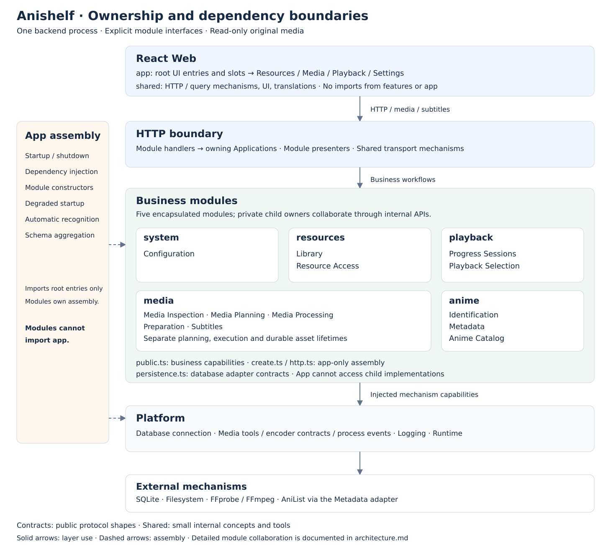

# Anishelf Architecture

This document describes the overall system structure, module ownership and
architectural constraints. [Requirements](requirements.md) owns the feature
inventory and delivery status. [Current version requirements](current-version-requirements.md)
owns the selected AniList account scope and acceptance. Account connection and shared
request scheduling, account-scoped list reads/cache/refresh, manual submissions, coverage-based playback updates and derived Library/detail viewing displays are implemented. Real-provider write acceptance remains pending. [Current version design](current-version-design.md)
records the delivered account, read, submission and playback observation flows. The anime-library version's requirements and
acceptance are complete as of 2026-10-14, confirmed by the user.
[History](history.md#anime-library-archive-notes) retains its requirements,
CAT01–CAT08 acceptance record and detailed design, alongside earlier designs and
the [archived implementation details](history.md#architecture-detail-snapshot-2026-10-11).
[Design system](design-system.md) owns shared UI conventions, while
[Development](development.md) and [Deployment](deployment.md) cover setup and
operations. Source contracts and database schemas remain authoritative for exact
fields, routes and policy values.

## System structure

Anishelf is a React Web application backed by one Node.js process. HTTP separates
the browser from the backend; business modules collaborate through in-process
Public APIs. The backend uses SQLite for durable application state, the filesystem
for original media and generated assets, and FFprobe/FFmpeg for media inspection
and processing. Original resources remain read-only.

The diagram shows five encapsulated business modules and their internal
owners. A module owns its public contract, private assembly and lifecycle. Solid arrows show layer calls or mechanism use; dashed arrows
show application assembly. The collaboration table below identifies the main
module interfaces rather than every import.

Bootstrap constructs modules, injects dependencies and owns startup/shutdown.
Background-work owners stop before shared media services and persistence close.
The HTTP layer validates requests and projects public responses; business workflows
remain in Applications. System owns single-user credentials and authentication.
A reverse proxy owns TLS; transport enforces session/CSRF checks for business APIs
and scoped tokens for original-media delivery.

## Internal ownership

| Module | Owns |
| --- | --- |
| Authentication | Independent credential file, persistent login sessions, password recovery and scoped original-media links |
| Configuration | Validated policy, persistent user settings, coordinated settings commands and transcode profiles |
| Library | Published resource index, scans and resource-root switching |
| Resource Access | Confined file access, shared source identities and source validity |
| Media Inspection | Source-bound media metadata and shared inspection caching |
| Media Planning | Compatibility interpretation, output specifications and read-only execution decisions |
| Media Processing | Execution preflight, media-tool work and validated temporary outputs |
| Playback Selection | Browser-evidence validation and selection of original or prepared resources |
| Progress | Progress sessions, durable viewing progress and history |
| Preparation | Persistent tasks, scheduling, reusable artifacts and prepared-media delivery |
| Subtitles | Track discovery, selected-track preparation, delivery and asset lifecycle |
| Metadata | Provider queries, normalized snapshots, persistent cache, refresh and artwork |
| Identification | Stateless local extraction, candidate ranking and episode association proposals |
| Tracking | Account lifecycle, session-bound previews, private credentials, connection state, account-scoped list cache and refresh |
| Anime Library | Read-only join of Catalog and Tracking, local/all scope, status filters and pagination |
| AniList protocol | Typed Viewer, list and metadata clients, GraphQL schemas, provider response validation; shared bounded pacing, retry, priority fairness and cancellation |
| Anime Catalog | Durable local works/episodes, review decisions, confirmed associations, corrections and library projections |

These are the existing runtime owners. [Identification](architecture.md#internal-ownership) exposes
a stateless recognition Public API and a consumer-owned Metadata port.
[Metadata](architecture.md#internal-ownership) implements AniList access behind its own Public API, and
Anime assembly adapts cached summaries into recognition candidates.
An Anime workflow uses Resources publication/read and source-access APIs to
automatically supply validated sources. Identification has no HTTP, database or
Catalog dependency. AniList supplies metadata-assisted matching through the persistent Metadata cache. [Anime Catalog](architecture.md#internal-ownership) consumes complete publications,
preserves manual decisions and owns confirmation/query HTTP APIs. The Web poster, detail, playback and Review workflows are implemented.

## Source organization and dependency boundaries

The backend source has six responsibility roots:

| Root | Responsibility |
| --- | --- |
| `app` | Connect complete modules, assemble global policy, own protocol setup and staged shutdown |
| `modules` | Five independently encapsulated business modules |
| `contracts` | Browser-safe protocol shapes, schemas and shared protocol constants |
| `platform` | Database connection capabilities, media tools, filesystem/process mechanisms and logging |
| `shared` | Small internal concepts: identities, errors, readonly utilities, sorting and fingerprints |
| `transport` | HTTP mechanisms, security, errors, streaming and genuinely shared projections |

### Large modules

| Module | Internal owners | External responsibility |
| --- | --- | --- |
| System | Configuration, Authentication | Deployment/settings/profile capabilities, immutable effective settings, credentials and login |
| Resources | Library, Resource Access | Directory/file reads, scans, root switching, settings-change exclusion, publications, confined source access and registration |
| Media | Inspection, Planning, Processing, Preparation, Subtitles | Compatibility, published-copy views, media information, preparation and subtitle HTTP services |
| Playback | Progress, Playback Selection | Resource selection, sessions, durable progress and history |
| Anime | Identification, Metadata, Anime Catalog, Tracking, Anime Library, AniList protocol | Recognition, provider cache, review/associations, account/list lifecycle, combined Library reads and shared provider access |

The five directories are API boundaries, not categorization folders. External
consumers cannot import any child entry, including a child's `public.ts`.
Internal owners still collaborate through their own Public APIs and ports;
module composition owns the only implementation-access exception.

Within Anime, `anilist/` owns provider protocol code and never imports Metadata,
Tracking or Catalog business types. Its account, list and metadata clients share
one `AniListScheduler` created by Anime assembly. Metadata and Tracking
infrastructure adapters convert typed protocol results/errors into their own
contracts. Their Applications depend on consumer-owned ports, not provider
implementations or the AniList transport. The AniList authorization configuration
is injected into Tracking during assembly.

`tracking/application/tracking.ts` owns the named `TrackingModule` facade and its
ordered account/list shutdown. `tracking/application/account.ts` coordinates
account commands. `composition/tracking.ts` only constructs collaborators and
injects ports; business code cannot import composition, including for types.
`TrackingApi` is the complete contract and extends the narrower
`TrackingAccountsApi` and `TrackingListsApi`. Library requests only the list
capability. Composition code does not define runtime business facades.

| Root entry | Allowed consumer |
| --- | --- |
| `public.ts` | Sibling modules, app and boundary presenters: selected business capabilities/types only |
| `create.ts` | App only: construction, policy inputs and module lifecycle capabilities |
| `http.ts` | App only: module HTTP registration; internal registrations stay private |
| `persistence.ts` | App and database adapters only: schema, foreign-key contracts and repository-port factories |

Only root entries cross a large-module boundary. Public entries cannot expose
Application/repository constructors or load assembly implementations. Root
contracts select actual capabilities rather than wildcard-exporting child APIs.
Returned business APIs are method capability objects, not Application instances.
Media's compatibility facade publishes an independent immutable view without
canonical roots or private encoder profiles. Its prepared-copy view contains
only the eligibility/identity facts needed by Playback.

App also cannot access child implementations. Each module constructs its own
services, adapters and HTTP handlers. HTTP registration closures retain private
owners; app connects registrations to protocol setup. Domain and port types do
not derive from HTTP schemas. Platform/shared cannot depend on business modules,
and modules cannot import app.

### Module collaboration

| Consumer | Dependency |
| --- | --- |
| System | Platform configuration mechanisms; app supplies only settings-validation policy |
| Resources | System settings and profile selection; confined source capabilities are constructed internally |
| Media | Resources source validity/access, System settings/profiles, injected platform media tools |
| Playback | Resources identities/access; Media compatibility checks and published-copy views; System selected profile |
| Anime | Resources publications and bounded reads/access; System deployment settings |
| Anime internal recognition | Parser and Metadata candidate port, both adapted inside Anime |

Playback consumes Media's `inspectCompatibility`, `checkCompatibility`,
`listPlaybackCopies` and `getPlaybackCopy`; it does not know about Planning or
Preparation APIs. Anime owns automatic recognition and proposal-to-Catalog
publication; app does not coordinate its child services.

Module owners define policy defaults and validation. App aggregates them into
its global policy and passes the relevant sections through root create entries.
System no longer imports or publishes other modules' policies. Shared sorting
is an independent concept, not a dependency on Library's policy implementation.

Each durable child owns tables beside its repository. Root persistence entries
provide schema and structural storage ports; they do not publish repository
classes. `app/schema.ts` aggregates root schema entries for Drizzle initialization
and migration tooling. Database connections remain in app/platform. Existing
table, column, index, foreign-key and migration identities are preserved.

### Application responsibilities

System owns settings HTTP commands and persistence. App supplies a consumer-owned
resource-settings coordination port implemented by Resources. Resource-root saves and scan-interval commands reserve Resources' scan gate;
cache budgets and transcode options can change independently when their request
retains the current root. System queues partial updates against the latest saved
settings, so an unrelated update cannot overwrite concurrent profile selection or
restore a resource root that changed after the request began. HTTP presenters own
settings/profile DTO projection; Playback reads effective profile selection directly.

Media composition constructs Preparation's context, scheduler, worker, recovery and
artifact services, and constructs subtitle/font services. Preparation's command
facade owns admission, retry and shutdown; its query service owns detail/list and
summary projections. Processing coordinates execution and output lifetime while
its domain validators own explicit request and completed-output checks. Subtitle
discovery and external-content reads have dedicated implementations; its facade
coordinates source-bound preparation and delivery. Metadata's cache reader owns
freshness, refresh deduplication, subscriber cancellation and retained snapshots;
the application supplies provider queries and delegates artwork to its own cache.
Platform media tools delegate descriptor parsing and subtitle/attachment extraction
to dedicated adapters while retaining a single mechanism entry.

### Lifecycle

`quiesce()` stops producers without invalidating source access needed by cleanup.
App first quiesces Anime recognition, Media preparation and Resources scans. It
then closes Playback, Anime, Media and Resources, followed by database and logging.
Each owner manages its private teardown order; Media stops preparation before
closing subtitle assets, execution and inspection. Repeated/concurrent Media and
Anime shutdown calls share one completion. App attempts all cleanup even if an
owner fails, then reports an aggregate error.

### Frontend ownership

Web source retains `app`, `features` and `shared`. Five encapsulated feature
modules expose selected data capabilities through root `public.ts` entries and
app-only components through root `ui.ts` entries.

| Module | Internal owners |
| --- | --- |
| Resources | Directory browsing/scans and shared file reads |
| Media | Browser compatibility, preparation and subtitles |
| Playback | Player and history |
| Settings | Resource/profile settings and external-player preferences |
| Anime | Catalog, Metadata and Review |

Public data entries use explicit named exports of actual implementations. Pure
forwarding `services.ts` wrappers are unnecessary. Data entries must not load UI
barrels, including indirectly through child entries. App uses only feature-root
entries; sibling modules cannot import private children or another module's UI.

App owns the global runtime and router context: library/settings queries, scan
notifications and cross-module invalidation, manual refresh and player reset.
The App component assembles the shell, Providers, navigation feedback and Outlet.
Routes register the tree; dedicated page adapters compose capabilities and pass
narrow props. Loaders/actions are grouped by page responsibility and share scope
prewarming. Resources defines the scan/browse presentation contract without
player state. Anime Library receives readiness through props rather than reading
application context. Query scope remains shared infrastructure.

Anime Catalog owns the poster library, details, source associations, version
selection and playback-title projection. Metadata owns candidate lookup, detail
and relations queries. Review owns review reads and association commands; its
controller retains selected-work state, preview operation keys, mutations and
invalidation. Form parsing is separate from presentation. Resource summaries,
candidate selection, mapping forms, previews and rejection/removal sections are
separate components. Catalog detail sections and poster controls/results also
have distinct presentation responsibilities. Recognition-status presentation is
shared by Catalog and Review at the Anime root.

Review may consume Catalog and Metadata public capabilities; Catalog may consume
Metadata but cannot depend on Review. Metadata is independent of both. Anime's
shared presentation and formatting leaves cannot import these owners. No generic
form framework, event bus or additional state-management library is required.

App supplies Resources' file-action slot using Playback and Media UI entries,
and Playback's preparation/subtitle slots using Media UI. Provider placement and
query scope are retained. Profile controls receive preparation actions from app,
avoiding Settings-to-Media dependencies. Other dependencies remain one-way:
Media uses Settings; Resources uses Media; Playback uses Resources, Media and
Settings. Shared HTTP/query mechanisms, UI primitives, navigation and translations
import neither app nor features.

Refactoring preserves URLs, query keys, scopes, polling, cancellation, cache
invalidation, notifications and source-bound playback behavior. Dependency-cruiser
checks module/internal-owner boundaries, public/UI entries, shared leaves,
unresolved imports and runtime cycles. Regression tests cover scan notification
deduplication, refresh/root switching, media lifetime, title updates, Review
confirmation/retry/removal and return/filter/focus behavior.

## Core collaboration

Library publishes scanned resources; Resource Access validates their identity and
confines access to the configured root. Inspection, playback, preparation and
subtitles use that shared source capability. Source changes and root switches
invalidate dependent work and prevent stale resources from being delivered.

Playback Selection combines source inspection, browser evidence and available
prepared artifacts to choose an original resource, a prepared resource or a blocked
result. Selection is read-only. Preparation is an explicit workflow that uses
Media Planning and Media Processing to produce validated, reusable artifacts;
opening a playback session does not start processing.

The browser streams the selected resource directly through media responses with
GET/HEAD/Range support. Playback sessions own progress and history independently
of selection and preparation. Source time remains the shared reference for progress,
chapters and subtitles, including when playback uses a prepared copy. Subtitle
assets are prepared and delivered independently of the video resource.

Persistent task and asset owners reconcile durable state with files at startup and
revalidate source identity before reuse or delivery. Media-tool execution and
resource lifetimes remain bounded, with cancellation and cleanup owned by the
workflow that acquired them.

## Delivered anime-library workflow

Recognition retains provider primary-title/alias provenance and filename/directory
title sources. Unknown source seasons remain unknown. For locally in-scope
numbering, an unmarked source may prefer a base work over a candidate whose
primary titles explicitly indicate a later season. Alias-only ordinal evidence
has a weaker influence, and a complete ordinal-bearing source title overrides
the missing-season prior. This is a reported assumption, not extracted season-one
evidence. Unresolved continuous numbering does not justify this prior.

Work recognition and episode mapping are separate Catalog assessments. Explicit
identity contradictions exclude candidates from automatic identity competition;
unknown ordinals or numbering conversions remain plausible alternatives. Minimum
score and margin apply to the remaining competitors. A recognized work can be
shown and preselected in Review while its episodes remain pending; no association
is created until mapping is resolved or explicitly confirmed. Manual decisions
and source availability continue to take precedence.

Title comparisons use one canonical representation for exact admission and fuzzy
ranking: Unicode normalization, punctuation/spacing folding and dictionary-based
Traditional-to-Simplified Chinese conversion. Provider titles are titles, not
release filenames: only explicit season/part syntax is removed from them, never
an arbitrary trailing number or language word. Shorter names remain search hints
unless a provider alias corroborates them. Candidate ordinals come from explicit
provider title syntax and retain their snapshot source; shared aliases and missing
ordinals do not imply season one. Calendar seasons and relation order do not
establish numbering offsets.

Continuous numbering can use an offset corroborated by at least two explicit
continuous/local filename pairs in the same root, directory, source season and
candidate work. The anchors must cover distinct episode numbers, identify one
candidate without conflicts and agree on the offset. A target's leaf title must
also match the candidate; an unrelated file cannot borrow its directory's work.
If both the source and converted numbers fit the known count, the alternative
requires manual selection. Rules live only for that identification publication, carry
their anchor identities, never cross directories and never replace manual Catalog
decisions. Absent, conflicting or invalid anchors require an explicit Catalog
preview/confirmation. Zero episodes receive a manual special suggestion requiring
an identity and label or another explicitly verified target; they are not
automatically invented positive regular episodes. Unknown TV numbering has
no default target. Review defaults use the selected candidate's valid proposal,
preserve the original source numbers and show the proposal's unresolved reasons.

Completed resource scans publish validated source contexts to Anime's bounded
recognition coordinator. Identification uses `anitomy-ng` and cached AniList
candidates to return evidence and candidate-specific episode proposals. Catalog
automatically admits unambiguous matches and persists review decisions, stable
local work/episode identities and source associations in SQLite. Ambiguous or
incomplete evidence stays in Review.

Recognition parses release names with `anitomy-ng`; the adapter's explicit title
grammar handles provider titles without release-token stripping. Original names
remain available while series ordinals are compared separately from similarity.
All runtime calls to the library pass through Identification's `anitomy-adapter.ts`.
The adapter preserves raw elements and supplements explicit Chinese/Japanese
season markers, menu/NC opening/ending labels and language residue backed by a
parsed dubbed-audio tag. Provider-title grammar shares explicit ordinal rules
without discarding title words or numbers. Exact menu directories mark ancillary resources;
an `extras` directory alone does not. Corrections do not infer work identities,
season-one defaults or episode offsets. Normalization version changes invalidate
recognition reuse on rescan while preserving Catalog decisions.
Space-delimited Han/Latin title pairs supply separate title candidates. A bracket
label supplies a fallback search title only when both a numbered leaf and an
ancestor without a parsed title repeat it; this is not sufficient to admit a work.
Explicit leaf movie types constrain candidate format. Punctuation, spacing,
multiplication-cross glyphs and Chinese script variants normalize consistently
for title comparison. Canonical base-title equality is combined with title provenance. An unmarked
source can prefer a base work when its numbering fits a local episode scope;
this soft prior penalizes explicit primary-title sequels more than alias-only
ordinals and never inserts a source season or an episode offset.

Leaf numbering distinguishes bounded contiguous ranges from multiple numbering
systems. A filename containing a continuous number followed by explicit `SxxEyy`
may select the season-local `yy` when the continuous number is not smaller; both
raw tokens remain recorded and contradictory season evidence still blocks admission.
Descending, oversized, inconsistent and zero numbering remains unresolved. Files
with only continuous numbering still need an explicit correction. Corpus reports
expose selected numbering and separately count admissions whose numbering differs
from the corpus's provider sort values. Independently corroborated local-number
labels enable separate comparisons; unverified cross-provider numbering remains
excluded and explicitly reported.
Complete contextual title matches outrank shared short aliases. Bare Roman
numerals support ordinal matching only when a complete contextual source title
also matches; unmarked titles do not imply season one. Missing candidate season evidence does
not contradict an explicit first-season file, but later-season files require
corroborating candidate evidence or an exact complete contextual title match.
Context matching preserves directory ordinals: a title stripped of `第2期` must
not boost an unmarked first-season candidate. A complete arc title can identify
an AniList work despite a release-specific series ordinal (such as `S06`),
without assigning that ordinal to the provider work. Explicit contradictory
ordinals still block admission even when the contextual title matches. Contradictory ordinals, unknown parts and
ambiguous episode mappings remain reviewable. Search may append a series-season
query within the existing request budget; calendar airing seasons and relations
never establish episode offsets. Matcher version changes invalidate recognition
reuse on rescan while Catalog preserves manual decisions.

Explicit confirmation, reassociation and
single-file numbering corrections preserve manual decisions and source history
across rescan, metadata refresh and restart.

The default Web entry is the confirmed poster library, with cached search/filter
controls, work details, ordered episodes and explicit resource-version selection.
Files retains directory browsing and source playback, adds identification status
and links to Review or associated works. Review owns candidate lookup, mapping
previews, confirmation, correction and rejection. Version selection reuses the
existing source-validity, compatibility, preparation, subtitle and progress paths;
a multi-episode association does not create seek boundaries or watched states.

Metadata owns provider transport, normalized snapshots, refresh/retry and bounded
local artwork storage. Provider outages retain usable cached browsing and existing
playback; unknown numbering remains unresolved. Original names and bytes remain
unchanged. Personal tracker authorization is not required. Episode watched-state
aggregation, subscriptions, download orchestration and tracker synchronization
remain future requirements rather than existing runtime owners.

## Authentication boundary

System's Authentication owner maintains an atomically written `auth.json` and a
separate session signing key under the data directory. Passwords use salted
scrypt; plaintext generated passwords go only to the startup console after listen
succeeds. The local CLI can hash or reset credentials without starting the server.
File edits require restart; Web changes apply immediately. SQLite availability is
required at startup, and its System-owned tables persist sessions and hashed
media-link tokens. Session and link records bind to the loaded credential
fingerprint, so manual hash replacement invalidates old authorization after restart.

The private `AuthenticationService` class owns the loaded credential, fingerprint
and password-change exclusion. `AuthenticationRepository` implements the durable
storage port; module assembly exposes registration capabilities and storage ports
rather than exporting these constructors. Named helpers and handlers express
operations; callbacks retain closures where they adapt injected dependencies.
The frontend playback API adapter owns the media-access-link endpoint and its
shared response contract; media-link orchestration consumes that typed method.

App supplies Authentication with a consumer-owned file-version capability adapted
from Resources. Authentication registers Cookie/session plugins and a global API
guard before module HTTP routes. Host/Origin validation remains in transport;
CSRF checks cover unsafe authenticated requests and login. Anonymous access is
limited to session bootstrap, login, minimal health status and frontend files.
Sessions expire after 30 days; login rotates identifiers. Browser guards precede
business loaders; API 401 responses clear client caches and leave the protected
application. Focus/minute checks also detect server-side session revocation.

Login/password verification uses bounded per-source and instance-wide attempts.
Forwarded scheme/client address headers are trusted only from loopback proxies.
HTTPS public origins require Secure cookies. Password changes revoke all sessions
and media links; logout revokes its current session. Media tokens authorize one
original version for 24 hours and reuse existing HEAD/Range delivery. They do not
authorize business APIs or create playback history. Existing streams may finish.

### Local work detail query naming

The local detail read follows `localWorkDetailQuery` → `getLocalWorkDetail` →
`GET /api/catalog/works/:id` → `AnimeCatalogApi.getLocalWorkDetail` →
`CatalogQueries.getLocalWorkDetail`. The HTTP contract is
`LocalWorkDetailResponse` (`LocalWorkDetailSchema`); the Catalog domain aggregate
is `LocalWorkDetail`. It combines the local work, metadata snapshot, episodes
and file versions. Tracking viewing state and provider airing schedules remain
separate reads. The frontend cache key is
`["catalog", scope, "local-work-detail", id]`; `scope` isolates client caches.

### Anime detail resource actions

App's `AnimeDetailPage` supplies `AnimeResourceActionSlot` to the Anime detail UI.
Episode/version selection remains Anime-owned; `AnimeFileActions` composes the same
`FileActions` used by Files, using Media's version-scoped compatibility query and
existing Playback/Media UI exports. The per-detail negotiation gate uses Media's
existing concurrency limit, with cancellation and resource/source-version query
identities. No feature imports App or a sibling feature's private implementation.
Preparation task reads remain lazy on menu opening. A single deduplicated summary
request covers the available file IDs from the observed detail cache; published
copies matching the Catalog source version show the prepared indicator before
opening a menu, including while original compatibility is still being checked. Existing media-link/access,
compatibility, preparation and playback endpoints retain their diagnostics and
source checks; this UI adds no independent command implementation or backend API.

## Playback Completion Observation

Playback/Progress persists source-version coverage and completion receipts alongside
resume/history. Source duration comes from Media's version-checked shared inspection.
A progress transaction merges validated intervals and inserts an 85-percent receipt
atomically. Its worker retries durable receipts through an injected consumer-owned
port; Anime captures/revalidates account generation and Catalog mapping, then admits
absolute intent to Tracking's existing operation queue. Replay, uncertain admission
and alternate versions cannot add repeated increments; explicit backwards manual
changes take precedence over older observations. Playback stops and drains this
producer before Anime quiesces. No tracking provider request is awaited by a position
save. Decision-required receipts remain durable and are exposed through authenticated
Playback session routes. A decision posted before any receipt exists records explicit
manual intent as a receipt in the same handoff, so marking an episode watched never
bypasses mapping/account revalidation, while declining without a receipt records
nothing and cannot suppress later evidence. Local episode/Library indicators derive
only from confirmed cached AniList progress; they introduce no authoritative local
watched ledger.
