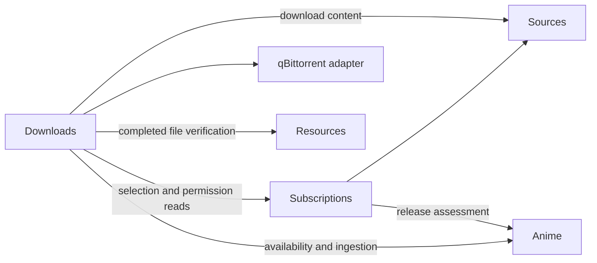

# Automatic Acquisition: Current Iteration Architecture

Date: 2026-10-24. The responsibility refactor and direct subscription-save path are
implemented, including opt-in Watching reconciliation, ordered source discovery and
search subscriptions. Automated checks, user-reported manual pipeline acceptance
and pending live Watching acceptance are separate. See
[current requirements](current-requirement.md) and the
[refactor decisions](acquisition-redesign.md).

## Business ownership

Acquisition has four business units and a qBittorrent adapter:

| Unit | Responsibilities and owned state |
| --- | --- |
| Watching | Explicit activation grants, confirmed Watching list reconciliation, ordinary subscription creation and recreation exclusions |
| Sources | RSS/Jackett bindings, credentials, transport, evidence, retry metadata and opaque download references |
| Subscriptions | User subscription intent, pending source discovery, source pinning, starting episode, profile, enable/pause/remove, accepted download scope and candidate selection |
| Downloads | Global destination, stable directories, accepted tasks, episode/hash reservations, submission, remote observation, recovery and import outcomes |
| qBittorrent adapter | Private account configuration, connection generations, client lifetime and SDK operations |

The former Discovery code lives in `subscriptions/`. Selection profiles, schemas,
algorithms and waiting/ranking behavior are unchanged. There is no top-level
workflows, Fulfillment or Imports business module. `downloads/application/` owns
the full task lifecycle; `downloads/transfers/` implements transfer execution and
`downloads/application/import.ts` coordinates completed-file ingestion.

Resources owns roots, confinement, source versions, inspection and targeted refresh
through its LibrarySynchronizer gate. Anime owns title/file recognition, current
local episode availability, Catalog association and Review. Acquisition never
writes their tables or duplicates their recognition implementations.

Sources owns its creation and HTTP registration through `createSourcesModule`.
Composition shares the unified SourcesApi without importing protocol implementations. Subscriptions does
not depend on the Downloads application. Read-only configuration stamps, locked
candidate IDs and active downloader hashes are supplied at assembly. The dedicated
locked-candidate query does not load Activity payloads. There are no application
callback cycles, shared context inheritance, internal HTTP calls or event bus.

## Direct subscription save

The detail form displays the validated destination and sends one
`PUT /api/acquisition/subscriptions`. Its body contains workKey, source (automatic, a feed/search definition or null),
startEpisode, optional profileId, expected subscription revision, destinationRevision
and connectionGeneration. A null source keeps the existing binding on edits. The form translates its RSS URL
to the common feed definition.
Save validates identity syntax, scope, profile availability and the current target
stamp; it performs no RSS, Anime metadata or qBittorrent network request.

A synchronous shared-connection transaction persists the subscription source definition
and accepted permission. No Sources record or network request is required. Sources
creates internal cache/backoff state when fetch first receives the definition.
Automatic choices retain a nullable source and defer permission until atomic background
binding; explicit sources accept permission during save. A permission failure rolls the whole
save back. Saving the same source preserves selection history/waiting evidence;
changed profiles remain fenced by the existing fingerprint rules until reevaluation.
Per-work saving needs no preview token or confirmation session. Global Watching
activation separately retains its session-bound preview/confirmation endpoints.

HTTP activation requires a validated destination belonging to the current downloader
account. Internal subscription commands can explicitly save a discovery-only scope;
this revokes previous permission. Existing migrated subscriptions do not acquire
permission merely by being read, refreshed or resumed. The UI enables automatic
acquisition only by saving against the displayed current target. New source/episode
scope or destination/account changes require a matching permission before submission.

Pausing stops new reservations/submissions while transfers and imports continue.
Removal preserves accepted tasks and source/download evidence. Watching creates missing ordinary subscriptions. Later AniList status changes do
not change existing subscriptions.

## Background collection and publication

Subscriptions supplies enabled source IDs to the bounded Sources scheduler. The
initial tick and subsequent 30-second ticks collect due sources, at most two at a
time. Successful evidence follows the configured refresh interval (30 minutes by
default); failures retain evidence and use exponential backoff/upstream hints.
There is no standalone register/enable/remove lifecycle for recurring sources.
Bindings/evidence persist independently of subscription ownership.

SubscriptionWorker obtains a prepared publication through SourcesApi.fetch and evaluates affected subscriptions
asynchronously. Only after evaluation does its synchronous commit operation recheck
source/subscription revisions and reserved-candidate snapshots, publish the source
and its download references, and update candidates. A paused/changed subscription,
new reservation or storage error cannot leave candidates published without their
corresponding source result. Assessment failures retain candidates and are recorded
on the subscription; Sources records source failures and retry state internally.
All source operations share one SourcesApi, including fetch and its atomic commit result.
Runtime start/close is separate and belongs to composition. Subscriptions does not
call source failure handling or private publication primitives.

`selectCandidates` retains the existing explicit-snapshot algorithm and all
[profile semantics](acquisition-profiles.md). Already reserved choices stay locked;
unreserved choices can improve. Source URLs, credentials and protocol descriptors
remain private; consumers receive evidence and opaque download references.

## Task execution and recovery

Downloads periodically reads eligible selections and accepted permission. It checks
current Anime availability, persists one work/episode reservation and a stable
work directory, resolves source content, validates canonical torrent hash/paths,
and claims the hash. Existing unique indexes preserve deduplication after restart.
Parsed content is reused within that execution rather than fetched/parsed twice.

Immediately before remote add, Downloads rechecks permission, scope, selection,
local availability, other active versions, destination/incomplete configuration and
source validity. A persisted submitting state precedes the external mutation.
Category `anishelf` and tag `anishelf-<intent-id>` prove task ownership; matching
hash alone does not authorize controlling another task. Automatic Torrent Management
is disabled and the explicit stable directory is passed as savePath.

Submission states remain pending, submitting, unknown, bound, blocked, missing and
available. Transfer observation and import states remain distinct. Unknown attempts
are queried before further action and never automatically resent when absent.
Explicit retry uses revision/command IDs and queries remotely before possible add.
An external pause stays paused; external removal is suppressed until explicit retry.
An outage means stale observation, not removal. A changed account cannot inherit
old tasks/permissions. Terminal tasks retain reservation identities after detail
redaction. These behaviors and their SQL state fields are retained.

DownloadContext is the single revision-checked task writer. Transfer stages receive
the narrow transfer context; business stages use its explicit full options type,
without inheriting another application's context. Late asynchronous failures cannot
overwrite a newer user command. Planning failures are exposed as Downloads Activity
planningError/attention and never overwrite a subscription assessment error. Their
in-memory retry/diagnostic state is recomputed after restart.

A completed transfer provides task/files plus a revalidation capability. The
internal import stage requires one selected supported video, complete files and
safe paths. It asks Resources to inspect/refresh the confined path, verifies size
and source version, rechecks downloader evidence, then asks Anime to validate and
associate the actual source. Review/failed/available outcomes stay on the same task.
Import retry does not resubmit or transcode. Busy resource synchronization is retryable.

## Destination, persistence and feedback

One global destination maps a downloader absolute POSIX prefix to a Resources root.
Configured validation and proven file visibility remain separate. A separate enabled
incomplete directory must be outside watched roots. Real shared mounts remain an
operator responsibility. Work directories retain the initial sanitized
`Title [provider-id]` identity; metadata renames never move originals.

Subscriptions owns the existing acquisition_authorizations table and its mappings.
Downloads owns destination, directories and intents. Sources owns source/feed and
locator storage. Migration 0007 adds the subscription source definition and removes
the foreign key that required a Sources record before saving. Existing definitions
are backfilled from source bindings. Repositories share one SQLite connection for subscription saves and
source/candidate publication. See [database design](database-design.md).

The detail Activity view combines subscription candidates and download/import tasks.
It preserves source/assessment errors separately from download planning/task errors,
shows actionable retries and stays compact when collapsed. Transfer controls,
seeding, task removal and data deletion remain in qBittorrent WebUI.

| HTTP capability | Owner |
| --- | --- |
| GET /api/acquisition/profiles | Subscriptions |
| GET/PUT/PATCH/DELETE /api/acquisition/subscriptions | Subscriptions |
| POST /api/acquisition/subscriptions/refresh | Subscriptions |
| GET/PUT /api/acquisition/downloads/settings and POST .../validate | Downloads |
| GET /api/acquisition/downloads?workKey=... and POST .../:id/retry | Downloads |
| /api/acquisition/qbittorrent settings/check/credentials | qBittorrent adapter |
| /api/acquisition/sources configuration/status/test | Sources |
| /api/acquisition/sources/connector settings/providers/probe | Sources setup |

Shutdown stops Watching first, stops/drains Downloads, cancels Subscriptions, aborts/drains Sources
and drains Watching before closing the downloader connection and dependent modules.
Watching stops waiting for shared Tracking refreshes through its shutdown signal;
Anime subsequently cancels/drains Tracking before the shared database closes.
Structured logs correlate work/source/task/revision/command decisions without
credentials, raw private locators or torrent payloads.

## Verification boundary

Fixtures cover direct saves, rejected stale targets, atomic rollback, background
collection, profile/waiting persistence, source changes during assessment, pause,
reservations, uncertain mutation recovery, account replacement, import-only retry,
source upgrades, shutdown and HTTP/UI contracts. Run Biome, lint, type checks and
project tests with localhost/subprocess permissions where required. These checks do
not establish real Jackett/RSS/qBittorrent/shared-media/browser playback acceptance.

## Unified Subscriptions and Watching Creation

Implementation status (2026-10-24): manually requested and Watching-created
subscriptions use the same persisted model, editor and execution path. See
[subscription interaction](subscription-interaction-redesign.md), [Watching setup](watching-automation.md)
and [shared Sources lifecycle](source-lifecycle.md).

Saving an automatic-source subscription persists user intent before searching:
`feed_id` is null, `automatic` stores the accepted source generation, profile
fingerprint, destination/downloader binding and retry deadline. Starting episode is
fixed at creation. No fabricated feed identity or pre-search download permission is
created. Explicit RSS remains available and resolved source choices remain pinned.

A serial Subscriptions worker runs every 30 seconds and resolves at most five
pending subscriptions per pass. Empty/failed discovery retains intent and retries
after five minutes. It uses the existing ordered-site discovery and Anime release
assessment; ambiguous identities, packs and unsupported content do not authorize
downloads. Source/profile/target changes invalidate the pending scope until it is
explicitly saved again. Every asynchronous result rechecks subscription revision,
configuration and shutdown before binding source and download authorization in one
SQLite transaction. Edits, pause and deletion fence late discovery results.

Resolved sources use the existing Sources scheduler and selection/download/import
pipeline. Explicit Check updates can resolve and collect a pending source. Site
failure does not silently replace an established pin. Existing reservation,
unknown-submission recovery, external-removal suppression and verified ingestion
boundaries remain in Downloads.

Watching is default-off and retains its five-minute session-bound activation preview.
Its grant controls creation of missing subscriptions from a fresh complete confirmed
Watching list; pending local Tracking commands cannot authorize creation. Existing
subscriptions are skipped regardless of their origin, so progress/status changes,
account changes and global disable never overwrite user settings or stop their
execution. Future creation still requires current accepted account/source/profile/
destination generations and a valid list. Creation uses confirmed progress plus one
or episode 1 and fixes that lower bound immediately, even while source discovery is
pending. Invalid/excessive progress produces a visible decision instead of clamping.

Manual edits and pause/resume work identically for every subscription. Unsubscribe
removes intent and records creation exclusions for the known account/work records;
this prevents immediate automatic recreation. Exclusions survive restart and can be
cleared explicitly. Submitted transfers and imports continue independently.

Migration `0010_unified_subscriptions` preserves manual permissions and existing
pins/lower bounds/candidates. Previously managed grants were conditional ongoing
permissions, so migrated managed subscriptions are paused and their authorization
is revoked until the operator reviews/saves/resumes them. Old Watching grants are
disabled. No account permission is silently broadened during this conversion.

HTTP uses the existing authenticated/CSRF/revision-checked routes. Subscription
save accepts `{ kind: "automatic" }`, explicit source input, or null to retain an
existing source. `GET /api/acquisition/subscriptions?diagnostics=false` returns a
compact view without release evidence. Unified work detail uses this summary; full
candidate diagnostics are loaded on demand. The source-search endpoint remains an
optional diagnostic operation, not a prerequisite for saving.

The Header row lives inside the work header, preserving playback priority. One
summary and Activity action replace the overlapping information blocks. The short
editor reveals overrides under More options. Activity prioritizes failures/active
work; History and lazy grouped Diagnostics are secondary. See the
[design system](design-system.md#automatic-acquisition).

Fixtures verify persisted no-result intent, scope freezing, cancellation/edit/pause
races, configuration fences, atomic authorization rollback, migration preservation,
Watching creation-only behavior, user management, activity ordering, HTTP/session/
CSRF and frontend defaults/diagnostics. These checks are separate from real-service
acceptance. Source/import fixtures and browser fixture actions do not enable the
user's actual account or prove real media playback.

### Subscription interaction completion (2026-10-24)

The editor keeps an opening snapshot until close/save, so background binding revisions
cannot remount it or discard unsaved values. Optimistic revision checks still reject
stale saves instead of silently rebasing permission. Check updates explicitly bypasses
the pending subscription's local retry delay while retaining Sources transport limits.
Migration 0011 stores the latest bounded source-discovery diagnostic snapshot; normal
detail reads omit it and Activity requests it lazily. Backend lifecycle logs retain
attempt/defer/bind outcomes without exposing credentials or private download URLs.

Tracked work details switch with replace navigation to the local detail route as soon
as refreshed aggregate data includes a local work. The local work ID is authoritative;
library filters and other query context survive the transition. Existing local detail
polling updates episodes without remounting the playback or episode-selection owner.
