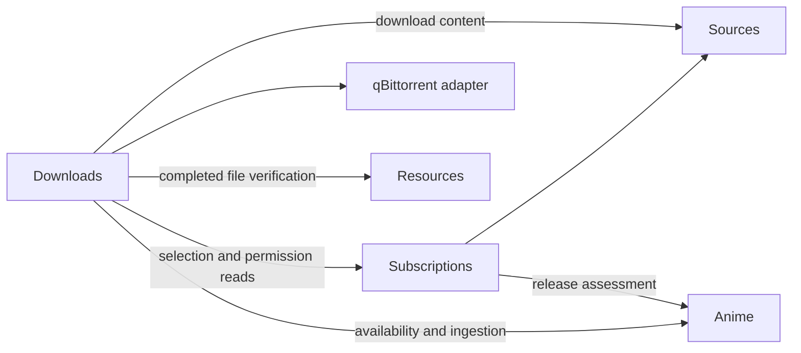

# Automatic Acquisition: Current Iteration Architecture

Date: 2026-10-23. The responsibility refactor and direct subscription-save path are
implemented. Automated checks and real deployment acceptance are separate. Watching
reconciliation, automatic source selection and its UI remain pending. See
[current requirements](current-requirement.md) and the
[refactor decisions](acquisition-redesign.md).

## Business ownership

Acquisition has three business units and a qBittorrent adapter:

| Unit | Responsibilities and owned state |
| --- | --- |
| Sources | RSS/Jackett bindings, credentials, transport, evidence, retry metadata and opaque download references |
| Subscriptions | Per-work source, starting episode, profile, enable/pause/remove, accepted download scope, candidate selection and waiting evidence |
| Downloads | Global destination, stable directories, accepted tasks, episode/hash reservations, submission, remote observation, recovery and import outcomes |
| qBittorrent adapter | Private account configuration, connection generations, client lifetime and SDK operations |

The former Discovery code lives in `subscriptions/`. Selection profiles, schemas,
algorithms and waiting/ranking behavior are unchanged. There is no top-level
workflows, Fulfillment or Imports business module. `downloads/application/` owns
the full task lifecycle; `downloads/transfers/` implements transfer execution and
`downloads/application/import.ts` coordinates completed-file ingestion.

Resources owns roots, confinement, source versions, inspection and targeted refresh
through its LibrarySynchronizer gate. Anime owns title/file recognition, current
local episode availability, Catalog association and Review. Acquisition never
writes their tables or duplicates their recognition implementations.

Sources owns its creation and HTTP registration through `createSourcesModule`.
Composition shares the unified SourcesApi without importing protocol implementations. Subscriptions does
not depend on the Downloads application. Read-only configuration stamps, locked
candidate IDs and active downloader hashes are supplied at assembly. The dedicated
locked-candidate query does not load Activity payloads. There are no application
callback cycles, shared context inheritance, internal HTTP calls or event bus.

## Direct subscription save

The detail form displays the validated destination and sends one
`PUT /api/acquisition/subscriptions`. Its body contains workKey, source (a feed/search definition or null),
startEpisode, optional profileId, expected subscription revision, destinationRevision
and connectionGeneration. A null source keeps the existing binding on edits. The form translates its RSS URL
to the common feed definition.
Save validates identity syntax, scope, profile availability and the current target
stamp; it performs no RSS, Anime metadata or qBittorrent network request.

A synchronous shared-connection transaction persists the subscription source definition
and accepted permission. No Sources record or network request is required. Sources
creates internal cache/backoff state when fetch first receives the definition.
A permission failure rolls the whole
save back. Saving the same source preserves selection history/waiting evidence;
changed profiles remain fenced by the existing fingerprint rules until reevaluation.
There are no preview caches, tokens, expiry rules, preview or confirm endpoints.

HTTP activation requires a validated destination belonging to the current downloader
account. Internal subscription commands can explicitly save a discovery-only scope;
this revokes previous permission. Existing migrated subscriptions do not acquire
permission merely by being read, refreshed or resumed. The UI enables automatic
acquisition only by saving against the displayed current target. New source/episode
scope or destination/account changes require a matching permission before submission.

Pausing stops new reservations/submissions while transfers and imports continue.
Removal preserves accepted tasks and source/download evidence. AniList status has
no automatic acquisition effect until Watching reconciliation is implemented.

## Background collection and publication

Subscriptions supplies enabled source IDs to the bounded Sources scheduler. The
initial tick and subsequent 30-second ticks collect due sources, at most two at a
time. Successful evidence follows the configured refresh interval (30 minutes by
default); failures retain evidence and use exponential backoff/upstream hints.
There is no standalone register/enable/remove lifecycle for recurring sources.
Bindings/evidence persist independently of subscription ownership.

SubscriptionWorker obtains a prepared publication through SourcesApi.fetch and evaluates affected subscriptions
asynchronously. Only after evaluation does its synchronous commit operation recheck
source/subscription revisions and reserved-candidate snapshots, publish the source
and its download references, and update candidates. A paused/changed subscription,
new reservation or storage error cannot leave candidates published without their
corresponding source result. Assessment failures retain candidates and are recorded
on the subscription; Sources records source failures and retry state internally.
All source operations share one SourcesApi, including fetch and its atomic commit result.
Runtime start/close is separate and belongs to composition. Subscriptions does not
call source failure handling or private publication primitives.

`selectCandidates` retains the existing explicit-snapshot algorithm and all
[profile semantics](acquisition-profiles.md). Already reserved choices stay locked;
unreserved choices can improve. Source URLs, credentials and protocol descriptors
remain private; consumers receive evidence and opaque download references.

## Task execution and recovery

Downloads periodically reads eligible selections and accepted permission. It checks
current Anime availability, persists one work/episode reservation and a stable
work directory, resolves source content, validates canonical torrent hash/paths,
and claims the hash. Existing unique indexes preserve deduplication after restart.
Parsed content is reused within that execution rather than fetched/parsed twice.

Immediately before remote add, Downloads rechecks permission, scope, selection,
local availability, other active versions, destination/incomplete configuration and
source validity. A persisted submitting state precedes the external mutation.
Category `anishelf` and tag `anishelf-<intent-id>` prove task ownership; matching
hash alone does not authorize controlling another task. Automatic Torrent Management
is disabled and the explicit stable directory is passed as savePath.

Submission states remain pending, submitting, unknown, bound, blocked, missing and
available. Transfer observation and import states remain distinct. Unknown attempts
are queried before further action and never automatically resent when absent.
Explicit retry uses revision/command IDs and queries remotely before possible add.
An external pause stays paused; external removal is suppressed until explicit retry.
An outage means stale observation, not removal. A changed account cannot inherit
old tasks/permissions. Terminal tasks retain reservation identities after detail
redaction. These behaviors and their SQL state fields are retained.

DownloadContext is the single revision-checked task writer. Transfer stages receive
the narrow transfer context; business stages use its explicit full options type,
without inheriting another application's context. Late asynchronous failures cannot
overwrite a newer user command. Planning failures are exposed as Downloads Activity
planningError/attention and never overwrite a subscription assessment error. Their
in-memory retry/diagnostic state is recomputed after restart.

A completed transfer provides task/files plus a revalidation capability. The
internal import stage requires one selected supported video, complete files and
safe paths. It asks Resources to inspect/refresh the confined path, verifies size
and source version, rechecks downloader evidence, then asks Anime to validate and
associate the actual source. Review/failed/available outcomes stay on the same task.
Import retry does not resubmit or transcode. Busy resource synchronization is retryable.

## Destination, persistence and feedback

One global destination maps a downloader absolute POSIX prefix to a Resources root.
Configured validation and proven file visibility remain separate. A separate enabled
incomplete directory must be outside watched roots. Real shared mounts remain an
operator responsibility. Work directories retain the initial sanitized
`Title [provider-id]` identity; metadata renames never move originals.

Subscriptions owns the existing acquisition_authorizations table and its mappings.
Downloads owns destination, directories and intents. Sources owns source/feed and
locator storage. Migration 0007 adds the subscription source definition and removes
the foreign key that required a Sources record before saving. Existing definitions
are backfilled from source bindings. Repositories share one SQLite connection for subscription saves and
source/candidate publication. See [database design](database-design.md).

The detail Activity view combines subscription candidates and download/import tasks.
It preserves source/assessment errors separately from download planning/task errors,
shows actionable retries and stays compact when collapsed. Transfer controls,
seeding, task removal and data deletion remain in qBittorrent WebUI.

| HTTP capability | Owner |
| --- | --- |
| GET /api/acquisition/profiles | Subscriptions |
| GET/PUT/PATCH/DELETE /api/acquisition/subscriptions | Subscriptions |
| POST /api/acquisition/subscriptions/refresh | Subscriptions |
| GET/PUT /api/acquisition/downloads/settings and POST .../validate | Downloads |
| GET /api/acquisition/downloads?workKey=... and POST .../:id/retry | Downloads |
| /api/acquisition/qbittorrent settings/check/credentials | qBittorrent adapter |
| /api/acquisition/sources configuration/status/test | Sources |
| /api/acquisition/sources/connector settings/providers/probe | Sources setup |

Shutdown stops/drains Downloads first, cancels Subscriptions, aborts/drains Sources
and closes the downloader connection before database/dependent modules close.
Structured logs correlate work/source/task/revision/command decisions without
credentials, raw private locators or torrent payloads.

## Verification boundary

Fixtures cover direct saves, rejected stale targets, atomic rollback, background
collection, profile/waiting persistence, source changes during assessment, pause,
reservations, uncertain mutation recovery, account replacement, import-only retry,
source upgrades, shutdown and HTTP/UI contracts. Run Biome, lint, type checks and
project tests with localhost/subprocess permissions where required. These checks do
not establish real Jackett/RSS/qBittorrent/shared-media/browser playback acceptance.

## Watching Automation with Torznab and Jackett (Planned)

Implementation status (2026-10-23): Jackett connection/search and the
[shared Sources lifecycle](source-lifecycle.md) are delivered. The following design
also describes later subscription, deployment and automation work; it is not an
inventory of delivered behavior.

### Selected Approach and Deployment

Use Jackett as a separately deployed site adapter and Torznab as the acquisition
search protocol. Jackett owns site definitions, site credentials, cookies and
site-specific HTTP/HTML handling. Anishelf owns Watching reconciliation, work and
episode verification, preferences, subscription permission, release selection and
the existing download/import workflow. Do not embed Jackett, scrape site pages in
Anishelf, or let Jackett submit downloads independently of Anishelf reservations.

Configure one Jackett instance with an ordered list of explicit indexer endpoints.
Each work pins one indexer after discovery; subsequent results remain release
evidence, not a newly discovered permanent per-anime RSS URL. Search indexers in
configured order until one yields an eligible release. Do not merge/rank releases
across sites or silently replace a pinned source. A missing release triggers retry
on the pinned source; changing it is an explicit per-work override or policy preview.
This keeps S09 multi-source ranking and upgrades deferred while supporting multiple
configured sites. Prowlarr-specific integration is outside this iteration.

Add an optional `jackett` Compose profile at implementation time to both development
and published deployment examples. Use the existing Compose network and service
DNS (`http://jackett:9117`), a persistent Jackett configuration volume, and an optional
loopback-published management port. Jackett needs no media mount. Select and verify
a maintained container image/version during implementation; do not change the
backend image to include Jackett. An external instance remains supported. Update
deployment documentation and CI/configuration checks alongside that change.
Jackett failure must not prevent backend startup, library browsing or local playback.

Protocol references: [Jackett query syntax](https://github.com/Jackett/Jackett#jackett-torznab-query-syntax)
and the [Torznab specification](https://torznab.github.io/spec-1.3-draft/torznab/Specification-v1.3.html).
Jackett documents `t=caps`, `t=search` and per-indexer endpoints; its aggregate
`all` endpoint has per-site control and result-limit tradeoffs. Use explicit indexers
and capability negotiation rather than relying on aggregate behavior.

### Module Boundaries and Contracts

```mermaid
flowchart LR
    AniList --> Tracking[Anime Tracking: complete confirmed list]
    Tracking --> Watching[Acquisition Watching reconciliation]
    Watching --> Managed[Managed subscription and scoped permission]
    Managed --> Search[Subscriptions search plan]
    Search --> Torznab[Torznab adapter]
    Torznab --> Jackett
    Jackett --> Sites[Configured BT sites]
    Torznab --> Evidence[Normalized release evidence]
    RSS[Manual RSS] --> Evidence
    Evidence --> Assess[Anime assessment and preference selection]
    Assess --> Selection[DownloadSelection]
    Selection --> Downloads[Existing Downloads workflow]
    Downloads --> Q[qBittorrent]
    Q --> Import[Existing verified ingestion]
```

- Add an internal Acquisition Watching application and bounded reconciler. It
  depends on a consumer-owned `WatchingListPort` supplied by bootstrap, not on
  Tracking repositories or provider adapters. Anime exposes a narrow projection
  of its existing Tracking list/refresh capability: provider-qualified account and
  work references, connection generation, immutable complete-snapshot revision,
  freshness/completeness, confirmed status and progress. Extend the public boundary
  to expose completeness/revision explicitly; `fetchedAt` alone is not a revision.
  Tracking publishes a complete snapshot only after all provider pages succeed.
  Pending local status commands are not confirmed remote list state.
- Add an internal `torznab` adapter with `capabilities`, `search`, optional
  `recent` and `readTorrent` operations. Return normalized results and typed failures
  rather than XML, raw URLs or Jackett errors through business APIs. Keep the
  existing XML parser and HTTP library where suitable; no new generic crawler.
- Keep the source protocols in sibling adapters under `sources/rss/` and
  `sources/jackett/`. The RSS adapter owns feed URL validation, RSS parsing and
  transport, conditional requests and retained feed evidence. Jackett owns its
  credentials, Torznab parsing and saved-origin transport. `SourcesApplication`
  owns shared recurring scheduling, Jackett evidence persistence and retry state,
  and coordinates reference, freshness and checked publication; Subscriptions continues to own subscriptions,
  assessments and acquisition decisions. Both adapters use the shared bounded
  request gate.
- Subscriptions owns both manual RSS and managed search subscriptions, evidence,
  assessments and preferences. Subscriptions reference the common source identity;
  protocol-specific binding configuration stays inside Sources. Manual RSS retains
  its workflow; query configuration UI remains later work.
  Downloads reads source-neutral release evidence through `DownloadSelection`;
  it never reads Watching or Torznab persistence directly. Replace its raw download
  URL projection with an opaque download reference. Sources retains protocol
  descriptors privately; bootstrap supplies a source-neutral torrent reader returning
  magnet content or bytes. Downloads retains parsing/hash verification, validates
  reference currentness after admission and owns submission. The reader exposes
  neither source storage nor credentials. See the [shared Sources contract](source-lifecycle.md).
- Anime retains title/season/episode assessment through `ReleaseAssessmentApi`.
  Reuse its target metadata and release parser. Extend the assessment projection
  with versioned release attributes and provenance needed for preference decisions;
  do not duplicate anime recognition in Jackett or Acquisition.
- Extend `SubscriptionConfirmation` into an admission coordinator supporting a
  session preview or a persisted automation grant. Save managed-subscription state,
  source plan, confirmed work scope and download permission in one synchronous
  database transaction. Perform remote calls before that transaction and recheck
  all input revisions inside it. No worker may bypass this coordinator.

### Configuration, Policy and Permission

Store Jackett credentials in an Acquisition-owned private configuration file using
the existing credential-file permissions and atomic replacement pattern. Keep the
API key separate from the endpoint, expose only `hasApiKey`, and never return it to
the browser. An omitted key on update retains it; replacement and clearing are
explicit commands. Database records reference a configuration generation rather
than copying the key. Authenticated configuration saves and connection tests alone
grant no download permission.

Store a revisioned automation policy containing enabled state, tracking account and
generation, ordered indexer IDs/configuration generations, preference revision,
destination revision, downloader generation and backlog mode. Default automation
to disabled. Use `progress + 1` as the selected backlog default, with `from 1`
as an explicit alternative; allow a positive integer per-work starting-episode
override. Freeze a work's starting episode at admission so later progress changes
cannot silently expand or shrink accepted scope. Do not generate a bulk episode
queue from a missing/unknown episode count; acquire only verified published episodes
within that lower bound and any known valid upper bound.

Activation uses a five-minute, authenticated-session-bound preview, showing the
complete Watching snapshot, affected works, effective starting episodes, preferences,
source order and destination. Confirm a persisted grant only if the preview's
tracking/source/preference/destination revisions still match. Future Watching
entries inherit this grant and need no per-title preview. New metadata or search
results may populate evidence but cannot broaden the accepted grant. Preview
does not search an unbounded number of titles or submit downloads; report unresolved
metadata explicitly and resolve it asynchronously after confirmation.

Download permission becomes source-neutral: work, subscription/scope revision,
source binding and generation, start episode, grant ID/revision (managed only),
preference revision, destination revision and downloader generation. Source additions,
preference changes, backlog expansion, account changes or destination changes
require a new preview/confirmation before affecting managed acquisition. Disabling
automation or a source takes effect immediately. Retain the current manual grant
path and recheck effective permission immediately before external submission.
Changing the API key or endpoint advances source generation and blocks old unsent
permissions until validation and confirmation; credentials are never inherited by
an old intent solely because its URL has the same host.

### Watching Reconciliation and Manual Overrides

Use confirmed provider-neutral `watching` status, currently mapped from AniList
`CURRENT`. Apply these selected defaults only to automation-owned subscriptions:

| Observed state | Effect on new acquisitions |
| --- | --- |
| Watching | Admit or reactivate within the accepted grant and frozen scope |
| Paused, Dropped, Completed, Planned or Rewatching | Suspend new reservations/submissions; do not opt into rewatch acquisition |
| Entry absent from a new complete, healthy snapshot | Suspend with `tracking_entry_removed`; retain subscription and history |
| Stale, partial, failed or disconnected snapshot | Retain last confirmed state, block new admissions/submissions, and show tracking unavailable |
| Return to Watching | Resume a suspension caused by tracking policy, preserving manual overrides |
| Different account or connection generation | Block managed work until a new activation preview is confirmed |

Represent status eligibility, manual pause, per-work opt-out, source readiness and
authorization separately; effective enablement is their conjunction, not a single
boolean overwritten by polling. A manual pause survives a later Watching transition.
Removing a managed subscription writes an account/work opt-out tombstone so the
next list poll does not recreate it. Explicit re-enable clears that tombstone.
Global disable stops new work while existing transfers and imports continue.

One active subscription remains unique per work. If a manual RSS subscription
exists, record `manual_subscription_present` and leave it untouched; it does not
inherit global automation permission. Converting a managed subscription to manual
requires explicit confirmation and removes automatic ownership. Pinning a different
source or changing scope uses a revision-checked per-work preview and persists the
override. Never reset an override from list reconciliation or a metadata refresh.

The reconciler obtains a complete snapshot, resolves work metadata, then commits
revision-checked per-work admissions in bounded batches. Record an applied snapshot
revision only after all entries and removals are processed; restart resumes the
persisted cursor idempotently. Recheck account generation, current snapshot and
policy revisions after every await. No partial batch authorizes an absent work.
Retain the existing maximum of 64 subscriptions; surface excess work as
`subscription_limit` rather than silently discarding or replacing entries. Keep
overflow state lightweight and retry it when capacity becomes available.

### Torznab Transport and Normalized Evidence

Configure explicit per-indexer API endpoints such as
`http://jackett:9117/api/v2.0/indexers/<id>/results/torznab/api`.
Reject embedded credentials, fragments and supplied API-key/query parameters;
the adapter constructs queries with `URLSearchParams` and adds its private key.
Probe `t=caps` to validate free-text search, supported categories and page limits.
Use only advertised categories/parameters; a healthy capabilities response does not
prove that the upstream site can return usable results. Validate with a bounded
search as a separate step, and distinguish empty results from connection failure.

Use `t=search&q=...` as the baseline. Do not send AniList IDs as TVDB IDs, or infer
TV `season`/`ep` parameters from Japanese airing seasons or absolute numbering.
Indexed TV search remains unused until an explicit verified mapping exists.
Generate up to four unique title queries from current metadata in stable language
and primary/alias order; preserve distinguishing season/part tokens. Use aliases
to improve recall, then assess each result against the actual target.

Normalize results to source/generation, upstream GUID, observation ID, title,
publication time, byte size, nullable seed/peer counts, nullable claimed v1 hash,
private torrent locator or magnet, and parsed attributes with provenance/version.
Reuse RSS item normalization where possible but explicitly add Torznab response
metadata, errors, namespaces and extended attributes. Support only the current
v1/hybrid download policy. Prefer a validated hash for cross-query deduplication;
otherwise use source-scoped GUID or normalized locator identity. Treat locator/hash
claims as untrusted until Downloads verifies torrent identity. Never use a detail
page link as a torrent download automatically.

The existing `RssTransport` rejects private networks and cannot be reused unchanged
for Jackett. Introduce a dedicated transport restricted to the saved Jackett origin
and configured API/download route families, supporting private service DNS. API
requests do not follow redirects. Jackett torrent locators must match the configured
origin and accepted download route; store a validated opaque locator and resolve
credentials at fetch time. Strip configured API keys from query strings and any
Jackett route path carrying the key when normalizing locators; reconstruct these
only inside the transport for the captured generation. Do not treat every
same-origin URL as a download route.
For a redirect to a public torrent host, remove Jackett credentials and apply existing
public-address/DNS/redirect checks on each hop. Reject redirects to other private
origins and credential-bearing external URLs. A public direct torrent URL follows
the existing public transport. Magnet URIs use the existing validation path.

Pass torrent bytes through the existing bounded parser/hash verification before
qBittorrent submission. Never send Jackett's authenticated proxy URL to qBittorrent
as an unchecked URL. Retain the existing public-only RSS policy; browser requests
cannot supply arbitrary proxy targets. Bound XML bodies to 5 MiB/1000 items,
torrent bodies to 10 MiB and requests to 30 seconds. Reject DTD/entities and parse
Torznab error documents even on HTTP 200. Classify authentication, rate limiting,
unsupported capability, malformed response, timeout and upstream failure separately.
Honor retry hints without logging response bodies or credential-bearing URLs.

### Source Search, Release Selection and Scheduling

1. On admission, search allowed indexers sequentially in configured order using
   metadata title queries. Pin the first indexer with an identity-confirmed release
   satisfying scope and hard preferences. No result means `no_match`, not removal
   or authorization of a weaker identity. Pinning does not itself submit a task.
2. Persist a query plan keyed by work, metadata revision, indexer generation and
   policy revision. Store query cursors and bounded observations; do not invent an
   RSS URL or freeze the first response as a permanent feed. Reassess retained
   evidence after metadata changes before reserving any new download.
3. Require existing Anime identity/season and single-episode checks, accepted scope,
   supported download format, local-availability and reservation checks first.
   Required language, allowed group, resolution, codec and include/exclude keywords
   are hard constraints. Unknown required attributes yield `preference_unknown`;
   an absent preference imposes no constraint. Parse subtitle language separately
   from audio language and retain evidence, not a guess from the site/category.
4. Among eligible versions on the pinned source, use the implemented [profile selection](acquisition-profiles.md) rules:
   apply hard conditions and ordered wait levels, then optional seed counts,
   same-group revision, publication time and stable identity. Reconsider
   unreserved choices while preserving reserved choices. Missing seed count is
   unknown, not zero, and cannot prove downloadability. Do not replace reserved,
   active or available episodes with a later higher-ranked version. Keep packs,
   specials and uncertain numbering excluded with explicit reasons.
5. Publish selected candidates through `DownloadSelection`. Downloads performs its
   existing final authorization/availability check, hash and work/episode reservation,
   uncertain-submission reconciliation and independent verified import.

Poll the Tracking list every five minutes through its existing coalesced refresh and
provider scheduler; invalidate/wake after confirmed local status updates without
using pending commands as remote state. A new complete snapshot schedules immediate
reconciliation. Before any managed submission require a healthy snapshot no older
than that interval; otherwise wait for refresh. Use the configured RSS interval
(default 30 minutes) for per-indexer recent-release polling where keywordless search
is actually supported. Route each result to pinned works using the same assessment.
If unsupported, schedule per-work searches at that interval. Probe recent support
explicitly; a search endpoint may require keywords even when general search exists.

Run initial backlog search on admission, bounded gap repair every six hours and
on-demand refresh through the same queue. Persist deadlines with jitter and one
active tick; share a global maximum of two discovery requests across RSS and Torznab,
with one in flight per indexer and at least five seconds between its requests.
Request at most 100 results per page, respecting lower advertised limits; process
at most ten pages/1000 observations per query run and persist continuation when
pagination works. Detect repeated pages or absent paging support, expose
`source_window_limited`, and never claim complete backlog coverage. Recent polling
uses overlapping observations and deduplication; a window gap schedules bounded
repair. Search truncation is not evidence of episode absence.

Honor rate-limit retry hints; otherwise back off failures from one minute to one
hour. Retry a healthy no-match search after six hours. Explicit refresh does not
bypass limits. Retain prior evidence and successful deadlines on failed attempts;
do not feed an empty failure snapshot into selection. On shutdown abort/drain
Watching and discovery before Downloads and dependent Anime/Tracking/SQLite close.

### Persistence and Migration Plan

Names below describe proposed records; implementation must add a new numbered
migration and update [database design](database-design.md), not rewrite old migrations.

| Record | Durable fields and invariants |
| --- | --- |
| Source | Indexer ID, label, endpoint, order, config generation, capabilities/validation revision, health, retry deadline; no API key |
| Automation policy/grant | Revision, enabled state, provider/account/generation, allowed sources/preferences, backlog mode, destination/downloader binding, confirmation receipt |
| Reconciliation run | Account/generation, complete snapshot revision, policy revision, entry/removal cursor, attempt/deadline and completion marker |
| Managed work | Unique account/work, owner, frozen start episode, tracking suspension, manual pause/opt-out, overrides, pinned source, revision and last applied snapshot |
| Query plan/observation | Source/work/revisions, title query and page cursor, run completeness, due time, last success/error, normalized evidence and private locator |
| Download permission/intent | Source-neutral scope and grant binding; immutable accepted source/preference provenance on intent; retain existing episode/hash uniqueness |

Keep sensitive source configuration in its private file. Pair DB bindings with its
generation so a crash between file replacement and DB writes blocks stale work
rather than admitting it. Use transactional compare-and-swap updates after remote
calls; source/account/policy changes fence late results. Unique account/work and
command receipts make reconciliation and confirmation idempotent. Existing intent
records remain independent of subscriptions and keep their captured provenance.

Migrate existing subscriptions to manual RSS ownership without granting additional
permission; preserve already confirmed destination-bound permissions and existing
intents, reservations, source identities and suppression. Adapt their feed references
to source bindings explicitly. Default automation off and preserve removal
tombstones independently of evidence pruning. Bound observations to the existing
2000 retained-item limit per work/source; overflow is visible and blocks new
selection until bounded recovery, not silent eviction of unresolved evidence.
Apply the existing 90-day private terminal-detail retention to completed query
diagnostics while retaining active plans, permission provenance and deduplication
reservations. No migration starts a worker-triggered download on its own.

### Planned HTTP and Compact Interface

All new mutations use existing authentication, CSRF, TypeBox validation and
revision/command-ID checks. Safe responses omit private locators and credentials.

| Proposed route | Purpose |
| --- | --- |
| `GET/PUT /api/acquisition/sources` | Safe source settings and explicit Jackett credential/configuration update |
| `POST /api/acquisition/sources/:id/test` | Bounded capabilities/search validation; no download permission |
| `GET /api/acquisition/automation` | Policy, grant validity and compact health/counts |
| `POST /api/acquisition/automation/preview` | Session-bound affected-work/backlog preview |
| `POST /api/acquisition/automation/confirm` | Atomically accept the exact preview and enable its grant |
| `POST /api/acquisition/automation/disable` | Immediately stop new managed acquisitions |
| Existing subscription routes | Project source kind/ownership/reasons; support explicit overrides, managed opt-out and bounded refresh |

Settings adds compact source rows with individual remove/test actions and bottom
add controls, one secret input, release preferences and Watching automation controls.
Source/preferences remain drafts until Save; activation is a distinct preview/confirm
action. Explain that Jackett is a separate service and link to its management page
without exposing its key. Show tracking/source validation and download destination
as distinct statuses. Keep lists and numeric summaries compact, with complete
reasons in accessible details/Tooltips following [the design system](design-system.md).

Rename the detail RSS panel to Acquisition for both source kinds. Show Manual RSS
or Watching ownership, pinned source, scope and effective pause/block reason. Reuse
collapsed Activity for search/selection outcomes and existing download/import
recovery. Unresolved search identity is a discovery state, not a fabricated local
file Review record. Keep local file conflicts in existing Review. Provide relevant
Refresh, Pause, scope/source override and Settings actions; no global download
dashboard or duplicated WebUI transfer controls.

### Delivery and Verification

Implement in this order: source configuration and bounded Torznab adapter; normalized
evidence/preferences and source-neutral manual-RSS regression; complete Tracking
projection and managed admission/overrides; polling/recovery and compact UI; optional
Compose deployment and live acceptance. Each stage keeps automatic permission
disabled until its complete grant path is implemented. Update contracts, persistence
documentation and requirements with delivery status as stages land.

Fixtures must cover capabilities/errors/paging, repeated pages, nullable attributes,
XML limits, endpoint/redirect confinement and secret redaction; title aliases,
season collisions and absolute numbering; hard/unknown preferences and stable
selection; complete versus partial/stale snapshots; all status transitions,
account/source generations and manual overrides; atomic grant rollback, crash/cursor
recovery, capacity/retention limits and duplicate reservations. Include manual RSS
migration, stale async results and unchanged uncertain-download/import behavior.

Emit structured `acquisition.watching_reconciled`, `source_probe`, `search_completed`,
`search_failed`, `managed_subscription_changed` and `automation_blocked` events with
run/work/source IDs, revisions, counts, duration, sanitized reason and retry time.
Never include full request URLs, query-string keys, private locators, raw errors,
credentials or torrent contents. These are planned events, not existing telemetry.

ACQ12–ACQ15 require a real AniList account, a verified target site through Jackett,
qBittorrent and shared media storage. Demonstrate activation, a new Watching entry,
automatic matching/download/ingestion without per-anime RSS input, status and manual
override behavior, source/tracking outages and restart. Run ACQ01–ACQ11 as regression
acceptance, including actual browser playback separately from successful ingestion.
Passing mocked Torznab tests or a healthy Jackett API does not establish site or
end-to-end reliability. Season packs, quality upgrades and cross-site ranking remain
outside the selected single-episode workflow.

## Bundled qBittorrent Setup

The bundled deployment initializes a new qBittorrent configuration before the
service starts. It creates a random permanent password using qBittorrent's native
PBKDF2 representation, enables `/data/incomplete`, and sets `/data/media` as the
completed directory. A private connection volume carries the initial credentials;
Backend mounts it read-only. Development Compose, published Compose and Quadlet
share the same initialization script. Existing qBittorrent configurations are never
overwritten. Interrupted credential publication resumes from the pending file.

Acquisition imports deployment credentials only when no local connection record
exists. Saved manual configuration, including an explicit removal, wins on restart.
The worker retries initial setup without blocking application startup, selects the
resource root by its actual `/data/media` path, and reuses the existing destination
revision while retrying validation. Existing destinations from another connection
generation require explicit reconfiguration. Automatic setup grants no subscription
permission and does not assert completed-file visibility.

Authenticated users can request bundled WebUI credentials through a dedicated
CSRF-protected POST endpoint with `Cache-Control: no-store`. Normal connection
responses never include passwords. The UI keeps revealed credentials outside query
and mutation caches, hides them after 30 seconds or on backgrounding, and provides
copy controls. The separately configured browser WebUI URL remains independent of
the internal API address. Users changing credentials in WebUI must update the
Anishelf connection and reconfirm destination-bound permissions. Initialization,
validation, connection replacement and credential access emit sanitized events.
