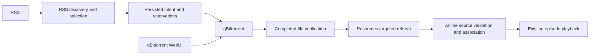

# Automatic Acquisition: Current Iteration Architecture

Date: 2026-10-20. Implementation delivered; real deployment/browser acceptance
pending. [Current requirements](current-requirement.md) define this iteration.
[Architecture](architecture.md) describes the complete application.

## Ownership and Data Flow

Acquisition is the sixth encapsulated module. It owns private qBittorrent account
settings, RSS evidence, subscriptions, destination configuration, download
permissions, canonical reservations, submission attempts and import outcomes.

Resources owns configured roots, confinement, source versions, indexing and the
single `LibrarySynchronizer` mutation gate. Its Acquisition capability lists roots,
validates access, inspects completed paths and refreshes an affected file. Busy
synchronization returns a retryable import failure instead of a full-library scan.

Anime owns actual-file recognition, Catalog/Review and associations. Its ingestion
capability checks the accepted episode against leaf filename evidence, publishes
conflicting files into local Review and uses revision-checked Catalog confirmation
without replacing manual decisions. Acquisition does not write their tables.

## Internal Workflow Boundaries

`DownloadsApplication` is an internal facade over destination settings and authorization,
recovery commands, activity queries, reservations, remote submission/reconciliation,
completed-file import and a bounded worker. `DownloadContext` owns cancellation,
request draining and the single revision-checked intent writer. Each reconciliation
uses a `DownloadExecution` that retains its own latest written revision across
submission and import stages. A delayed failure cannot adopt and overwrite a newer
command. Structured intent transition logs include the work, intent and new revision.

Discovery owns feed evidence, subscription revisions and candidate publication. Its
application manages session-bound previews and commands; `FeedReader` coalesces
bounded source requests, the pure `selectCandidates` policy evaluates explicit
snapshots, and `DiscoveryWorker` owns polling and scheduling. Downloads consumes a
consumer-owned selection port with subscription/candidate/release reads and an explicit
reservation-outcome notification. Discovery applies that notification without
replacing candidates or clearing a separate assessment failure on recovery.

`SubscriptionConfirmation` coordinates the synchronous SQLite transaction that saves
the subscription, feed and candidates together with the confirmed download permission.
A permission failure rolls the complete confirmation back and retains the preview
for retry. Production repositories share the application database connection; injected
persistence implementations must preserve that transaction boundary.

Module assembly exposes selected method capabilities. Internal workflow objects,
stores, workers and lifecycle methods do not escape through the business API.

## Destination and Authorization

One destination maps a qBittorrent absolute POSIX prefix to a configured Resources
scope. Store a revision, connection generation and separate configured/visibility
verification flags. Validate the account, root and enabled incomplete directory
outside watched roots. This is configuration validation; only a completed mapped
file proves shared visibility. The operator must provide equivalent mounts.

Persist each work's first `Title [provider-id]` directory. Clean invalid components,
bound UTF-8 bytes, retain Unicode and use stable provider-qualified identity.
Title refreshes do not move data. qBittorrent receives the work-specific save path,
`useAutoTMM=false`, category `anishelf` and tag `anishelf-<intent-id>`. Preserve the
torrent's internal layout. Anishelf never moves or renames downloaded originals.

RSS previews include the destination directory when validated configuration exists.
Preview confirmation binds the authenticated session, metadata/availability,
subscription/feed revisions and destination revision. Existing subscriptions have
no acquisition permission after migration. Confirming a fresh preview grants a
permission for its feed, starting episode, destination revision and account
generation. Reads and configuration saves start no downloads. Destination or
account changes require confirmation again. Pausing stops pending submission,
not existing transfers/imports. AniList status has no automatic acquisition effects.

## Persistence and Commands

Migration `0019` adds destination, permissions, work directories and intent tables.
Intent records are independent of subscription foreign keys, so removal does not
lose in-flight tasks. Unique indexes reserve work/episode and canonical torrent
hashes. Unresolved release identities receive a provisional unique reservation
until the bounded torrent parser resolves them. Duplicate canonical identities
remain blocked rather than silently controlling another work's task.

Download persistence provides work-scoped activity pagination and aggregate counts,
indexed work/episode and hash reservation lookups, and cursor-ordered due-task batches.
The worker loads at most two intent payloads per batch, while including available
sources for subsequent availability checks. Idle detection uses an existence query.
Retention redacts terminal detail in SQL and preserves reservations. JSON state filters
and activity ordering still run in SQLite; this change does not establish a load benchmark.

Private intent evidence includes source URL, expected feed hash, canonical hash,
destination snapshot, stable directory, accepted subscription revision, submission
state/attempts, transfer observation, import result and actual source identity.
A persisted submitting record precedes the external add. Successful HTTP receipt
alone does not bind a task: query by hash and require category/tag ownership.

Submission states are pending, submitting, unknown, bound, blocked, missing and
available. Transfer observations and import states remain separate. On interruption,
query unknown/submitting attempts before doing anything else; absent uncertain
attempts are never automatically resent. Explicit Retry acquisition first checks
for the hash before a new add. Unsent reservations whose selection changed are
blocked; explicit recovery can adopt the newly confirmed choice. Recheck fresh
metadata and other active versions immediately before submission. Existing unowned tasks become conflicts.

Connection failure retains intent and marks observations stale. External removal
marks missing and suppresses automatic recreation. External pauses remain paused.
User retries carry command IDs and revisions; replaying the last accepted command
is harmless, while reusing its ID for a different command is rejected. A changed account does not inherit old bindings. Save/validate its destination and
reconfirm scope; Retry acquisition explicitly reconciles the retained hash/tag in
the new connection before any possible resend. Available local sources remain
independent of downloader connectivity. Definitively rejected
or unsent submissions can back off; unknown mutations require reconciliation.

## Completion and Ingestion

1. Observe full completion with no remaining bytes and no metadata/check/move/error
   state. Read selected-file completion; only one selected episode video is supported.
2. Validate original relative path components and map the task's captured save prefix
   to its captured root. Open through confined Resources access, rejecting symlinks,
   traversal, inaccessible roots and unexpected size/version.
3. Refresh the affected path through the shared synchronization gate and obtain a
   real `SourceIdentity`. Recheck downloader state/file layout before association.
4. Anime verifies actual title/episode evidence and existing decisions. It creates an
   idempotent association or returns local Review without overriding manual links.
5. Record availability only after confirmed association and source access. Retry
   import independently of download submission. Later source loss or manual association changes update availability independently of downloader connectivity.

Successful indexing does not certify browser compatibility or start transcoding.
A torrent can continue seeding after ingestion. All transfer controls, removal and
destructive file deletion belong to WebUI, independently from Catalog operations.

## Scheduling, Retention and Lifecycle

Reuse the existing bounded RSS scheduler. The download worker reconciles every
5 seconds with active work and every 60 seconds idle. Process at most two intents
concurrently; serialize each tick and intent, reload revisions around asynchronous
boundaries and exponentially back off to one hour. Checks and reads never become
empty snapshots on failure. No synthetic transfer progress is generated.

Keep terminal detail for 90 days, then clear private source payload/title/transfer
and error detail while retaining reservations, suppression and source identities.
Expired evidence cannot be used for acquisition retry. Feed evidence retains the
existing explicit limits; exceeding them reports an error instead of silently
losing release identities. Acquisition closes workers and aborts/drains transport
before dependent modules and SQLite close.

## HTTP and Compact Web Interface

All routes use existing authentication and CSRF protection. TypeBox contracts own
request validation and safe response projections.

| Route | Capability |
| --- | --- |
| Existing `/api/acquisition/subscriptions` routes | Preview/confirm scope and destination, pause/resume, refresh and remove |
| `GET/PUT /api/acquisition/downloads/settings` | Read/select the single global destination |
| `POST /api/acquisition/downloads/validate` | Validate current saved mapping/account/incomplete settings |
| `GET /api/acquisition/downloads?workKey=…&page=1` | Paginated safe per-work activity and authorization |
| `POST /api/acquisition/downloads/:id/retry` | Revision/command-ID checked acquisition or import recovery |

There is no global Downloads page. The detail RSS panel keeps compact status,
secondary subscription actions, Open WebUI and collapsed Activity. Reuse each
release row for acquisition state; omit duplicate transfer statistics and playback
buttons. Show true progress or named states. Error counts remain visible while
collapsed, and affected rows expose Retry acquisition, Retry import, Review or
Settings only when applicable. Deduplicated Toasts report failures without replacing
persistent error context. qBittorrent WebUI owns pause/resume, removal and deletion.

## Validation and Observability

Use safe structured events for destination changes, authorization, reservations,
state transitions and recoverable failures. Correlate intent/work IDs and revisions;
never log private RSS/Magnet URLs, tokens, torrent payloads or SDK raw responses.

Fixtures cover identity/path validation, SQLite reservations/restart, uncertain
submission, external task changes, confined refresh, Catalog association/manual
preservation, HTTP authentication/CSRF/revisions and compact UI recovery. Regression coverage also
checks atomic confirmation rollback, activity pagination and summaries, bounded
worker cursors, retained reservations and late failures after a newer retry command. Run Biome,
lint, type checks and project tests with required localhost/subprocess permissions.
Actual RSS/qBittorrent/mapped-media/browser tests remain separate acceptance gates.
