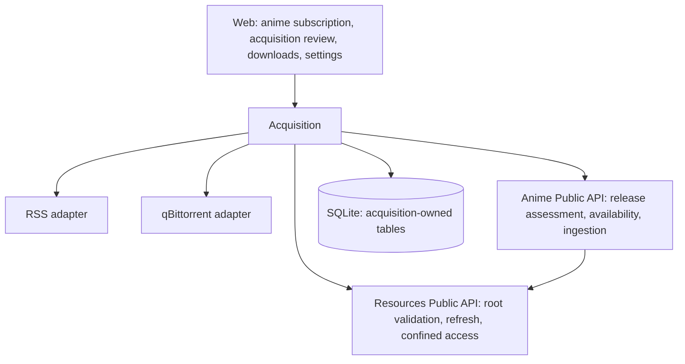

# Automatic Acquisition: Current Iteration Architecture

Date: 2026-10-20. Status: [qBittorrent connection settings](qbittorrent-adapter.md)
and [RSS subscriptions with automatic release selection](rss-subscriptions.md) are
implemented. Download orchestration and end-to-end acceptance remain pending. This document defines the target architecture for
[current requirements](current-requirement.md). [Architecture](architecture.md)
continues to describe the implemented system. No release number is assigned.

The implemented first two stages use minimal configuration: one RSS URL and a
starting episode on the anime detail page. Automatic selected/skipped decisions
replace earlier proposals for advanced filters or release review. The remaining
download/ingestion sections describe future work; see the RSS document for exact
implemented contracts and limits.

## 1. Scope and Selected Design Policies

Deliver S01–S07 and D01–D07, the necessary parts of O03–O05, and an explicit
minimal S08 policy. Use one qBittorrent instance. Support user-configured RSS 2.0
feeds with torrent enclosures or supported Magnet links. Provider-specific search,
HTML scraping, automatic feed provisioning, Atom and interactive website login
are outside the initial adapter contract. Select representative production feeds
before certifying compatibility; arbitrary RSS extensions are not promised.

The initial automatic path handles one regular episode per release. Packs,
ambiguous numbering and specials are skipped with an explanation;
unsupported file layouts cannot be forced through automatic ingestion. Automatic
quality upgrades, file organization, multiple download clients and seeding policy
management remain deferred.

Design defaults, subject to fixture and real-provider acceptance:

| Concern | Initial policy |
| --- | --- |
| Subscription scope | Explicit starting episode, default 1; preview the currently known backlog before enabling. Never infer scope from AniList progress. |
| Future episodes | An open-ended subscription accepts confidently mapped future regular episodes; unknown episode count is not a rejection by itself. |
| First feed fetch | Store and evaluate currently returned entries within the confirmed scope; warn that RSS is not a complete historical release index. |
| Pause or scope edit | Stop new automatic selections/submissions; retain existing downloader tasks and pending ingestion. Recheck revision immediately before submission. |
| AniList status change | Display an advisory; do not enable, pause, cancel or delete anything automatically. Reading lists causes no acquisition writes. |
| Existing version | Any currently accessible confirmed local version satisfies an episode; do not upgrade automatically. |
| Missing identity or episode evidence | Skip with an explanation. No release-review queue. |
| Candidate preference | Keep a valid previous choice; otherwise earliest known publication time, then stable release ID. Select one version per episode automatically. |
| Dismissal/cancellation | Preserve a suppression record so repeated polling does not recreate the same acquisition; explicit retry can reopen it. |
| File placement | qBittorrent writes completed files into a configured resource root; incomplete data must be outside all watched roots. No moves or copies by Anishelf. |

These policies narrow the questions in requirements section 7. The specific live
feed, deployment mappings, supported qBittorrent API baseline and retention
limits still require implementation-time validation.

## 2. Module Ownership

Add `backend/src/modules/acquisition` as a sixth encapsulated business module.
The directory currently contains the qBittorrent adapter, private manual connection
configuration, connection-test HTTP API, SQLite-backed RSS subscriptions and a
bounded discovery worker. Bootstrap registers and closes this module. Download
intent, command, reservation and ingestion records remain unimplemented.
It owns acquisition intent and workflow, not anime identity, local file identity,
playability, viewing state or the BitTorrent engine. Keep HTTP between browser and
backend, and direct in-process Public API calls between backend modules. Do not
introduce an event bus, internal HTTP or a generic workflow engine.

| Owner | Responsibility |
| --- | --- |
| Acquisition subscriptions | Subscription revision, episode scope, selection rules and enable/pause commands |
| Acquisition discovery | Feed validation/fetching, release evidence, cursors and bounded periodic discovery |
| Acquisition selection | Apply subscription rules, retain assessments and reasons, review, suppression and reservations |
| Acquisition downloads | Durable commands, qBittorrent task binding, submission reconciliation and controls |
| Acquisition ingestion | Coordinate completed-task validation, resource refresh and Anime association; retain retry state |
| Anime | Provider identities and metadata, shared parsing/matching, work/episode proposals, Catalog associations and manual decisions |
| Resources | Canonical roots, path confinement, source identities, index publication and filesystem monitoring |
| System | Existing deployment/authentication and shared settings capabilities |
| qBittorrent | Torrent transfer, verification, files, peers and ongoing seeding |

Private organization: `domain/`, `application/`, `infrastructure/`, `composition/`
and HTTP handlers. Root `public.ts`, `create.ts`, `http.ts` and `persistence.ts`
follow the existing module rules. App assembles root APIs, migration schema,
logging and lifecycle. System Configuration owns shared setting validation and
persistence. Acquisition owns downloader business logic and private credentials,
and consumes configuration through injected capabilities. Prefer established
RSS/XML and torrent parsing libraries; select and pin them during implementation
rather than writing parsers from scratch.

## 3. Public Capabilities and Required Extensions

The following are proposed capabilities, not existing method signatures. Define
domain inputs independently from browser schemas and expose only narrow root APIs.

| Boundary | Capability |
| --- | --- |
| Acquisition → Anime | Resolve a provider-referenced subscription target, including a work without local files; read its metadata snapshot and assess release evidence against it. |
| Acquisition → Anime | Read bounded episode availability and relevant revisions; submit completed-source evidence for idempotent ingestion and query its outcome. |
| Acquisition → Resources | Validate a mapping under a configured root; resolve actual files through confined access; request a bounded path/directory refresh and observe publication. |
| Web → Acquisition | Preview/save/pause subscriptions; list candidates/tasks; review/dismiss/select; issue download controls and ingestion retries. |
| App → Acquisition | Construct with injected ports, register HTTP, start recovery/workers and stop/drain before database shutdown. |

Current `AnimeApi.acquisition` exposes target resolution, current accessible
episodes and stateless release assessment. Acquisition ingestion remains pending.
Current `IdentificationApi.identify()` accepts validated `SourceIdentity[]` and
must not receive synthetic RSS paths. The implemented release-assessment input is independent of local sources. Share `anitomy-adapter.ts`, title normalization,
contradiction checks and episode-mapping primitives, while keeping local directory
anchors confined to local identification. Return versioned evidence and proposals;
Acquisition decides acquisition eligibility, Anime decides identity correctness.
All runtime `anitomy-ng` calls continue through its existing adapter.

Current Resources has publications and directory reads, but no acquisition-facing
path refresh command. Add a confined targeted refresh capability using its existing
synchronization gate; do not perform a full-library rescan per download or let
Acquisition mutate the index. Anime's ingestion capability reuses Catalog's
validation/confirmation rules, accepts an idempotency key and respects newer
manual decisions. Download intent never directly inserts Catalog associations.

## 4. Durable Data and Identities

Use SQLite and module-owned repositories/schema. Proposed logical records:

| Record | Durable facts and constraints |
| --- | --- |
| Integration | One qBittorrent endpoint, private credential reference, configuration generation, validated path mappings and probe status |
| Feed | Private URL/configuration, enable flag, validators, next attempt, bounded error summary and revision |
| Subscription | Provider reference, optional existing local work reference, scope, preferences, feed bindings, revision and enabled state |
| Release / observation | Canonical torrent identity where known; original title, parsed evidence, provenance, publication time and source observation identity |
| Assessment | Subscription/release pair, parser/matcher/rules versions, metadata snapshot, mapping, attribute provenance, reasons and current decision |
| Suppression | Dismissed release or cancelled intent and explicit reopen history; unaffected by routine reevaluation |
| Acquisition intent | Stable ID, target episode, release, accepted subscription revision, downloader binding, submission state, retry schedule and ingestion outcome |
| Episode reservation | Unique active provider-work/episode key tied to intent; prevents competing releases acquiring the same episode |
| Command / history | Idempotency key, command revision, requested action, delivery outcome, timestamps and bounded structured reason codes |

A subscription target uses the existing provider reference encoding, not its own
anime-ID format. Canonical episode keys include provider reference, episode kind
and normalized number. A remote-only subscription does not create an empty local
Catalog work; Anime materializes local identity through its existing validated
Catalog workflow once files are available.

Separate feed observation identity from torrent identity: a GUID or enclosure URL
identifies an observation, not necessarily unique torrent contents. Resolve a
supported info hash before submitting, by parsing Magnet identifiers or fetching
and parsing bounded torrent bytes. Store hash aliases where the supported torrent
format requires them. Initially automatic submission requires a canonical v1 hash;
v2-only or unresolvable identities are reviewable unsupported cases. Normalize
hybrid identities consistently with the tested qBittorrent baseline.

Unique constraints cover feed observation keys, canonical active torrent identity,
command keys and active episode reservations. Never keep a SQLite transaction open
while performing network or filesystem work. Commit intent/reservations and a
pending command first; execute externally; record/reconcile the outcome afterward.

## 5. Discovery, Recognition and Selection

1. Fetch a due feed through a bounded HTTP adapter, preserving ETag/Last-Modified
   where provided. Validate XML shape and enclosure types. Persist observations
   and the next schedule atomically after a successful parse; a partial/error
   response must not mark unseen entries as processed.
2. Extract title, season/part, episode, release group, language claims, resolution
   and codec. Preserve raw tokens and attribute provenance. Feed/title claims are
   not verified media facts; unknown remains unknown.
3. Ask Anime to compare with the subscribed target using cached metadata. Match
   primary/alias titles, reject explicit work/season/part/type contradictions and
   independently assess episode mapping. Feed binding alone does not prove identity.
   No cross-feed borrowing of local directory anchors or guessed episode offsets.
4. Apply starting scope and built-in identity/episode checks. Skip explicit
   contradictions and uncertain mappings with explanations. Users choose a source
   feed representing their release preferences; no advanced filter configuration
   or per-release approval is exposed.
5. Exclude accessible confirmed local episodes, active acquisitions and persistent
   suppression records. Query qBittorrent by canonical hash before adding: an
   external existing torrent blocks duplicate submission but is not silently
   adopted or controlled without explicit user action.
6. Keep a valid existing choice, otherwise rank eligible candidates by earliest
   known publication and stable identity. Automatically select one per episode.
   Episode/torrent reservations and pre-submission rechecks belong to the pending
   download phase; candidate selection alone does not create a download intent.

Each stage produces reason codes and readable explanations such as
`season_conflict`, `language_unknown`, `outside_scope`, `already_available`,
`active_download` and `unsupported_pack`. Persist reasons and policy versions for
review; reevaluate affected nonterminal candidates after a rule change without
replaying suppressed or already accepted actions.

Remote release decisions are automatic selected/skipped results with reasons.
There is no Acquisition Review queue or manual version selection. Existing Catalog
Review continues to own actual local-file associations; remote releases never
impersonate local sources.

## 6. Download Commands and Reconciliation

Keep independent state axes instead of one overloaded task status:

| Axis | Proposed states |
| --- | --- |
| Submission | pending, submitting, unknown, bound, blocked, cancelled |
| Transfer observation | unknown, metadata, queued, downloading, paused, checking, complete, error, missing |
| Ingestion | not-ready, pending, validating, awaiting-review, available, failed |
| Command delivery | pending, sending, unknown, confirmed, failed |

A disconnection makes transfer observations stale; it does not mark the torrent
missing or release reservations. A submission transport timeout becomes unknown,
not failed-and-ready-to-resubmit. Terminal ingestion does not stop seeding.

For submission, resolve canonical hash, persist intent, then query qBittorrent for
that hash and send the supported add request with an Anishelf category and a
stable intent tag. Reconcile using hash and durable prior attempt, with tags as
additional evidence rather than the only identity. A successful HTTP response is
not a durable task binding; query the task and persist its identity. Never assume
the API supports an application idempotency key or a distributed transaction.

After timeout/crash, reconcile unknown attempts before any resend. When absence
cannot be established safely, retain a blocked/unknown state for explicit recovery
rather than claiming exactly-once execution. Serialize local submissions per hash;
qBittorrent's hash identity provides a further duplicate defense. External clients
can still race or edit tasks: report observed conflicts and avoid claiming atomic
ownership across processes.

Pause/resume/cancel also persist commands before delivery and reconcile observed
state before reporting success. Cancel removes the managed torrent while retaining
files (`deleteFiles=false` in the supported API), then records suppression; it is
not merely a pause. Data deletion is a separate explicit destructive operation,
restricted to a proven managed task, confined mapped files and a preview of
consequences. Uncertain ownership or path mapping blocks deletion. Removing a
library association is separately delegated to Anime and never erases viewing history.

If a bound torrent disappears in a successful complete downloader snapshot, mark
it externally missing and retain intent. Check already ingested files independently;
require explicit recovery before re-adding. An ingestion retry never resubmits a
torrent. Changing endpoint/credentials increments configuration generation and
invalidates in-flight results; endpoint replacement with active tasks requires
reconciliation, not automatic reassignment.

## 7. Completion, Paths and Catalog Ingestion

Configure segment-aware mappings from qBittorrent absolute save prefixes to
canonical Resources roots (`scopeId` plus a root-relative prefix). Reject overlapping
ambiguous mappings, traversal and root escape; retain generation/fingerprint so
root edits invalidate in-flight validation. A connectivity probe validates access
to qBittorrent; mapping validity also needs a known completed file visible to both
sides. Report unproven visibility explicitly rather than equating a valid directory
with proven shared storage.

Require incomplete downloads outside watched roots, including clients configured
to append temporary extensions. Probe configurable preferences when supported and
explain any unverified setting. Existing watcher discovery alone cannot guarantee
that an external process is no longer writing a file.

On observed completion:

1. Read the task's file list and selected-file progress; validate relevant files
   are complete. Require the supported single-episode video shape; sample/extra
   exclusions use explicit evidence, and conflicting/multiple episode videos
   require review. Do not trust `progress == 1` alone.
2. Translate paths using the captured mapping revision. Resolve/open them through
   Resources with root confinement, including symlink checks. Confirm size and
   source version; recheck downloader completion/file layout before publication.
3. Request targeted Resources refresh. Observe publication and resolve real
   `SourceIdentity` values; watcher publication can satisfy this step, but must
   not be awaited indefinitely or missed in a subscribe/read race.
4. Ask Anime to validate the actual filename evidence against the accepted release
   target and confirm eligible associations idempotently. Actual-file conflicts
   enter local Review; existing manual decisions take precedence.
5. Mark available only after querying confirmed associations and current accessible
   sources for the target episode. Store source identity/version and outcome.

Ingestion retries are idempotent across crashes between these steps. Unavailable
roots, source changes and mapping edits defer/retry verification without creating
new downloads or removing previous good associations. Availability is a current
query, not a permanent historical promise: later file deletion changes availability
while task history and viewing history remain. Playback compatibility remains the
existing Media/Playback decision; ingestion does not start transcoding or certify
browser playback.

## 8. Scheduling, Limits and Lifecycle

Use module-owned bounded workers and durable `nextAttemptAt`, not one timer per
release or a generic scheduling platform. Proposed starting limits: feed interval
10 minutes (minimum 1 minute), at most 2 concurrent feed fetches, one serialized
downloader reconciliation loop (5 seconds with active work, 60 seconds idle), and
2 concurrent ingestions. Store policy centrally in Acquisition and inject through
its create entry. Tune only after measured provider/deployment acceptance.

Set explicit network deadlines, redirect limits, body/item limits, retry ceilings
and exponential backoff with jitter; respect server retry instructions. Suggested
starting caps are 30 seconds per request, 5 MiB feed bodies, 10 MiB torrent bodies
and 1,000 entries per feed response. Reject oversized input visibly rather than
silently truncating a backlog. Disable XML entity/network resolution and validate
responses with schemas. Reuse conditional requests and cached Anime snapshots.

Keep current candidates, unresolved intents and suppression identities durable;
page all listings. Retain detailed terminal decision/task history for a proposed
90 days, while compact suppression/deduplication identities survive history pruning.
Pruning must not reopen downloads. Bound text fields and raw evidence; choose a
storage cap and backpressure policy before enabling unbounded feed enrollment.

Startup loads durable state, recovers interrupted commands, reconciles downloader
bindings and resumes ingestion before permitting fresh submissions. One supported
application process owns a data directory; multi-process worker coordination is
outside this iteration. Shutdown stops discovery/submission, aborts requests,
drains bounded in-flight persistence, then closes repositories. Unknown external
outcomes remain durable for next startup.

## 9. HTTP, Web and Security

Add authenticated, CSRF-protected `/api/acquisition` routes for subscriptions,
previews, candidates/review, downloads/commands and integration settings. Exact
schemas belong in `contracts`; command handlers call applications. Use command
idempotency keys, revision checks and paginated results. Preview tokens bind scope,
rules and input revisions; reject stale confirmations with an actionable refresh.

Anime detail gains subscription controls and scope/impact preview, including
remote-only titles. Its RSS panel shows automatic selections and skipped reasons,
with enable/pause, refresh, edit and removal. Settings provides qBittorrent account
configuration and connection tests. Task controls and path probes remain pending. Use the
existing design system, query invalidation and task-feedback conventions; opening
any read view must not initiate a subscription or download.

Store credentials in private module-owned persistence with restricted data-directory
permissions; ordinary responses expose configured flags and redacted summaries,
not secrets. Never log full feed/Magnet URLs, tracker URLs, cookies, torrent bodies
or credentials. Render release text as text, never trusted HTML. User-configured
qBittorrent endpoints may be on a LAN; fetch only configured destinations, validate
redirect targets and strip credentials on origin changes. Feed/torrent fetches
must not inherit downloader cookies or use release links as unrestricted internal
network requests. Keep separate endpoint policies for LAN integrations and feed
payload retrieval; enforce destination restrictions across redirects and DNS resolution.

### 9.1 qBittorrent API Account Settings (Implemented)

Settings accepts a backend-reachable API base URL, username and password through
Acquisition-owned authenticated/CSRF-protected routes. Acquisition atomically
persists credentials in a private `acquisition/qbittorrent.json` file under the
application data directory; plaintext is recoverable for API login, with `0700`
directory and `0600` file permissions. Public responses expose only account metadata
and a password-configured flag. Blank passwords preserve the existing credential
only for an unchanged endpoint and username; changing identity requires reentry.
Generation checks reject stale edits and invalidate in-flight connection tests.
Explicit save, test and remove actions do not submit or modify downloads.
See the [adapter contract and security boundary](qbittorrent-adapter.md#manual-account-settings).

The optional `ANISHELF_QBITTORRENT_API_URL` deployment hint prefills the API URL
only when no account is saved. It is not a configured connection, never triggers
login or persistence, and does not override a saved account. Blank is unset.
Compose's downloader profile is optional and independent from this hint. The
new deployment mounts application state exclusively in Backend, completed media
read-only in Backend/read-write in qBittorrent, and private config/incomplete
volumes only in qBittorrent. See [deployment](deployment.md).

### 9.2 qBittorrent WebUI Access

Provide an **Open qBittorrent WebUI** link in integration settings. Open the
explicitly configured absolute HTTP/HTTPS URL directly in a new tab with
`rel="noopener noreferrer"`. Reject embedded usernames/passwords and unsupported
schemes. The browser must be able to reach this address.

System Configuration owns the optional `qbittorrentWebUiUrl` setting in
`settings.json`. The Settings page reads and writes `/api/settings`; omitted
update fields retain their values. Blank or cleared values persist as `null`
and hide the link until another URL is saved. The deployment initializer
`ANISHELF_INITIAL_QBITTORRENT_WEBUI_URL` seeds this URL only when `settings.json`
is missing, independently of resource-root initializers. Validate it as a browser
HTTP(S) address and publish settings atomically; existing settings (including an
absent URL or explicit `null`) always win. It neither probes connectivity nor
performs downloader API authentication. Use the English label **WebUI URL**
and helper text explaining that it is an optional browser address independent
from API access. Compose does not seed a localhost WebUI link by default.

Anishelf does not proxy qBittorrent pages, assets or API requests. There is no
private WebUI upstream environment variable or separate navigation endpoint.
The destination uses its own authentication and access controls. This setting
only controls browser navigation; it does not configure downloader API access,
qBittorrent alternate UI files, acquisition commands or task reconciliation.

Settings persistence, URL validation and direct navigation are covered by local
tests. Real qBittorrent/browser access still requires live deployment validation.

## 10. Observability and Validation

Structured logs correlate feed, subscription, release, intent, command, root scope
and source IDs. Record discovery counts/durations, rule outcomes, reservation
conflicts, unknown submissions, reconciliation changes, ingestion failures and
retry schedules. Expected filtering is debug-level; state transitions are info;
recoverable integration failures are warn. User history is durable application
data, not reconstructed from logs. Summaries and error classes must be redacted.

| Verification | Required coverage |
| --- | --- |
| Domain fixtures | Title/season contradictions, unknown attributes, regular/special/pack scope, filter precedence, deterministic ranking and suppression |
| SQLite integration | Concurrent reservations, repeated commands, crash windows, history pruning and versioned decisions |
| Adapter contract | RSS variants/malformed/oversized bodies, canonical torrent identity, qBittorrent baseline states, authentication and completion/path shapes |
| Recovery integration | Add timeout before/after remote success, restart before binding, disconnect, external task removal and cancellation outcomes |
| Resources/Anime integration | Confined mapping, root generation changes, targeted refresh, source mismatch, manual association preservation and idempotent ingestion |
| Real deployment/browser | Representative RSS plus supported qBittorrent and shared paths; ACQ01–ACQ11 including a supported real media sample |

Run Biome and lint for code changes, architecture-boundary checks for the new
module and appropriate automated tests in an environment allowing child processes
and localhost listeners. Mocked adapters do not certify live provider compatibility.

## 11. Implementation Sequence and Remaining Gates

1. Introduce Acquisition schema/root boundaries, integration probes and subscription
   preview; extend architecture rules for the sixth module.
2. Add shared Anime release assessment, bounded RSS discovery, filtering and remote
   candidate review. Validate representative feed evidence before enabling auto-submit.
3. Implement intent/reservations, qBittorrent commands, reconciliation and restart
   recovery. Prove uncertain submission behavior before enabling retries.
4. Extend Resources targeted refresh and Anime ingestion; connect verified completion
   to real source associations and current availability.
5. Complete Web controls, deletion previews, history/logging and ACQ01–ACQ11 live
   acceptance. Record actual results separately from this design.

Before implementation fixes adapter contracts, select the real feed fixtures and
qBittorrent supported version/API range, validate v1/hybrid torrent identity
behavior, verify incomplete-file placement, and confirm production path mappings.
These remain workflow compatibility gates. The standalone adapter targets 5.x and
has local HTTP contract tests; it does not establish live compatibility or deliver
the orchestration described above. See its [implemented boundary](qbittorrent-adapter.md).

External protocol reference: [official qBittorrent WebUI API documentation](https://github.com/qbittorrent/qBittorrent/wiki/WebUI-API-%28qBittorrent-5.0%29).
Endpoint names, response shapes and available parameters must be checked against
the selected baseline; this design intentionally promises no unverified version range.
