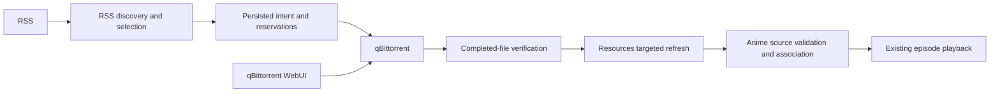

# Automatic Acquisition: Current Iteration Architecture

Date: 2026-10-21. RSS-based acquisition is implemented; real deployment/browser
acceptance remains pending. The Watching automation and Torznab + Jackett extension
below is designed but not implemented. [Current requirements](current-requirement.md) define this iteration.
[Architecture](architecture.md) describes the complete application.

## Ownership and Data Flow

The following sections describe the implemented RSS path. The final section designs
its pending extension; proposed contracts, tables and routes are not current APIs.

Acquisition is the sixth encapsulated module. It owns private qBittorrent account
settings, RSS evidence, subscriptions, destination configuration, download
permissions, canonical reservations, submission attempts and import outcomes.

Resources owns configured roots, confinement, source versions, indexing and the
single `LibrarySynchronizer` mutation gate. Its Acquisition capability lists roots,
validates access, inspects completed paths and refreshes an affected file. Busy
synchronization returns a retryable import failure instead of a full-library scan.

Anime owns actual-file recognition, Catalog/Review and associations. Its ingestion
capability checks the accepted episode against leaf filename evidence, publishes
conflicting files into local Review and uses revision-checked Catalog confirmation
without replacing manual decisions. Acquisition does not write their tables.

## Internal Workflow Boundaries

`DownloadsApplication` is an internal facade over destination settings and authorization,
recovery commands, activity queries, reservations, remote submission/reconciliation,
completed-file import and a bounded worker. `DownloadContext` owns cancellation,
request draining and the single revision-checked intent writer. Each reconciliation
uses a `DownloadExecution` that retains its own latest written revision across
submission and import stages. A delayed failure cannot adopt and overwrite a newer
command. Structured intent transition logs include the work, intent and new revision.

Discovery and Downloads group their application facades, workflows, workers,
contexts and operational policies under their respective `application/` directories.
Their public contracts and ports remain at the submodule root, alongside `domain/`,
`infrastructure/` and `http/`. qBittorrent keeps its smaller integration flat.

Discovery owns feed evidence, subscription revisions and candidate publication. Its
application manages session-bound previews and commands; `FeedReader` coalesces
bounded source requests, the pure `selectCandidates` policy evaluates explicit
snapshots, and `DiscoveryWorker` owns polling and scheduling. Downloads consumes a
consumer-owned selection port with subscription/candidate/release reads and an explicit
reservation-outcome notification. Discovery applies that notification without
replacing candidates or clearing a separate assessment failure on recovery.

`SubscriptionConfirmation` in `acquisition/subscription-confirmation.ts` coordinates
the synchronous SQLite transaction that saves
the subscription, feed and candidates together with the confirmed download permission.
A permission failure rolls the complete confirmation back and retains the preview
for retry. Production repositories share the application database connection; injected
persistence implementations must preserve that transaction boundary.

Module assembly exposes selected method capabilities. Internal workflow objects,
stores, workers and lifecycle methods do not escape through the business API.

## Destination and Authorization

One destination maps a qBittorrent absolute POSIX prefix to a configured Resources
scope. Store a revision, connection generation and separate configured/visibility
verification flags. Validate the account, root and enabled incomplete directory
outside watched roots. This is configuration validation; only a completed mapped
file proves shared visibility. The operator must provide equivalent mounts.

Persist each work's first `Title [provider-id]` directory. Clean invalid components,
bound UTF-8 bytes, retain Unicode and use stable provider-qualified identity.
Title refreshes do not move data. qBittorrent receives the work-specific save path,
`useAutoTMM=false`, category `anishelf` and tag `anishelf-<intent-id>`. Preserve the
torrent's internal layout. Anishelf never moves or renames downloaded originals.

RSS previews include the destination directory when validated configuration exists.
Preview confirmation binds the authenticated session, metadata/availability,
subscription/feed revisions and destination revision. Existing subscriptions have
no acquisition permission after migration. Confirming a fresh preview grants a
permission for its feed, starting episode, destination revision and account
generation. Reads and configuration saves start no downloads. Destination or
account changes require confirmation again. Pausing stops pending submission,
not existing transfers/imports. AniList status has no automatic acquisition effects.

## Persistence and Commands

The current schema defines destination, permission, work-directory and intent tables.
Intent records are independent of subscription foreign keys, so removal does not
lose in-flight tasks. Unique indexes reserve work/episode and canonical torrent
hashes. Unresolved release identities receive a provisional unique reservation
until the bounded torrent parser resolves them. Duplicate canonical identities
remain blocked rather than silently controlling another work's task.

Download persistence provides work-scoped activity pagination and aggregate counts,
indexed work/episode and hash reservation lookups, and cursor-ordered due-task batches.
The worker loads at most two intent payloads per batch, while including available
sources for subsequent availability checks. Idle detection uses an existence query.
Retention redacts terminal detail in SQL and preserves reservations. State filters,
retry deadlines and activity ordering use explicit columns and indexes in the current schema. See [Relational persistence](database-design.md). These
changes do not establish a load benchmark.

Private intent evidence includes source URL, expected feed hash, canonical hash,
destination snapshot, stable directory, accepted subscription revision, submission
state/attempts, transfer observation, import result and actual source identity.
A persisted submitting record precedes the external add. Successful HTTP receipt
alone does not bind a task: query by hash and require category/tag ownership.

Submission states are pending, submitting, unknown, bound, blocked, missing and
available. Transfer observations and import states remain separate. On interruption,
query unknown/submitting attempts before doing anything else; absent uncertain
attempts are never automatically resent. Explicit Retry acquisition first checks
for the hash before a new add. Unsent reservations whose selection changed are
blocked; explicit recovery can adopt the newly confirmed choice. Recheck fresh
metadata and other active versions immediately before submission. Existing unowned tasks become conflicts.

Connection failure retains intent and marks observations stale. External removal
marks missing and suppresses automatic recreation. External pauses remain paused.
User retries carry command IDs and revisions; replaying the last accepted command
is harmless, while reusing its ID for a different command is rejected. A changed account does not inherit old bindings. Save/validate its destination and
reconfirm scope; Retry acquisition explicitly reconciles the retained hash/tag in
the new connection before any possible resend. Available local sources remain
independent of downloader connectivity. Definitively rejected
or unsent submissions can back off; unknown mutations require reconciliation.

### qBittorrent integration boundary

`acquisition/qbittorrent` owns account configuration, credential-file persistence,
settings HTTP routes and the SDK client behind one public entry point.
`QbittorrentConnection` owns configuration generations and lazily reuses one client
until configuration changes or shutdown. `QbittorrentClient` owns SDK operations;
it does not read configuration files or register routes. Downloads receives client
access through `withClient`, which checks the generation before and after work.
Existing configuration and operation logs remain at their respective owners.

`QbittorrentClient` uses `@ctrl/qbittorrent` directly. The SDK owns HTTP requests,
cookies, authentication recovery, multipart encoding and per-request timeouts.
The client retains input/response validation, domain mapping, shared initial login
and sanitized operation logs. Version-dependent API behavior is delegated to the
SDK. The client does not install a custom dispatcher, enforce a response byte
limit or validate raw add receipts.
SDK redirect and response-decoding behavior applies.

Cancellation is cooperative: it is checked before authentication, before the SDK
action and after that action completes. It does not abort an in-flight HTTP request;
that request finishes or reaches the SDK timeout. Closing blocks new operations,
drains pending operations and clears local authentication. Cancellation of one
operation does not interrupt shared login for other operations.

Once a mutation action starts, failures without an explicit rejection are treated
as unknown, even if the request might not have reached the server. The SDK may
re-authenticate and repeat a request after an explicit authentication rejection;
the client adds no mutation retries. A successful add call is only a receipt:
submission must still query by hash and validate category/tag ownership before
binding. Unrecognized receipts therefore cannot establish a binding on their own.

## Completion and Ingestion

1. Observe full completion with no remaining bytes and no metadata/check/move/error
   state. Read selected-file completion; only one selected episode video is supported.
2. Validate original relative path components and map the task's captured save prefix
   to its captured root. Open through confined Resources access, rejecting symlinks,
   traversal, inaccessible roots and unexpected size/version.
3. Refresh the affected path through the shared synchronization gate and obtain a
   real `SourceIdentity`. Recheck downloader state/file layout before association.
4. Anime verifies actual title/episode evidence and existing decisions. It creates an
   idempotent association or returns local Review without overriding manual links.
5. Record availability only after confirmed association and source access. Retry
   import independently of download submission. Completed imports leave the download worker. Activity retains the import outcome;
   current file/association availability belongs to Resources and Catalog and is not
   periodically reverified by Downloads.

Successful indexing does not certify browser compatibility or start transcoding.
A torrent can continue seeding after ingestion. All transfer controls, removal and
destructive file deletion belong to WebUI, independently from Catalog operations.

## Scheduling, Retention and Lifecycle

RSS discovery uses a global `rssRefreshIntervalMinutes` setting, defaulting to
30 minutes with a range of 1–1440 whole minutes. Its 30-second scheduler reads the
current setting and recalculates healthy feed deadlines from their last successful
check, including after restart. Failure retry deadlines remain independent of this
setting. The shared feed reader uses the current interval after successful requests,
including HTTP 304 responses. Settings updates and schedule changes emit structured
logs without source URLs.

The download worker reconciles every
5 seconds with active work and every 60 seconds idle. Process at most two intents
concurrently; serialize each tick and intent, reload revisions around asynchronous
boundaries and exponentially back off to one hour. Checks and reads never become
empty snapshots on failure. Completed, missing and blocked intents are excluded
from automatic work batches; explicit recovery commands re-admit eligible work.
No synthetic transfer progress is generated.

Keep terminal detail for 90 days, then clear private source payload/title/transfer
and error detail while retaining reservations, suppression and source identities.
Expired evidence cannot be used for acquisition retry. Feed evidence retains the
existing explicit limits; exceeding them reports an error instead of silently
losing release identities. Acquisition closes workers and aborts/drains transport
before dependent modules and SQLite close.

## HTTP and Compact Web Interface

All routes use existing authentication and CSRF protection. TypeBox contracts own
request validation and safe response projections.

| Route | Capability |
| --- | --- |
| Existing `/api/acquisition/subscriptions` routes | Preview/confirm scope and destination, pause/resume, refresh and remove |
| `GET/PUT /api/acquisition/downloads/settings` | Read/select the single global destination |
| `POST /api/acquisition/downloads/validate` | Validate current saved mapping/account/incomplete settings |
| `GET /api/acquisition/downloads?workKey=…&page=1` | Paginated safe per-work activity and authorization |
| `POST /api/acquisition/downloads/:id/retry` | Revision/command-ID checked acquisition or import recovery |

There is no global Downloads page. The detail subscription section uses a compact
divider and status row instead of a standalone card. Unsubscribed works show a
Subscribe action without an inline form or empty activity. Subscribe and Manage
open a scrollable dialog containing the RSS address, starting episode and explicit
preview/confirmation flow; successful confirmation closes the dialog. The saved
feed source is shown only in that dialog. Keep compact status, secondary
subscription actions, Open WebUI and collapsed Activity on the detail page. Reuse each
release row for acquisition state; omit duplicate transfer statistics and playback
buttons. Show true progress or named states. Error counts remain visible while
collapsed, and affected rows expose Retry acquisition, Retry import, Review or
Settings only when applicable. Deduplicated Toasts report failures without replacing
persistent error context. qBittorrent WebUI owns pause/resume, removal and deletion.

## Validation and Observability

Use safe structured events for destination changes, authorization, reservations,
state transitions and recoverable failures. Correlate intent/work IDs and revisions;
never log private RSS/Magnet URLs, tokens, torrent payloads or SDK raw responses.

Fixtures cover identity/path validation, SQLite reservations/restart, uncertain
submission, external task changes, confined refresh, Catalog association/manual
preservation, HTTP authentication/CSRF/revisions and compact UI recovery. Regression coverage also
checks atomic confirmation rollback, activity pagination and summaries, bounded
worker cursors, retained reservations and late failures after a newer retry command. Run Biome,
lint, type checks and project tests with required localhost/subprocess permissions.
Actual RSS/qBittorrent/mapped-media/browser tests remain separate acceptance gates.

## Watching Automation with Torznab and Jackett (Planned)

### Selected Approach and Deployment

Use Jackett as a separately deployed site adapter and Torznab as the acquisition
search protocol. Jackett owns site definitions, site credentials, cookies and
site-specific HTTP/HTML handling. Anishelf owns Watching reconciliation, work and
episode verification, preferences, subscription permission, release selection and
the existing download/import workflow. Do not embed Jackett, scrape site pages in
Anishelf, or let Jackett submit downloads independently of Anishelf reservations.

Configure one Jackett instance with an ordered list of explicit indexer endpoints.
Each work pins one indexer after discovery; subsequent results remain release
evidence, not a newly discovered permanent per-anime RSS URL. Search indexers in
configured order until one yields an eligible release. Do not merge/rank releases
across sites or silently replace a pinned source. A missing release triggers retry
on the pinned source; changing it is an explicit per-work override or policy preview.
This keeps S09 multi-source ranking and upgrades deferred while supporting multiple
configured sites. Prowlarr-specific integration is outside this iteration.

Add an optional `jackett` Compose profile at implementation time to both development
and published deployment examples. Use the existing Compose network and service
DNS (`http://jackett:9117`), a persistent Jackett configuration volume, and an optional
loopback-published management port. Jackett needs no media mount. Select and verify
a maintained container image/version during implementation; do not change the
backend image to include Jackett. An external instance remains supported. Update
deployment documentation and CI/configuration checks alongside that change.
Jackett failure must not prevent backend startup, library browsing or local playback.

Protocol references: [Jackett query syntax](https://github.com/Jackett/Jackett#jackett-torznab-query-syntax)
and the [Torznab specification](https://torznab.github.io/spec-1.3-draft/torznab/Specification-v1.3.html).
Jackett documents `t=caps`, `t=search` and per-indexer endpoints; its aggregate
`all` endpoint has per-site control and result-limit tradeoffs. Use explicit indexers
and capability negotiation rather than relying on aggregate behavior.

### Module Boundaries and Contracts

```mermaid
flowchart LR
    AniList --> Tracking[Anime Tracking: complete confirmed list]
    Tracking --> Watching[Acquisition Watching reconciliation]
    Watching --> Managed[Managed subscription and scoped permission]
    Managed --> Search[Discovery search plan]
    Search --> Torznab[Torznab adapter]
    Torznab --> Jackett
    Jackett --> Sites[Configured BT sites]
    Torznab --> Evidence[Normalized release evidence]
    RSS[Manual RSS] --> Evidence
    Evidence --> Assess[Anime assessment and preference selection]
    Assess --> Selection[DownloadSelection]
    Selection --> Downloads[Existing Downloads workflow]
    Downloads --> Q[qBittorrent]
    Q --> Import[Existing verified ingestion]
```

- Add an internal Acquisition Watching application and bounded reconciler. It
  depends on a consumer-owned `WatchingListPort` supplied by bootstrap, not on
  Tracking repositories or provider adapters. Anime exposes a narrow projection
  of its existing Tracking list/refresh capability: provider-qualified account and
  work references, connection generation, immutable complete-snapshot revision,
  freshness/completeness, confirmed status and progress. Extend the public boundary
  to expose completeness/revision explicitly; `fetchedAt` alone is not a revision.
  Tracking publishes a complete snapshot only after all provider pages succeed.
  Pending local status commands are not confirmed remote list state.
- Add an internal `torznab` adapter with `capabilities`, `search`, optional
  `recent` and `readTorrent` operations. Return normalized results and typed failures
  rather than XML, raw URLs or Jackett errors through business APIs. Keep the
  existing XML parser and HTTP library where suitable; no new generic crawler.
- Discovery owns both manual RSS and managed search subscriptions, evidence,
  assessments and preferences. Replace the feed-only subscription contract with
  a discriminated source (`rss` or `torznab-query`). Manual RSS retains its workflow.
  Downloads reads source-neutral release evidence through `DownloadSelection`;
  it never reads Watching or Torznab persistence directly. Replace its raw download
  URL projection with a descriptor for `magnet`, `public-torrent` or
  `jackett-torrent` (source ID, generation and opaque locator). Bootstrap supplies
  a descriptor-aware torrent reader; Downloads still owns parsing/hash verification
  and byte submission. The reader exposes neither source storage nor credentials.
- Anime retains title/season/episode assessment through `ReleaseAssessmentApi`.
  Reuse its target metadata and release parser. Extend the assessment projection
  with versioned release attributes and provenance needed for preference decisions;
  do not duplicate anime recognition in Jackett or Acquisition.
- Extend `SubscriptionConfirmation` into an admission coordinator supporting a
  session preview or a persisted automation grant. Save managed-subscription state,
  source plan, confirmed work scope and download permission in one synchronous
  database transaction. Perform remote calls before that transaction and recheck
  all input revisions inside it. No worker may bypass this coordinator.

### Configuration, Policy and Permission

Store Jackett credentials in an Acquisition-owned private configuration file using
the existing credential-file permissions and atomic replacement pattern. Keep the
API key separate from the endpoint, expose only `hasApiKey`, and never return it to
the browser. An omitted key on update retains it; replacement and clearing are
explicit commands. Database records reference a configuration generation rather
than copying the key. Authenticated configuration saves and connection tests alone
grant no download permission.

Store a revisioned automation policy containing enabled state, tracking account and
generation, ordered indexer IDs/configuration generations, preference revision,
destination revision, downloader generation and backlog mode. Default automation
to disabled. Use `progress + 1` as the selected backlog default, with `from 1`
as an explicit alternative; allow a positive integer per-work starting-episode
override. Freeze a work's starting episode at admission so later progress changes
cannot silently expand or shrink accepted scope. Do not generate a bulk episode
queue from a missing/unknown episode count; acquire only verified published episodes
within that lower bound and any known valid upper bound.

Activation uses a five-minute, authenticated-session-bound preview, showing the
complete Watching snapshot, affected works, effective starting episodes, preferences,
source order and destination. Confirm a persisted grant only if the preview's
tracking/source/preference/destination revisions still match. Future Watching
entries inherit this grant and need no per-title preview. New metadata or search
results may populate evidence but cannot broaden the accepted grant. Preview
does not search an unbounded number of titles or submit downloads; report unresolved
metadata explicitly and resolve it asynchronously after confirmation.

Download permission becomes source-neutral: work, subscription/scope revision,
source binding and generation, start episode, grant ID/revision (managed only),
preference revision, destination revision and downloader generation. Source additions,
preference changes, backlog expansion, account changes or destination changes
require a new preview/confirmation before affecting managed acquisition. Disabling
automation or a source takes effect immediately. Retain the current manual grant
path and recheck effective permission immediately before external submission.
Changing the API key or endpoint advances source generation and blocks old unsent
permissions until validation and confirmation; credentials are never inherited by
an old intent solely because its URL has the same host.

### Watching Reconciliation and Manual Overrides

Use confirmed provider-neutral `watching` status, currently mapped from AniList
`CURRENT`. Apply these selected defaults only to automation-owned subscriptions:

| Observed state | Effect on new acquisitions |
| --- | --- |
| Watching | Admit or reactivate within the accepted grant and frozen scope |
| Paused, Dropped, Completed, Planned or Rewatching | Suspend new reservations/submissions; do not opt into rewatch acquisition |
| Entry absent from a new complete, healthy snapshot | Suspend with `tracking_entry_removed`; retain subscription and history |
| Stale, partial, failed or disconnected snapshot | Retain last confirmed state, block new admissions/submissions, and show tracking unavailable |
| Return to Watching | Resume a suspension caused by tracking policy, preserving manual overrides |
| Different account or connection generation | Block managed work until a new activation preview is confirmed |

Represent status eligibility, manual pause, per-work opt-out, source readiness and
authorization separately; effective enablement is their conjunction, not a single
boolean overwritten by polling. A manual pause survives a later Watching transition.
Removing a managed subscription writes an account/work opt-out tombstone so the
next list poll does not recreate it. Explicit re-enable clears that tombstone.
Global disable stops new work while existing transfers and imports continue.

One active subscription remains unique per work. If a manual RSS subscription
exists, record `manual_subscription_present` and leave it untouched; it does not
inherit global automation permission. Converting a managed subscription to manual
requires explicit confirmation and removes automatic ownership. Pinning a different
source or changing scope uses a revision-checked per-work preview and persists the
override. Never reset an override from list reconciliation or a metadata refresh.

The reconciler obtains a complete snapshot, resolves work metadata, then commits
revision-checked per-work admissions in bounded batches. Record an applied snapshot
revision only after all entries and removals are processed; restart resumes the
persisted cursor idempotently. Recheck account generation, current snapshot and
policy revisions after every await. No partial batch authorizes an absent work.
Retain the existing maximum of 64 subscriptions; surface excess work as
`subscription_limit` rather than silently discarding or replacing entries. Keep
overflow state lightweight and retry it when capacity becomes available.

### Torznab Transport and Normalized Evidence

Configure explicit per-indexer API endpoints such as
`http://jackett:9117/api/v2.0/indexers/<id>/results/torznab/api`.
Reject embedded credentials, fragments and supplied API-key/query parameters;
the adapter constructs queries with `URLSearchParams` and adds its private key.
Probe `t=caps` to validate free-text search, supported categories and page limits.
Use only advertised categories/parameters; a healthy capabilities response does not
prove that the upstream site can return usable results. Validate with a bounded
search as a separate step, and distinguish empty results from connection failure.

Use `t=search&q=...` as the baseline. Do not send AniList IDs as TVDB IDs, or infer
TV `season`/`ep` parameters from Japanese airing seasons or absolute numbering.
Indexed TV search remains unused until an explicit verified mapping exists.
Generate up to four unique title queries from current metadata in stable language
and primary/alias order; preserve distinguishing season/part tokens. Use aliases
to improve recall, then assess each result against the actual target.

Normalize results to source/generation, upstream GUID, observation ID, title,
publication time, byte size, nullable seed/peer counts, nullable claimed v1 hash,
private torrent locator or magnet, and parsed attributes with provenance/version.
Reuse RSS item normalization where possible but explicitly add Torznab response
metadata, errors, namespaces and extended attributes. Support only the current
v1/hybrid download policy. Prefer a validated hash for cross-query deduplication;
otherwise use source-scoped GUID or normalized locator identity. Treat locator/hash
claims as untrusted until Downloads verifies torrent identity. Never use a detail
page link as a torrent download automatically.

The existing `RssTransport` rejects private networks and cannot be reused unchanged
for Jackett. Introduce a dedicated transport restricted to the saved Jackett origin
and configured API/download route families, supporting private service DNS. API
requests do not follow redirects. Jackett torrent locators must match the configured
origin and accepted download route; store a validated opaque locator and resolve
credentials at fetch time. Strip configured API keys from query strings and any
Jackett route path carrying the key when normalizing locators; reconstruct these
only inside the transport for the captured generation. Do not treat every
same-origin URL as a download route.
For a redirect to a public torrent host, remove Jackett credentials and apply existing
public-address/DNS/redirect checks on each hop. Reject redirects to other private
origins and credential-bearing external URLs. A public direct torrent URL follows
the existing public transport. Magnet URIs use the existing validation path.

Pass torrent bytes through the existing bounded parser/hash verification before
qBittorrent submission. Never send Jackett's authenticated proxy URL to qBittorrent
as an unchecked URL. Retain the existing public-only RSS policy; browser requests
cannot supply arbitrary proxy targets. Bound XML bodies to 5 MiB/1000 items,
torrent bodies to 10 MiB and requests to 30 seconds. Reject DTD/entities and parse
Torznab error documents even on HTTP 200. Classify authentication, rate limiting,
unsupported capability, malformed response, timeout and upstream failure separately.
Honor retry hints without logging response bodies or credential-bearing URLs.

### Source Search, Release Selection and Scheduling

1. On admission, search allowed indexers sequentially in configured order using
   metadata title queries. Pin the first indexer with an identity-confirmed release
   satisfying scope and hard preferences. No result means `no_match`, not removal
   or authorization of a weaker identity. Pinning does not itself submit a task.
2. Persist a query plan keyed by work, metadata revision, indexer generation and
   policy revision. Store query cursors and bounded observations; do not invent an
   RSS URL or freeze the first response as a permanent feed. Reassess retained
   evidence after metadata changes before reserving any new download.
3. Require existing Anime identity/season and single-episode checks, accepted scope,
   supported download format, local-availability and reservation checks first.
   Required language, allowed group, resolution, codec and include/exclude keywords
   are hard constraints. Unknown required attributes yield `preference_unknown`;
   an absent preference imposes no constraint. Parse subtitle language separately
   from audio language and retain evidence, not a guess from the site/category.
4. Among eligible versions on the pinned source, preserve a still-valid prior
   choice; otherwise compare ordered group/resolution/codec preferences, then known
   seed count, publication time and stable release identity. Missing seed count is
   unknown, not zero, and cannot prove downloadability. Do not replace reserved,
   active or available episodes with a later higher-ranked version. Keep packs,
   specials and uncertain numbering excluded with explicit reasons.
5. Publish selected candidates through `DownloadSelection`. Downloads performs its
   existing final authorization/availability check, hash and work/episode reservation,
   uncertain-submission reconciliation and independent verified import.

Poll the Tracking list every five minutes through its existing coalesced refresh and
provider scheduler; invalidate/wake after confirmed local status updates without
using pending commands as remote state. A new complete snapshot schedules immediate
reconciliation. Before any managed submission require a healthy snapshot no older
than that interval; otherwise wait for refresh. Use the configured RSS interval
(default 30 minutes) for per-indexer recent-release polling where keywordless search
is actually supported. Route each result to pinned works using the same assessment.
If unsupported, schedule per-work searches at that interval. Probe recent support
explicitly; a search endpoint may require keywords even when general search exists.

Run initial backlog search on admission, bounded gap repair every six hours and
on-demand refresh through the same queue. Persist deadlines with jitter and one
active tick; share a global maximum of two discovery requests across RSS and Torznab,
with one in flight per indexer and at least five seconds between its requests.
Request at most 100 results per page, respecting lower advertised limits; process
at most ten pages/1000 observations per query run and persist continuation when
pagination works. Detect repeated pages or absent paging support, expose
`source_window_limited`, and never claim complete backlog coverage. Recent polling
uses overlapping observations and deduplication; a window gap schedules bounded
repair. Search truncation is not evidence of episode absence.

Honor rate-limit retry hints; otherwise back off failures from one minute to one
hour. Retry a healthy no-match search after six hours. Explicit refresh does not
bypass limits. Retain prior evidence and successful deadlines on failed attempts;
do not feed an empty failure snapshot into selection. On shutdown abort/drain
Watching and discovery before Downloads and dependent Anime/Tracking/SQLite close.

### Persistence and Migration Plan

Names below describe proposed records; implementation must add a new numbered
migration and update [database design](database-design.md), not rewrite old migrations.

| Record | Durable fields and invariants |
| --- | --- |
| Source | Indexer ID, label, endpoint, order, config generation, capabilities/validation revision, health, retry deadline; no API key |
| Automation policy/grant | Revision, enabled state, provider/account/generation, allowed sources/preferences, backlog mode, destination/downloader binding, confirmation receipt |
| Reconciliation run | Account/generation, complete snapshot revision, policy revision, entry/removal cursor, attempt/deadline and completion marker |
| Managed work | Unique account/work, owner, frozen start episode, tracking suspension, manual pause/opt-out, overrides, pinned source, revision and last applied snapshot |
| Query plan/observation | Source/work/revisions, title query and page cursor, run completeness, due time, last success/error, normalized evidence and private locator |
| Download permission/intent | Source-neutral scope and grant binding; immutable accepted source/preference provenance on intent; retain existing episode/hash uniqueness |

Keep sensitive source configuration in its private file. Pair DB bindings with its
generation so a crash between file replacement and DB writes blocks stale work
rather than admitting it. Use transactional compare-and-swap updates after remote
calls; source/account/policy changes fence late results. Unique account/work and
command receipts make reconciliation and confirmation idempotent. Existing intent
records remain independent of subscriptions and keep their captured provenance.

Migrate existing subscriptions to manual RSS ownership without granting additional
permission; preserve already confirmed destination-bound permissions and existing
intents, reservations, source identities and suppression. Adapt their feed references
to source bindings explicitly. Default automation off and preserve removal
tombstones independently of evidence pruning. Bound observations to the existing
2000 retained-item limit per work/source; overflow is visible and blocks new
selection until bounded recovery, not silent eviction of unresolved evidence.
Apply the existing 90-day private terminal-detail retention to completed query
diagnostics while retaining active plans, permission provenance and deduplication
reservations. No migration starts a worker-triggered download on its own.

### Planned HTTP and Compact Interface

All new mutations use existing authentication, CSRF, TypeBox validation and
revision/command-ID checks. Safe responses omit private locators and credentials.

| Proposed route | Purpose |
| --- | --- |
| `GET/PUT /api/acquisition/sources` | Safe source settings and explicit Jackett credential/configuration update |
| `POST /api/acquisition/sources/:id/test` | Bounded capabilities/search validation; no download permission |
| `GET /api/acquisition/automation` | Policy, grant validity and compact health/counts |
| `POST /api/acquisition/automation/preview` | Session-bound affected-work/backlog preview |
| `POST /api/acquisition/automation/confirm` | Atomically accept the exact preview and enable its grant |
| `POST /api/acquisition/automation/disable` | Immediately stop new managed acquisitions |
| Existing subscription routes | Project source kind/ownership/reasons; support explicit overrides, managed opt-out and bounded refresh |

Settings adds compact source rows with individual remove/test actions and bottom
add controls, one secret input, release preferences and Watching automation controls.
Source/preferences remain drafts until Save; activation is a distinct preview/confirm
action. Explain that Jackett is a separate service and link to its management page
without exposing its key. Show tracking/source validation and download destination
as distinct statuses. Keep lists and numeric summaries compact, with complete
reasons in accessible details/Tooltips following [the design system](design-system.md).

Rename the detail RSS panel to Acquisition for both source kinds. Show Manual RSS
or Watching ownership, pinned source, scope and effective pause/block reason. Reuse
collapsed Activity for search/selection outcomes and existing download/import
recovery. Unresolved search identity is a discovery state, not a fabricated local
file Review record. Keep local file conflicts in existing Review. Provide relevant
Refresh, Pause, scope/source override and Settings actions; no global download
dashboard or duplicated WebUI transfer controls.

### Delivery and Verification

Implement in this order: source configuration and bounded Torznab adapter; normalized
evidence/preferences and source-neutral manual-RSS regression; complete Tracking
projection and managed admission/overrides; polling/recovery and compact UI; optional
Compose deployment and live acceptance. Each stage keeps automatic permission
disabled until its complete grant path is implemented. Update contracts, persistence
documentation and requirements with delivery status as stages land.

Fixtures must cover capabilities/errors/paging, repeated pages, nullable attributes,
XML limits, endpoint/redirect confinement and secret redaction; title aliases,
season collisions and absolute numbering; hard/unknown preferences and stable
selection; complete versus partial/stale snapshots; all status transitions,
account/source generations and manual overrides; atomic grant rollback, crash/cursor
recovery, capacity/retention limits and duplicate reservations. Include manual RSS
migration, stale async results and unchanged uncertain-download/import behavior.

Emit structured `acquisition.watching_reconciled`, `source_probe`, `search_completed`,
`search_failed`, `managed_subscription_changed` and `automation_blocked` events with
run/work/source IDs, revisions, counts, duration, sanitized reason and retry time.
Never include full request URLs, query-string keys, private locators, raw errors,
credentials or torrent contents. These are planned events, not existing telemetry.

ACQ12–ACQ15 require a real AniList account, a verified target site through Jackett,
qBittorrent and shared media storage. Demonstrate activation, a new Watching entry,
automatic matching/download/ingestion without per-anime RSS input, status and manual
override behavior, source/tracking outages and restart. Run ACQ01–ACQ11 as regression
acceptance, including actual browser playback separately from successful ingestion.
Passing mocked Torznab tests or a healthy Jackett API does not establish site or
end-to-end reliability. Season packs, quality upgrades and cross-site ranking remain
outside the selected single-episode workflow.
