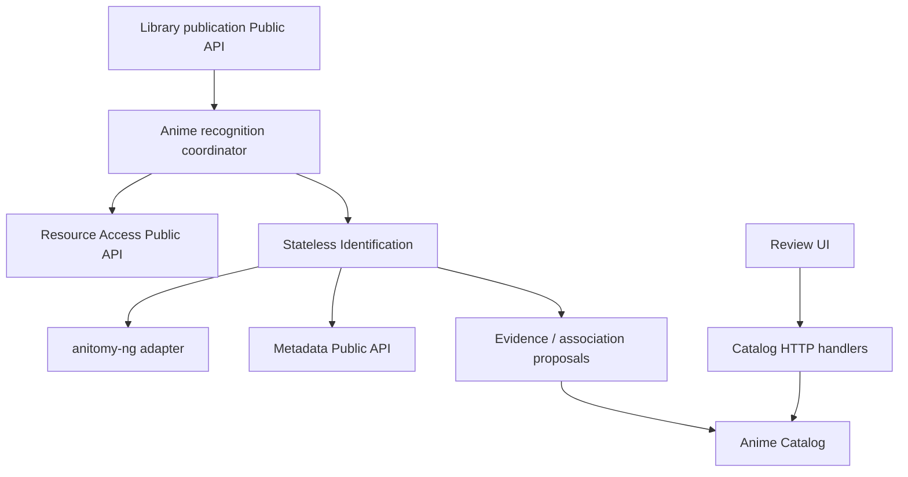

# Current Iteration Overall Design

Status: proposed implementation design, selected on 2026-10-11. This document
does not declare the anime-library iteration implemented or accepted and does
not assign a release number.

[Current iteration requirements](current-version-requirements.md) owns scope and
CAT01–CAT08 acceptance. [Architecture](architecture.md) owns system boundaries;
[Design system](design-system.md) owns shared interaction and visual conventions.
The APIs and storage records below are the iteration design baseline. The backend
[Identification implementation](identification.md) now provides stateless recognition
and automatic scan coordination. [Metadata](metadata.md) now implements cached
AniList queries, details, relations, airing and artwork and supplies recognition
candidates. [Anime Catalog](anime-catalog.md) now implements durable local works,
episodes, review decisions, confirmation/correction transactions and HTTP queries.
The Web poster library, work detail and version playback are implemented.
Automatic admission and Web Review/correction are implemented. Files displays current-version identification icons with Tooltips and conditional Review/work menu links. Exact implemented
contracts are defined in source.

## 1. Product decisions

The default entry becomes a poster-based anime library. Local directories remain
the resource-management, identification and direct-file playback interface.
Published scans automatically feed new or changed resource contexts into
Identification. Review and confirmed association changes belong to Anime Catalog. A folder is context rather
than a work identity, and a work can have resources in several folders.

Use `anitomy-ng` through its npm WebAssembly binding for local name extraction.
Use AniList as the first external metadata provider. Keep provider-specific
transport and fields behind an adapter, with provider-qualified references and
stable local work/episode identities. A second provider can be added later without
replacing saved associations; automatic cross-provider identity resolution is
outside this iteration.

Persist provider metadata and confirmed associations in SQLite. Cache artwork
locally with a separate bounded lifecycle. Opening the library must not require
AniList connectivity or a provider account. Original filenames and bytes remain
unchanged. Existing playback, subtitles, preparation and source-level progress
remain authoritative.

## 2. Information architecture and screens

| Entry | Purpose | Primary actions |
| --- | --- | --- |
| Library | Default poster wall of confirmed local works | Search, filter, open work |
| Files | Existing directory browser | Browse, play file, scan, inspect identification results |
| Review | Unidentified and ambiguous identification results | Inspect evidence, search candidate, correct, confirm or reject |
| History | Existing source-level playback history | Resume the corresponding source |
| Settings | Resource root and existing playback/preparation settings | Configure resources and playback/preparation preferences |

Keep the existing source history; do not introduce planned/watching/completed
statuses or episode completion percentages in this iteration. Identification
progress is a nonblocking status panel reachable from Files and Review, not a
competing full-screen workflow.

### Poster wall

Show one card per confirmed local work in the active resource root, including
works whose previously associated resources are now unavailable. Separate AniList
season/part/movie entries remain separate cards. Relationships appear on the
detail page; a guessed franchise does not merge cards or episode numbering.

Cards show artwork, preferred title, format/year when known, and the number of
distinct locally available episodes. Count a multi-episode resource by its
confirmed associations and count multiple versions of the same episode once.
Show a denominator only when a regular episode count is known and the count
uses the same numbering scope; label it as availability, not watched progress.

Search operates over cached provider titles and synonyms. Provide
format, release-year and availability filters, plus title and recently-added
sorting. Pagination uses a stable local ID as a tie-breaker. Restore filters,
scroll position and the selected card after returning from a detail or player.
Do not make a cloud discovery feed part of the local poster wall.

Use the shared full-width page header. A compact toolbar shows search, a filter
panel toggle and sorting. Search submits explicitly; discrete filters and sorting
apply immediately and reset pagination. Year changes apply on blur or Enter after
validation. Applied criteria have removable labels. Reserve two title lines and a
consistent availability summary on cards; put cache details on the work page.
Cards have subtle hover feedback and a visible keyboard focus. Mobile uses two
poster columns; desktop columns adapt to the available card width.

Use a responsive grid, approximately 2:3 artwork, lazy-loaded thumbnails and
reserved image space. A missing image shows the real title in a neutral fallback;
do not invent artwork. The whole card is a keyboard-accessible link. Secondary
actions are available on the detail page. Loading, empty, no-results, stale-cache
and unavailable-resource states provide an appropriate next action.

### Work detail

The header shows title, alternate titles, cover/banner where cached, synopsis,
format, release status, dates, episode count and provider attribution/link.
Do not add local work-title or alias editing controls. Show metadata failures and
retry in the relevant search/detail view, and identify stale data when applicable.
Keep provider/cache technical status out of Settings and normal browsing; this
does not remove actionable failure feedback or detail-page refresh.
Genre, studio, source type, duration, tags and provider rating are secondary
details when supplied. Do not duplicate the full metadata on every card.
Treat provider descriptions as untrusted text/Markdown and render through a
sanitizing renderer; preserve the provider's original value in the snapshot.

The main list groups regular episodes and explicitly identified specials.
Each row shows a label, optional real title, availability and version count.
Unknown titles use an honest numbered label such as `Episode 3`; unknown numbers
stay in an unresolved section. Distinguish unavailable local files from episodes
not yet aired and from missing provider data. If total count is unknown, list
only established episodes and show that the total is unknown.

With one usable version, Play opens existing playback. With several, Play opens
a version selector showing filename, relative directory, release group, revision,
available language and quality evidence. Name-derived quality is labelled as
release information; inspected stream properties are shown separately when
available. Do not promise browser compatibility from a filename.

Return from playback to the originating detail/episode or Files view. Reuse the
existing preparation controls, subtitle selection and compatibility decisions.
A multi-episode file opens its normal source timeline; associations do not create
seek boundaries. Existing source progress can support resume but does not imply
that every associated episode is watched.

The detail layout places episodes before secondary metadata. Desktop uses an
episode column and a narrower information column; mobile stacks them in that
order. Long descriptions can expand, and secondary metadata and relations use
consistent disclosure panels. Unresolved files retain direct Review entry points.

Settings shares the page container and header alignment with browsing. Its
section descriptions and bounded forms are side by side on desktop and stacked
on mobile; the entire page is not restricted to a narrow centered column.

### Files and identification review

Files uses focusable identification icons with status/association Tooltips;
Review and confirmed work/episode links are conditional file-menu actions.
Files retains breadcrumbs, current scan/root state, direct playback and original
names. Completed scans automatically identify affected resource contexts. No
separate Identify action is required. A mixed directory can produce several work
proposals; Catalog review can split or reassign their associations.

Review presents work candidates before episode mappings. Candidate rows show
title, format, dates, cover, provider and specific matching/conflicting evidence.
Users can search by another title or resolve an explicit AniList ID/URL. A score
is a ranking aid, never a probability. Candidate results do not appear on the
poster wall unless Catalog accepts them automatically under the clear-match policy or the user confirms them.

For each selected work, show filename, extracted numbering, proposed target
episode and reasons. Support individual file corrections and an explicit offset
with a before/after preview for that file. Selecting multiple files for one batch
offset correction is later scope (L15). Confirm only rows with valid targets;
leave unresolved rows in Review. Reassociation previews affected existing links
and requires an explicit replacement action. Rejection permits an empty reason and preserves any supplied reason; it
does not silently turn into confirmation on retry.

## 3. Backend responsibilities and dependencies

Retain the React/Node modular monolith. No parser sidecar, Go service, internal
HTTP client or universal job engine is needed.

| Owner | Responsibility |
| --- | --- |
| Existing Library | Scan and publish resource index, directory browsing and root switching |
| Existing Resource Access | Confined source resolution, registry, source versions and root epochs |
| Metadata | Provider registry/adapters, normalization, metadata/search cache, artwork and refresh |
| Identification | Stateless extraction evidence, candidate ranking and candidate-specific numbering proposals |
| Application coordination | Library publication subscription, bounded source enumeration, automatic batches, cancellation and transient reuse |
| Anime Catalog | Durable local works/episodes, confirmation transactions, associations, manual corrections and library projections |
| Existing playback modules | Source playback, compatibility, preparation, subtitles and progress |

The coordinator lives inside the Anime module and consumes the Resources root Public API,
then calls Identification with validated source identities. Identification uses a
parser adapter and a consumer-owned Metadata port, and returns evidence/proposals. It
neither reads Catalog decisions nor saves tasks, review outcomes or associations.
Anime Catalog owns durable decisions and consumes proposals without overwriting
manual corrections. Catalog calls Metadata for snapshots and Resource Access for
source registration/validity. Dependencies remain acyclic; Anime assembles its private recognition/cache/Catalog owners; app connects complete modules.

HTTP enters each owning Application and projects public DTOs. Domain types are
independent of HTTP and provider GraphQL types. Cross-module imports, including
types, use Public APIs and consumer-owned ports. Platform database/filesystem
mechanisms do not own matching or refresh policy.

Library exposes publication/root-reset notifications and bounded revision-checked
file pages. The coordinator uses these public reads, not the internal resource index.

## 4. Local extraction and evidence

Start with the evaluated `anitomy-ng@1.0.10`, pinned in the lockfile. The npm
binding supports Node through WASM. It returns ordered elements with `kind`,
`value` and `position`; repeated kinds must survive normalization. Consult the
[official parser documentation](https://github.com/tylergibbs2/anitomy-ng#usage)
for binding and path APIs.

The parser receives strings, not video bytes. Build inputs on the backend from
validated file names and relative paths. Parse the basename and useful ancestor
names separately for provenance; use `parse_path` for path context and
`parse_together` for bounded groups of related files. Keep the results of each
mode distinct. Batch parsing must not assume that one folder contains one work,
and folder batch ranges must not become the leaf file's episode range.

| Evidence | Retained information |
| --- | --- |
| Input | Original basename, relative path, ancestor names and selected source identity |
| Extraction | Parser name/version, input mode, ordered raw elements and positions |
| Work hints | Titles, year, season, part, volume, format/type and episode title |
| Numbering | Every raw episode token, range/dual-number syntax, order and surrounding markers |
| Release | Group, revision, release information, checksum and extension |
| Language/quality | Languages, subtitle/audio terms, source, device, resolution and video terms |
| Interpretation | Normalized values, origin, conflicts, ignored ancillary markers and normalization version |

Capture all available element kinds, including unclassified `other` values.
Missing fields stay absent/unknown. A filename checksum is release evidence, not
a verified content hash; language markers do not certify embedded tracks.
Media Inspection can enrich technical information through its existing Public
API without becoming a requirement for name extraction.

Keep numbers as strings until their roles are resolved. Preserve `12.5`, `23β`,
revision suffixes and the original spelling. For `29 (S02E01)`, retain both `29`
and `01` and the season marker. They are potentially alternative numbering
systems, not automatically two episodes. Distinguish contiguous ranges from
dual numbering, reject descending ranges, bound expansion, and leave unknown
special identifiers unresolved. Detect NCOP/NCED, trailers and other ancillary
resources separately; do not force them into ordinary episodes.

Extraction reuse is keyed by durable source identity, parser version,
normalization version and directory/group-context fingerprint. Membership or
directory-context changes invalidate contextual results even if file bytes are
unchanged. Re-extraction never overwrites a confirmed manual decision.

## 5. AniList and provider extensibility

Use anonymous public GraphQL reads through the backend, with fixed query documents
and variables. The endpoint is `https://graphql.anilist.co`; queries explicitly
request anime. No personal token, list mutation or tracker authorization is
needed. The [official getting-started guide](https://docs.anilist.co/guide/graphql/)
defines the request transport.

### Provider contract

Each provider exposes a stable key, adapter/schema version, capability description,
search with pagination, lookup by provider ID and optional episode/relationship
retrieval. Normalize outputs to shared metadata records and typed failures such
as not-found, unavailable, rate-limited and invalid-response. Capability flags
describe whether information can be supplied; each response also records whether
it is present and complete.

All references use `{ provider, mediaType, id }`, with IDs represented as opaque
strings. AniList numeric conversion happens inside its adapter. Local IDs never
encode an AniList ID. Provider payloads remain within Metadata; HTTP and matching
use normalized projections. Future adapters can provide richer episode catalogs
without changing file associations or playback identities.

### Metadata coverage

Fetch a small search projection first, then details for shortlisted/selected
works. Details include titles/synonyms, synopsis, cover/banner, format/status,
dates, release season/year, count/duration, country/source, genres/tags/studios,
rating, source URL and update time when available. Fetch related-work edges and
available airing/streaming information separately with explicit pagination and
completeness. Spoiler tags remain hidden by default. Characters, staff, reviews
and recommendations are not needed for this iteration.

AniList's release `season` means the calendar season, not a series ordinal such
as `S02`. Its work relations do not establish an episode offset. Airing schedules
are not guaranteed historical episode catalogs, and streaming-episode entries
contain external links rather than stable episode identities or a canonical
numbering contract. Do not infer complete episode names, Chinese titles,
special numbering or cross-season offsets from their presence. These limits
follow the official [Media reference](https://docs.anilist.co/reference/object/media),
[AiringSchedule reference](https://docs.anilist.co/reference/object/airingschedule)
and [streaming-episode reference](https://docs.anilist.co/reference/object/mediastreamingepisode).

Retain source language where known without inventing it from a script. Display
the preferred available provider title with deterministic fallbacks. Keep provider
aliases available for search; local work-title and alias editing are not required.
If regular episode count is known, locally derived `1..N`
slots are labelled count-derived; they are not provider episode records. Unknown
counts permit explicitly confirmed numbered local episodes without inventing a
complete season. Movies use a confirmed whole-work playback slot rather than
requiring an episode token in the filename.

## 6. Candidate generation and episode mapping

1. The coordinator snapshots a published scan, root epoch and affected directory
   contexts. It reports unavailable sources before passing validated identities
   to Identification.
2. Extract names and group compatible evidence provisionally. Preserve mixed-work
   and contradictory-directory results as independent review items.
3. Search cached metadata first, then AniList using a small bounded set of distinct
   title variants. Deduplicate shared queries across files. Send title/year/format
   hints, not full local paths or raw filenames containing release metadata.
4. Rank candidates using normalized title/alias similarity, year, format,
   season/part evidence and plausible numbering. Preserve meaningful numbers in
   titles. Explain both supporting and conflicting evidence and record matcher
   version. Provider order alone is not a confirmation rule.
5. Identification generates a separate numbering proposal for each candidate.
   Catalog review presents source tokens, target labels, explicit offsets and
   remaining conflicts separately.
6. Preview and commit the user's selected associations atomically. Unresolved
   rows remain reviewable and original files remain directly accessible.

Identification remains stateless. Catalog now automatically commits a clear match: normalized exact title/alias, ranking score at least 70, a margin of at least 10 over the next candidate, no conflicts and complete valid episode targets. Specials, ancillary resources, season/part uncertainty and unresolved numbering remain in Review. These scores are ranking evidence, not probabilities or a measured accuracy guarantee. Existing associated/rejected decisions are preserved; manual correction is explicit. Identification itself does not commit associations. Thresholds and candidate margins are
versioned policy values calibrated against fixtures; no accuracy percentage is
used as a production confidence threshold.

Do not silently pick `29` over `01`, turn a decimal into an integer, classify an
unknown number as a special, or infer season order only from sequel edges.
User-confirmed mapping/offset rules have an explicit work and source-selection
scope. Multi-episode mapping creates several association rows for one source.
The user can correct numbering without changing parser evidence.

The coordinator owns cancellation, transient reuse and retry on later scans;
Identification observes caller cancellation without saving task state. A root/source
change invalidates affected proposals. Catalog confirmation revalidates source
versions and checks its decision revisions so stale proposals cannot overwrite a
newer correction.

## 7. Durable model and consistency

Reuse the existing `resource_roots` and `media_sources` registry through Resource
Access; never create a second filesystem identity model. Store root identity and
source version durably. The process-local root epoch guards active work and is
not a persistent identity.

| Record | Ownership and essential contents |
| --- | --- |
| Local work | Anime Catalog: local ID, timestamps, provider-derived display/search projection, revision |
| Provider link | Anime Catalog: local work ID, qualified provider reference, selected metadata snapshot reference |
| Local episode | Anime Catalog: local ID/work ID, kind, preserved number/label, ordering, provenance and optional provider episode reference |
| Source association | Anime Catalog: source registry ID, episode ID, confirmed release-to-target mapping and correction provenance |
| Recognition result | Identification output: source identity, extraction, candidates, mapping proposals and unresolved evidence; transient coordination cache, no Identification-owned durable record |
| Metadata snapshot | Metadata: qualified reference, normalized projection, selected provider payload, field/completeness status, versions and fetch/update/expiry times |
| Search cache | Metadata: provider/query/filter/page/schema key, result references, completeness and expiry |
| Artwork asset | Metadata: provider reference, remote URL fingerprint, local file/digest/type/size, fetch status and access time |

Provider links can accommodate another provider, but there is only one primary
display provider initially. Reconfirming the same provider reference reuses the
same local work; do not create duplicate cards. Season/part entries remain
independent unless explicitly reassociated. Local episode IDs survive label
corrections and metadata refreshes.

Use uniqueness constraints for qualified work links, regular episode keys within
a work, and source-to-episode links. Specials require explicit identities/labels;
do not collapse all unknown specials into episode zero. Store numbering sort
components separately from display strings rather than sorting labels lexically.

Confirmation registers/revalidates sources, retains needed metadata snapshots,
then transactionally saves local works, episodes, links, corrections and item
revisions. A failed catalog commit may leave a harmless retained snapshot for
later cleanup, never partial associations. Retries use a stable operation key
and optimistic revisions. Review outcomes are distinct from source availability;
a confirmed association can later become unavailable without losing confirmation.

Do not migrate links automatically to a replaced file version or another root.
Changed/disappeared sources retain historical links and become unavailable;
unchanged versions regain availability when rediscovered. A newly discovered
replacement is identified independently: clear matches can be admitted automatically, while unresolved replacements require manual review. Root switching
changes the active catalog projection without deleting other roots' state.
Metadata refresh updates provider information, not manual fields, episode IDs,
confirmed mappings or playback progress. Removing an association never deletes
the original source or its playback history.

## 8. Cache, artwork and provider failures

Caching is application-owned and survives restart. TanStack Query remains the
browser cache; it does not replace backend persistence. Read local snapshots
immediately, expose `fetchedAt`, stale status and refresh failure, and revalidate
eligible records in bounded background work. A refresh failure preserves the last
usable snapshot and local associations.

These are initial application policy defaults, not AniList API guarantees:

| Data | Freshness / retention |
| --- | --- |
| Search results | Fresh for 24 hours; empty successful results for 15 minutes; transient unconfirmed entries evicted by LRU above 1,000 keys |
| Selected work details/relations | Fresh for 24 hours while releasing/not yet released; 7 days when finished; retained while referenced by local works |
| Next-airing data | Fresh for 15 minutes; refreshed only when the relevant detail is used |
| Unconfirmed detail snapshots | Up to 2,000 transient snapshots with LRU eviction; confirmed references are exempt |
| Cover/banner files | 128 MiB separate initial budget, LRU eviction; fetch on selection/detail use and retain cached files while within budget |
| Extraction | Reuse until source/parser/context version changes |

Freshness expiry does not delete a confirmed snapshot. Successful empty searches
are distinguishable from request failures. Old search results can be shown as
stale candidates but do not become confirmed facts. Manual refresh is available,
coalesces with an in-flight request and still obeys provider limits. Cache keys
include projection/schema version and all query-affecting options; partial
responses cannot replace a more complete valid snapshot silently.

Keep normalized metadata plus the bounded queried provider payload for diagnostics
and future re-normalization. Mark omitted/null/partial fields appropriately;
do not call the selected projection a full provider database copy. Cache only
application-requested resources and local-work relationships; do not crawl the
AniList catalog. This is bounded local-library caching, consistent with the
[provider's data-collection constraints](https://github.com/AniList/docs/blob/master/docs/guide/terms-of-use.md).

Artwork is fetched by a provider adapter, stored outside original resources and
served through opaque local asset IDs. Only accept validated provider image URLs
and redirects from configured HTTPS image hosts; this is not an arbitrary URL
proxy. Bound response bytes (initially 5 MiB per image), timeout, image type and
concurrency. Publish files atomically; reconcile missing/orphan files at startup.
URL changes fetch a new version before replacing an existing usable image.
Failed/evicted images show the title fallback; offline artwork is available only
if that asset remains cached. Metadata and confirmation retention do not depend
on artwork success. Asset delivery never accepts a client filesystem path.

All AniList calls share one process-level limiter. Start conservatively at 25
requests/minute and at most two concurrent requests, pace requests to avoid
bursts, and adapt downward from response headers. Honor `Retry-After` and reset
times on 429. Timeouts and temporary failures use bounded retries with jitter;
not-found/invalid requests do not loop. The official documentation currently
mentions a degraded 30-request limit, so do not hard-code its nominal 90-request
rate as usable capacity. See [rate limiting](https://github.com/AniList/docs/blob/master/docs/guide/rate-limiting.md).

Validate HTTP status, GraphQL `errors`, runtime response shape and field
completeness; HTTP 200 alone is not success. Uncached queries can fail with retry
guidance while cached browsing and playback continue. Startup needs no provider
connection, and no per-card request fan-out is allowed. Shutdown cancels
coordination and provider work before persistence closes; subsequent published
scans reconstruct local recognition.

## 9. Application/API and frontend seams

Proposed Public APIs expose these business operations; route names and exact
DTO signatures should be finalized alongside implementation:

| Owner | Operations |
| --- | --- |
| Metadata | Search, get cached details, resolve qualified reference, refresh, retain/release snapshot, retrieve artwork status |
| Identification | Identify a bounded source batch; return extraction and candidate-specific proposals |
| Anime Catalog | List/detail works, review proposals, preview/confirm associations, correct/reassociate/remove links, list review outcomes and version availability |

Confirmation belongs to Anime Catalog even when initiated from Review; it checks
source versions and Catalog decision revisions. The HTTP layer
does not conduct provider calls or write another module's repository. Read DTOs
use opaque local IDs, qualified provider IDs, safe relative paths and actionable
state; canonical root paths and provider transport payloads stay backend-only.

Add frontend feature public entries for anime library, identification and metadata
presentation. Proposed route roles are Library, work detail, Files, Review and
identification detail. Keep old source playback reachable and preserve validated
return navigation. Query keys include active-root identity and relevant local
IDs; confirmation invalidates affected wall/detail/review queries. Recognition
is automatic; any future workflow status is owned by application coordination
rather than a manual Identification run. Filter changes and navigation
cancel/ignore stale responses.

Frontend search filters the local catalog unless the user explicitly opens
candidate search. Backend pagination prevents rendering the entire collection.
Use the existing shared controls, English labels and accessible status patterns.
Validate at 1280 px and 390 px with long Chinese/Japanese names, absent images,
multiple versions and unresolved numbers. Provider errors must not reset playback.

## 10. Delivery and validation

Implement in bounded increments, preserving one end-to-end workflow:

1. Add parser adapter and evidence model; evaluate basename/path/batch modes
   independently against the existing corpus and directory scenarios.
2. Add AniList adapter, normalized provider contract, durable cache, limiter and
   artwork delivery; verify deterministic failures with recorded/synthetic responses.
3. Add automatic scan coordination and stateless proposals, then Catalog-owned
   numbering preview, transactions and manual corrections; verify rescan, restart
   and source/root changes.
4. Add default poster wall, work detail, Files identification and Review; connect
   version selection to existing source playback and history.

The previous local benchmark compared single-component `parse()` extraction
with a common exploratory matcher. It did not validate production AniList search,
`parse_path`/`parse_together` or these Applications. Do not copy its thresholds
or treat its overall rates as release acceptance. Parser changes require field,
candidate, mapping and unsafe-confirmation regressions separately; repeated
release versions are not independent evidence of generalization.

Acceptance must cover CAT01–CAT08 plus the following design-specific cases:

- Filename-only, directory-only and related-file extraction; repeated element
  kinds, decimal/special tokens, ranges, dual numbering and credits/trailers.
- Mixed works in one folder, the same work across folders, separate seasons/parts,
  movie variants, unknown counts and multiple source versions.
- Live-provider smoke tests separate from reproducible adapter/normalization
  tests; all requested connection pages and partial-response states accounted for.
- Fresh/stale/missing/negative caches, deduplicated refresh, 429/reset handling,
  GraphQL errors, offline startup, artwork loss and cache eviction.
- Idempotent confirmation, stale-preview rejection, manual corrections across
  refresh/restart, replaced sources, root switching and retained playback history.
- Poster/detail/review navigation, keyboard/mobile operation and real playable
  fixtures for version selection. Corpus placeholder files cannot prove playback.

Run required Biome, lint, typechecks and relevant tests for implementation changes.
Record dependency/parser/provider projection versions and distinguish offline
fixture results from live API behavior. This document is the design baseline;
implementation and acceptance status remain separately reported.
