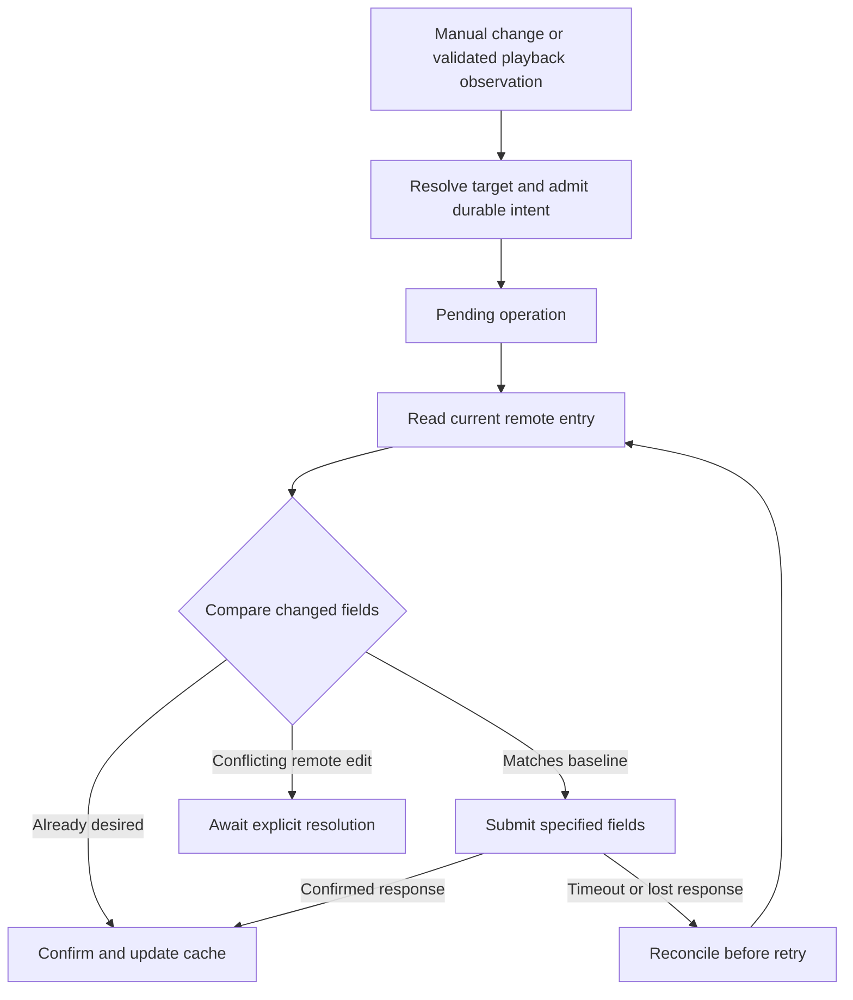

# Current Version Design: AniList Accounts

## 1. Scope and Status

This report defines the planned implementation of W03–W05 and T01–T05 in
[Current version requirements](current-version-requirements.md). AniList owns
viewing status and cumulative progress. Anishelf owns source playback positions,
local playback history, account-scoped remote caches and durable submission intent.
Existing Catalog identities and confirmed work/episode associations are reused.

This remains the iteration design baseline. The account foundation described in
[Implemented account foundation](#implemented-account-foundation) is delivered;
list access and the unified Library read projection are also delivered. Submission
workers and playback updates remain planned. No release
number is assigned. [Architecture](architecture.md) describes existing runtime
owners; [Overall requirements](requirements.md) retains delivery status. Historical
designs remain unchanged.

## 2. Module Ownership

| Owner | Planned responsibility |
| --- | --- |
| Anime / Tracking | Account lifecycle, credential access, personal-state adaptation, account-scoped remote-state cache, and planned update admission/worker/conflict resolution |
| Anime / AniList | Provider-specific account/list/metadata protocol clients, GraphQL schemas and response validation; shared request scheduler |
| Anime / Library | Read-only join of Tracking snapshots and Catalog summaries, filtering and pagination |
| Anime / Catalog (existing) | Local works, episodes, provider links, confirmed source associations and resource availability |
| Anime / Metadata (existing) | Public provider queries, metadata/artwork caches and recognition support, independent of personal authorization |
| Playback / Progress (existing, extended) | Source position/history, validated playback evidence and completion observation |
| System (existing) | Deployment configuration and Anishelf authentication; AniList authorization remains Tracking-owned |
| Anime composition | Assemble Tracking and Catalog adapters and a shared AniList request scheduler |
| App composition | Connect module root APIs, persistence and lifecycle without importing child implementations |

Tracking belongs inside Anime because personal AniList entries and later submission
targets relate to its work and episode identities. The Library read projection
combines Tracking and Catalog capabilities; the account application does not own
Catalog queries or list-cache refresh logic. Do not extend
MetadataProvider with personal-list mutations or store credentials in metadata
snapshots. Tracking exposes selected capabilities through Anime's root Public API.

Playback receives a consumer-owned observation port, wired to Anime through root
APIs. Anime resolves Catalog targets internally. Playback never imports Tracking
or Catalog child implementations; Anime does not call back into Playback to save
positions. Root dependency rules and architecture checks must be updated for this
explicit collaboration.

## 3. Authorization: Bundled Client ID and Manual PIN Flow

The software maintainer registers an AniList application and supplies its public
Client ID with Anishelf. Each user authorizes their own account and receives an
independent access token. Do not embed a Client Secret in source, frontend assets
or distributed images. No maintainer-operated authorization relay is selected.
The real application registration and issued Client ID are release prerequisites;
this report does not invent or register one.

Configure the application redirect URI as
`https://anilist.co/api/v2/oauth/pin`. Settings opens
`https://anilist.co/api/v2/oauth/authorize?client_id=<bundled-id>&response_type=token`.
The user authorizes on AniList, copies the displayed access token and pastes it
into a masked Settings field. The field label must say access token: the name
“PIN flow” does not mean Anishelf receives a numeric PIN to exchange.

The backend accepts the token through an authenticated, CSRF-protected POST,
validates it with Viewer and returns an account preview. The user confirms the
account before replacing an existing connection. Keep an unconfirmed credential
only in a short-lived server-side candidate, scoped to the Anishelf session; clear
it on expiry or rejection. A failed validation preserves an existing connection.
Neither the preview nor subsequent account responses return the credential.
Clear the browser field after submission and never save it in browser storage,
URLs, analytics or logs. The token necessarily passes through this initial input;
“credentials are not returned” does not mean the browser never handles the input.

Store confirmed credentials in a dedicated server-side file under the data
root, with restrictive file/directory permissions, atomic replacement and no
secret values in SQLite list caches or operation payloads. Treat data-root backups
as containing credentials. Do not claim encryption at rest merely from filesystem
permissions. SQLite stores a credential reference and connection generation;
startup rejects a missing/mismatched credential rather than binding it to another
account. Verify Viewer identity on connection and reconnection.

Disconnect invalidates the connection generation, stops admission/submission,
removes local credentials and hides account caches. In-flight responses must match
the current account and generation before changing local state. A request already
accepted remotely cannot be recalled; reconcile uncertain outcomes if that same
account reconnects. Disconnecting locally is not a claim of remote token revocation.
Retained operations never transfer to another account. Same-account reconnection
requires reconciliation before resuming submissions.

The official authentication guide documents manual token copying and no refresh
tokens. Expired or rejected authorization requires reconnection. The implicit-flow
guide describes client-side requests; using the manually supplied token in the
user's own backend is this design's deployment choice. Validate the actual PIN
output, Viewer access and server-side list reads/writes before claiming provider
compatibility. Do not silently switch to a distributed Client Secret if this fails.

Sources: [authentication and PIN](https://raw.githubusercontent.com/AniList/docs/master/docs/guide/auth/index.md),
[implicit grant](https://raw.githubusercontent.com/AniList/docs/master/docs/guide/auth/implicit.md).

## 4. Persistence and Read Model

Tracking owns its schema/repository and exports structural persistence ports
through Anime's root persistence entry, following the existing module pattern.
Use SQLite and the current Drizzle migration path; no additional queue service is
required.

| Record | Minimum design fields |
| --- | --- |
| Account connection | AniList user ID, name/avatar, credential reference, connection generation, authorization state and validation time |
| List cache | Account ID, media ID, list-entry ID, progress, status, remote updatedAt, fetchedAt and list display summary |
| Refresh snapshot | Account ID, snapshot generation, completed fetch time, freshness/error state |
| Pending operation | Account ID, connection generation, media/entry ID, changed fields, desired values, remote baseline, origin, revision, state, attempts, next attempt and safe error |
| Playback observation | Source version, playback generation/sequence, observation identity and mapped target/revision sufficient for deduplication and recovery |

The cache key is account plus AniList media ID. List display summaries may reuse
normalized metadata types, but personal state never enters the public metadata
cache. Titles without local resources remain remote entries; reading a list does
not create empty Catalog works or enable acquisition.

Use Viewer for account identity, MediaListCollection for lists and MediaList for
individual reconciliation. Fetch every chunk, deduplicate entries repeated in
custom lists and publish a complete refresh snapshot atomically. Partial failure
must not erase entries from the previous snapshot. Preserve pending intent when
refreshing and project it separately from confirmed remote values.

Join remote media IDs to existing Catalog provider links for local playback
availability. Only load full metadata when needed. Proposed refresh policy: use
cached results immediately, refresh on explicit request and stale page activation,
and periodically while a tracking view is active. Start with a five-minute cache
freshness interval; make timing a validated policy, not per-row polling. Mutations
update the affected cache from the confirmed response and invalidate relevant views.

Sources: [query reference](https://docs.anilist.co/reference/query),
[MediaList](https://docs.anilist.co/reference/object/medialist).

## 5. Submission and Conflict Handling

Commands express absolute desired values, such as progress = 6, rather than an
increment. Record only fields the operation intends to change. Preserve explicit
backward corrections; do not merge all progress using a maximum.

A worker serializes operations per account/media and uses the shared provider
scheduler. Coalesce unsent superseded intent, but never rewrite the identity of an
in-flight attempt. Version completions so an old response cannot clear a newer
operation. Rebase a later operation on the known successful predecessor while
preserving the later desired fields. Manual corrections take precedence over
older automatic observations; a delayed observation must not undo a correction.

Persist accepted intent before network delivery. Playback position saving remains
independent: a failed tracking admission is visible and retryable, rather than
turning a successful position save into a failed playback request. For crash
recovery, durably record accepted completion observations through a local handoff
before acknowledging tracking acceptance; asynchronous in-memory callbacks alone
are insufficient. Consume handoff records idempotently. A practical implementation
can add a Playback-owned outbox beside its store and expose bounded read/ack
capabilities through its root API; only Anime decides tracking targets and intent.
The exact local transaction boundary is an implementation gate.

Before every submission attempt, fetch remote state. If changed fields already
match the desired state, reconcile as success. If they still match the captured
baseline, submit; otherwise pause for conflict resolution. Compare field values,
not updatedAt alone: unrelated notes or scores must not create false conflicts.
An entry appearing or disappearing remotely also requires reconciliation.

Use SaveMediaListEntry with the existing entry ID for updates and the media ID
when creating an entry. Only send intended progress/status fields; preserve
ratings, notes, dates and repeat counts. Creation needs an explicit initial status
in the user intent. Read back or use returned fields to confirm actual remote state.

A timeout, cancellation or restart during delivery is an uncertain outcome, not
proof of failure. Read the remote entry before resubmitting. Transient network,
429 and server errors use bounded exponential backoff with jitter; honor provider
retry headers. Authorization errors pause the account. Invalid operations remain
failed until corrected; conflicts do not retry automatically. Bound active queue
capacity and report admission failure without discarding existing pending work.

Conflict resolution offers “Keep AniList value” and “Submit my change”. Both
require the current operation revision. The latter captures a fresh baseline;
it does not disable future conflict checks. Account-generation checks fence every
admission, attempt and response.

The documented mutation has no conditional-version argument. Read-before-write
therefore cannot eliminate a concurrent edit between the check and mutation.
Post-write verification and targeted field updates reduce this exposure but do
not provide atomic remote compare-and-swap guarantees.

Source: [mutation reference](https://raw.githubusercontent.com/AniList/docs/master/docs/reference/mutation.md).

## 6. Playback Completion and Existing Mappings

Observe only successfully validated progress updates after the existing source
version, session generation and sequence checks. Loading a resume position is not
completion evidence. Reuse the source-to-Catalog association path, checking source
availability, confirmed review decisions and association revision. Resolve the
AniList media ID and episode target inside Anime. Revalidate mappings when an
observation is admitted; if they changed after capture, leave it unresolved instead
of applying an old episode to a new association.

The proposed first completion policy requires normal playback reaching 90 percent
or a natural end, with seek discontinuities excluded. Position/duration alone does
not prove viewing: extend the observation contract with bounded playback intervals
or equivalent evidence and deduplicate accepted observations. This is cooperative
player telemetry, not proof against a malicious client. The exact minimum normal
play interval and treatment of resumed playback must be specified and tested before
automatic submission is enabled. Until then, manual updates provide the usable path.

| Completed target compared with confirmed progress N | Behavior |
| --- | --- |
| Episode N + 1 | Admit an absolute update to N + 1 |
| Episode at or below N | Do not increment or automatically lower progress |
| Episode above N + 1 | Ask whether to advance cumulative progress across skipped episodes |
| Ambiguous mapping, special or noninteger numbering | Do not infer a cumulative target; allow explicit manual correction |
| Multi-episode file without episode timing boundaries | Do not infer completion of each episode from a partial file position |
| Known movie with a confirmed single-entry target | Use the explicit mapping and completion policy; do not guess from format alone |

Specials or multi-episode files may automate only when existing evidence expresses
the remote target and completed range unambiguously. Do not add a parallel mapping
system or derive offsets from sequel order.

Automatic progress updates initially change progress only. Tracking status changes
are explicit manual commands. Preserve CURRENT, PLANNING, COMPLETED, PAUSED,
DROPPED and REPEATING as remote values; displaying REPEATING does not implement
advanced rewatch behavior. Automatic start/completion status transitions require
a separately specified policy before inclusion. Episode indicators describe
AniList cumulative progress, not an independent per-episode watched ledger.

## 7. HTTP and Frontend Contracts

The following are proposed route families, to be finalized with transport schemas
before implementation. Account commands require Anishelf authentication and CSRF;
media-link bearer tokens do not authorize tracking operations.

| Route family | Purpose |
| --- | --- |
| GET /api/tracking/account | Sanitized account, connection generation and authorization/connectivity state |
| POST /api/tracking/account/preview and /confirm | Validate pasted token and explicitly confirm the account |
| DELETE /api/tracking/account | Disconnect and invalidate the connection |
| GET /api/tracking/list and /entries/:mediaId | Implemented: cached remote entries with account generation, freshness and safe error state; pending overlay remains planned |
| GET /api/anime/library | Implemented: root-scoped local summaries joined with remote entries, local/all scope, viewing status and existing filters |
| POST /api/tracking/refresh | Request deduplicated refresh |
| POST /api/tracking/entries/:mediaId/updates | Admit manual absolute progress/status intent with baseline/revision |
| GET /api/tracking/operations | Bounded pending, failed and conflict projections |
| POST /api/tracking/operations/:id/retry and /resolve | Retry or resolve using the current operation revision |

Accepted commands return operation identity/state, not a claim of AniList success.
Read envelopes separate confirmed remote fields, freshness/errors and pending
intent. Define stable machine-readable failure codes and safe user feedback.

Settings owns connection, masked token input, identity confirmation and recovery.
A Tracking view shows remote lists and local-resource links. Anime detail adds
progress/status controls and pending/conflict feedback. The player shows completion
results and skipped-episode decisions without blocking playback. A small tracking
activity entry exposes failures; preparation tasks retain their own semantics.

Frontend query keys include account identity and connection generation, e.g.
[tracking, accountId, generation, entry, mediaId], plus existing resource scope for
local availability joins. Cancel and remove old-account queries on disconnect or
replacement. Mutations invalidate affected list/detail/operation queries. Any
optimistic desired value remains visibly pending until remote confirmation.

## 8. Shared Requests and Lifecycle

Extract request pacing from the existing AniListProvider into an Anime-owned
shared scheduler injected into Metadata and Tracking adapters. Share budget and
retry-header handling, not token state or personal cache contents. Prefer user
commands and reconciliation over background metadata refresh, with bounded queues
and fairness so neither consumer starves. Never attach a personal token to public
metadata requests by default. Parse GraphQL errors even on HTTP 200 and classify
partial data before publishing authoritative snapshots.

Reuse native fetch and existing schema validation. Use established dependencies
when a real missing capability warrants one; a GraphQL client framework, broker
and generic event bus are not prerequisites.

Startup validates credential references, recovers interrupted operations as
requiring reconciliation and starts workers only for valid connections. Shutdown
stops admission and polling, drains bounded local persistence, aborts or completes
network work within a deadline, retains uncertain operations and closes workers
before shared scheduler, credentials and database resources. Disconnect uses the
same account fencing without shutting down public metadata access.

## 9. Delivery and Verification

The [authorization and API verification runbook](anilist-api-verification.md)
provides the step-1 CLI, maintainer Client ID 53902, current evidence and explicit
pending real-account checks. The diagnostic CLI does not implement Tracking.

| Step | Deliverable | Acceptance coverage |
| --- | --- | --- |
| 1 | Maintainer application/PIN validation, credentials, account lifecycle and shared scheduler | ANI01, ANI02; real provider authorization prerequisite |
| 2 | Complete list snapshots, cache freshness, Catalog joins and account-scoped UI | ANI03, ANI09 |
| 3 | Manual commands, durable worker, uncertain outcomes, conflicts and restart recovery | ANI05–ANI08 |
| 4 | Validated playback evidence, durable handoff, mapping guards, deduplication and skipped-episode decisions | ANI04, ANI05 |
| 5 | Browser and real-account end-to-end verification and regression checks | ANI01–ANI10 |

Use a controllable provider fixture for chunk failures, repeated custom-list
entries, HTTP/GraphQL errors, lost mutation responses, remote edits, account
replacement during a request and an old response arriving after a newer operation.
Exercise the real database across close/reopen for handoff and worker recovery.
Test explicit backward corrections, seek-only completion, resuming near the end,
multiple versions, mapping changes and multiple-episode files. Verify playback,
subtitles, preparation and local history remain usable during authorization and
network failures. Run Biome, lint, architecture/type checks and relevant tests for
implementation changes. Provider and browser acceptance require actual runs and
must not be inferred from fixtures.

## 10. Remaining Implementation Gates

Before automatic updates ship, finalize completion evidence/thresholds and the
transactional handoff contract. Before account integration ships, verify the real
maintainer application's PIN behavior and backend usage. Finalize schema names,
HTTP request/response shapes, credential-file recovery, polling/backoff bounds and
queue limits in implementation review. Keep requirements and this design aligned;
none of these gates changes AniList's ownership or introduces list import/export.

## Implemented Account Foundation

The runtime now constructs Tracking and a shared AniListScheduler inside Anime.
Tracking's application, credential adapter, repository and HTTP routes live under
`backend/src/modules/anime/tracking/`. The scheduler's transport and domain helpers
live under `backend/src/modules/anime/anilist/`; the existing metadata provider
uses its public request capability. Anime composition constructs one scheduler for
both owners. Tracking is exposed through Anime's root API and HTTP registration.

The `tracking_connection` singleton row stores account ID/name, generation,
credential reference, state and last successful or authorization-failed check time.
Migration 0011 adds this table. Tokens are stored as immutable, fsynced 0600 JSON
files under `<dataDir>/tracking-credentials/` (directory mode 0700), keyed by an
unpredictable credential ID. SQLite publishes the file reference only after the
file write succeeds. Replacement preserves the old connection if publication
fails; startup removes unreferenced credential files and validates account and
generation binding. Missing or invalid credentials require reconnection. These
files use filesystem permissions, not application-level encryption.

Implemented HTTP endpoints are GET /api/tracking/account, POST
/api/tracking/account/preview, POST /api/tracking/account/confirm, POST
/api/tracking/account/check and DELETE /api/tracking/account. Preview receives
`{ token }` and returns candidateId/account/expiresAt/generation; confirmation
receives `{ candidateId, generation }`; disconnect receives `{ generation }`.
Candidates expire after five minutes and are session-bound. Status returns
clientId/authorizationUrl/generation/account/state/connectivity/checkedAt, never a
token. Invalid account authorization is a Tracking-specific 409 response so it
does not sign the browser out of Anishelf. Stale generations/previews return 409,
provider rate limiting returns 429 and unavailable account service returns 503.

Settings uses the account query key `[tracking, account]` for the connection
bootstrap; future personal-data queries must include account ID and connection
generation. Confirm, disconnect and checks cancel Tracking queries and remove
other Tracking cache entries before publishing the returned connection. The token
is transient component state and cleared as preview starts; mutation variables
contain only the operation name. This foundation was delivered before the list
cache described below; the update worker remains planned. Foundation checks passed with 51 architecture tests, 840 backend tests
(1 skipped) and 262 frontend tests; the production build succeeded with its
existing large-chunk warning.

The shared scheduler serializes requests at a default 2400 ms interval with an
8000 ms per-attempt timeout and at most 100 waiting requests. User account requests
receive priority, with an ordinary queued request served after three priority
requests. Rate-limit headers can slow both consumers. Safe read requests may
retry up to three times; mutation operations never retry automatically. Queued
cancellation removes the request, shutdown cancels active/queued work, response
size is bounded at 2 MiB and partial GraphQL results are rejected. Network/provider
errors retain no raw token-bearing payload or exception cause. Metadata keeps its
existing error contract through an adapter.

Automated fixtures cover storage, restart, expiry, stale generation, cross-session
confirmation, account replacement, request cancellation, priority fairness, shared
pacing and rate feedback. Real-token service validation succeeded for preview,
confirmation, connection check, restart and local disconnect; it performed no
list mutations and cleaned its temporary credentials. Browser verification covers
the disconnected Settings section; a freshly issued PIN and connected browser
flow remain manual acceptance items. The original PIN page and registered redirect
URI have not been independently observed.

### Account Foundation Diagnostics

Tracking now records preview/check outcomes, stale or expired operations,
runtime authorization failures, persistence/credential cleanup failures and
shutdown. Shared AniList requests record bounded admission, dispatch, pacing,
provider limits, retry, cancellation and terminal outcome using generated request
IDs. The [development log catalog](development.md#anilist-account-and-request-logging)
defines levels and fields. Diagnostic tests exclude tokens, session/candidate IDs,
account names, request/response contents and raw errors even at trace level.

## Library List Read Projection

The selected list implementation uses one Library page with a default local scope,
an all-works scope and AniList status filters. Tracking's account application keeps
account/credential lifecycle only. AniListListsClient decodes complete remote
chunks, while AniListListProvider adapts its results/errors to Tracking ports; TrackingListReader owns atomic account snapshots, freshness and refresh
coordination. AnimeLibraryQueries joins Tracking and Catalog public capabilities
by provider ID, applies combined filtering/sorting/pagination, and hydrates source
availability only for the selected page. Catalog exposes a root-scoped summary
index and bounded card hydration; the projection never creates Catalog works for
remote-only entries. Local playback and Review continue through existing paths.

Remote-only cards open a read-only metadata detail with remote viewing state and
an explicit no-local-resources message. Local cards keep their existing detail and
version playback path and additionally show AniList state. Cumulative progress is
labeled as AniList progress; no exact local watched-episode ledger is introduced.

The AniList protocol list client decodes every collection group, including custom lists, and
walks `hasNextChunk`. It rejects missing fields, account/media identity mismatches,
conflicting duplicate entries, nonterminal empty chunks and the upstream 11,000
unique-entry ceiling rather than publishing a possibly truncated snapshot. See
[AniList full-list documentation](https://docs.anilist.co/guide/graphql/queries/media-list).
Only HTTPS cover URLs on the AniList artwork host `s4.anilist.co` are retained.

`TrackingListReader` owns five-minute freshness, one refresh per connection
generation, background refresh on stale reads, a one-minute failure cooldown and
explicit refresh. Unauthorized responses mark the account as requiring reconnect.
Successful full reads replace one account's SQLite snapshot atomically; failures
retain its last complete snapshot. Refresh state/errors are process-local, while
entries and fetch time survive restart. Disconnect hides snapshots; switching
accounts selects only the new account's snapshot. Account-generation checks and
abort signals prevent late responses from publishing after connection changes.

Library filtering/sorting happens before pagination across the combined set.
Catalog supplies persisted root-scoped summaries and provider links; only the
selected local cards perform source availability checks. Remote aliases can match
an existing local work without creating a second card. A missing entry is labeled
Not on AniList only after a complete account snapshot exists. All works remains
usable when no local resource root is configured. Personal API responses retain
Anishelf session/CSRF protection and no-store headers; browser list and entry cache
keys include account ID and connection generation and are removed on account commands.

Structured list logs record refresh start/completion/failure/cancellation, counts,
duration and safe error codes; they omit tokens, titles and provider error bodies.
The Library read projection logs scope, page/total/local/remote counts and
Tracking state at trace level.

The Web `anime/library` feature owns the wall's filters, card presentation and
account/list/refresh coordination. Library scope and AniList viewing state live
in the expandable Filters panel alongside format, year and availability. The
panel remains reachable before local setup so All works can still be selected.
The icon-only Tracking refresh action shares the search/Filters/sort toolbar;
persistent Tracking feedback stays directly below it. It always reads `/api/anime/library` using
one response contract. Account status supplies the account ID and connection
generation for cache isolation; a status failure shows a retryable error and
preserves filters. It never changes the list endpoint or drops scope/status
filters. The parent route supplies resource readiness; the Library hook owns
its account and list queries without a duplicate page loader. Library caches use
the shared `anime-library` prefix, separate from Catalog details and reviews.
Account commands cancel and remove those caches before publishing new identity;
list refresh, Catalog edits, scans and completed identification invalidate them.

Validation covers chunk traversal, custom-list duplicates, malformed/partial
responses, snapshot replacement/restart, failed refresh retention, authorization
expiry, account changes during refresh, exact-ID joining, filter-before-pagination,
remote-only browsing, transport validation and safe diagnostics. Web tests cover
scope/status filters, refresh, cached feedback, remote details and return context.
A read-only live run fetched and persisted 244 AniList entries using the existing
private token file; no remote mutation was issued. A production-build fixture
browser check verified merged cards, status filtering, metadata-failure fallback,
and 390-pixel layout without horizontal overflow. Submission, completion evidence,
per-episode watched indicators and full iteration acceptance remain pending.

### Module Boundaries, Assembly and Explicit Types

The AniList boundary owns the provider protocol. `AniListAccountClient`,
`AniListListsClient` and `AniListMetadataClient` live under
`anilist/infrastructure/`, alongside GraphQL schemas. They use explicit,
provider-owned account/media/list models and share the scheduler supplied by Anime
composition. AniList does not import Metadata, Tracking, Library or Catalog types.
No protocol client creates another scheduler as a fallback.

Metadata's `AniListProvider` performs only reference validation, normalization and
error adaptation through the typed `AniListMetadataApi`. Tracking's account/list
adapters implement its own `TrackingAccountProvider` and `TrackingListProvider`
ports. They map provider errors into safe Tracking errors. Neither consumer's
Application imports protocol clients, raw transport or concrete adapters.

| Owner | Responsibility |
| --- | --- |
| `tracking/application/tracking.ts`: `TrackingModule` | Complete account/list facade and ordered shutdown |
| `tracking/application/account.ts`: `TrackingAccountApplication` | Account commands and serialized confirmation/disconnect |
| `TrackingConnectionState` | Persisted connection, generation checks, credential rotation/rollback, authorization state and abort signals |
| `TrackingAuthorizations` | Session-bound previews, concurrent preview replacement, capacity and expiry |
| `TrackingConnectionCheck` | Remote identity validation through the account port, overlapping-check sequencing and guarded publication |
| `TrackingDiagnostics` | Sanitized operation lifecycle logs |
| `TrackingListReader` | Account-scoped snapshots, freshness, refresh coalescing and retained cache on failure |
| `composition/tracking.ts` | Construct collaborators, inject ports/configuration, initialize credentials and return the module facade |

`TrackingApi` extends `TrackingAccountsApi` and `TrackingListsApi`; consumers can
request a narrower capability without constructing intersection types. HTTP
account routes use the account capability and Library uses only list reads.
`createTrackingModule` explicitly returns `Promise<TrackingModule>`. Core results
use `TrackingStatus`, `TrackingPreview`, `TrackingListSnapshot` or the server-only
`TrackingLease`. Important business and protocol models have named declarations;
module types do not depend on factory `ReturnType` inference.

Connection publication still follows credential-write, generation validation and
SQLite save before changing the active connection. Failed publication rolls back
the new credential. Successful connection changes cancel prior account work and
invalidate previews before old credentials are cleaned up. Shutdown cancels
requests, clears pending authorizations and waits for serialized account changes.
The existing session, CSRF, list-cache and safe-log contracts remain in force.

Architecture checks forbid consumer Applications from depending on infrastructure
or the AniList protocol directly, forbid AniList from importing business modules,
and forbid business code from importing composition. Dependency fixtures exercise
these failures and permit the intended port-based assembly path. Integration
fixtures exercise the assembled account/list facade through protocol adapters,
including malformed responses, retained snapshots and expired authorization.
