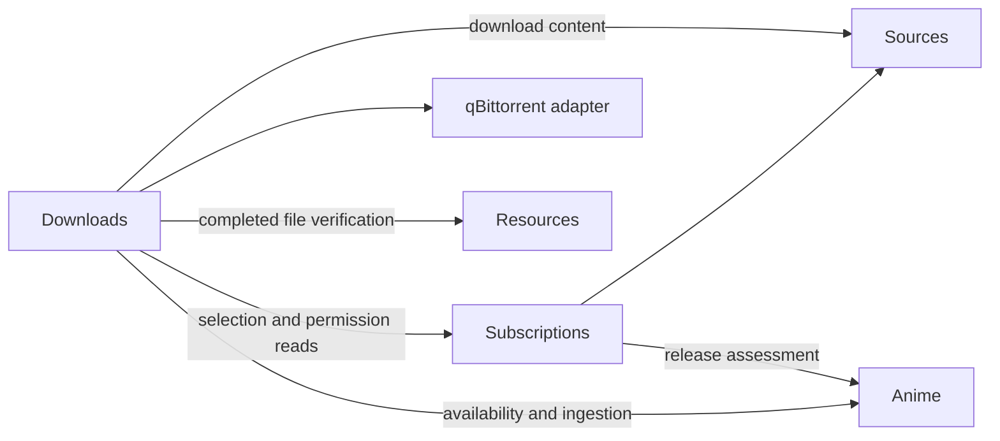

# Anishelf Architecture

This document describes the implemented system structure, module ownership and
architectural constraints. [Requirements](../requirements.md) owns the current feature
inventory and future work. The AniList accounts iteration (T01–T05, W03–W05;
ANI01–ANI10) was accepted by the user on **2026-10-17**; its completed requirements,
acceptance record and design are retained in [History](../history.md#anilist-accounts-archive-notes).
The anime-library iteration was accepted on 2026-10-14 and is also archived there.
Automatic acquisition and subscription interaction were marked complete by the user
on 2026-10-24; their [requirements and final design](../history.md#automatic-acquisition-archive-notes)
are archived. No next iteration or new release number has been selected.

[Design system](design-system.md) owns shared UI conventions; [Development](README.md)
and [Deployment](../guide/deployment.md) cover setup and operations. Source contracts and database
schemas remain authoritative for exact fields, routes and policy values. Historical
verification limits remain attached to the archived evidence; they are not current
iteration acceptance blockers.

## System structure

Anishelf is a React Web application backed by one Node.js process. HTTP separates
the browser from the backend; business modules collaborate through in-process
Public APIs. The backend uses SQLite for durable application state, the filesystem
for original media and generated assets, and FFprobe/FFmpeg for media inspection
and processing. Original resources remain read-only.

The diagram shows the five media/tracking modules and their internal
owners. A module owns its public contract, private assembly and lifecycle. Solid arrows show layer calls or mechanism use; dashed arrows
show application assembly. The collaboration table below identifies the main
module interfaces rather than every import.

Bootstrap constructs modules, injects dependencies and owns startup/shutdown.
Background-work owners stop before shared media services and persistence close.
The HTTP layer validates requests and projects public responses; business workflows
remain in Applications. System owns single-user credentials and authentication.
A host reverse proxy owns TLS; transport enforces session/CSRF checks for business
APIs and scoped tokens for original-media delivery. Container deployments use
separate web and backend images: Caddy serves the SPA and forwards `/api` on the
same browser origin to the private Node backend. Only the web container publishes
a host loopback port; only the backend mounts persistent data and original media.
Source installations can still explicitly enable Node frontend hosting.

## Internal ownership

| Module | Owns |
| --- | --- |
| Authentication | Independent credential file, persistent login sessions, password recovery and scoped original-media links |
| Configuration | Validated policy, persistent user settings, coordinated settings commands and transcode profiles |
| Library | Published resource index, scans and resource-root switching |
| Resource Access | Confined file access, shared source identities and source validity |
| Media Inspection | Source-bound media metadata and shared inspection caching |
| Media Planning | Compatibility interpretation, output specifications and read-only execution decisions |
| Media Processing | Execution preflight, media-tool work and validated temporary outputs |
| Playback Selection | Browser-evidence validation and selection of original or prepared resources |
| Progress | Source-bound playback sessions, resume/history, normal-play completion detection and a durable observation outbox |
| Preparation | Persistent tasks, scheduling, reusable artifacts and prepared-media delivery |
| Subtitles | Track discovery, selected-track preparation, delivery and asset lifecycle |
| Metadata | Shared current work information, provider queries, immutable evidence snapshots, refresh and artwork |
| Identification | Stateless local extraction, candidate ranking and episode association proposals |
| Tracking | Account/credential lifecycle, list cache, unified viewing commands, manual intent versions, command deduplication, durable decisions/submission, retry and conflict recovery |
| Anime Library | Read-only join of Catalog and Tracking, local/all scope, status filters and pagination |
| AniList protocol | Typed Viewer, list, update and metadata clients, GraphQL schemas, provider response validation; shared bounded pacing, retry, priority fairness and cancellation |
| Anime Catalog | Durable local identities/episodes, review decisions, confirmed associations and corrections; descriptions are read from Metadata |

These are the existing runtime owners. [Identification](#internal-ownership) exposes
a stateless recognition Public API and a consumer-owned Metadata port.
[Metadata](#internal-ownership) implements AniList access behind its own Public API, and
Anime assembly adapts cached summaries into recognition candidates.
An Anime workflow uses Resources publication/read and source-access APIs to
automatically supply validated sources. Identification has no HTTP, database or
Catalog dependency. AniList supplies metadata-assisted matching through the persistent Metadata cache. [Anime Catalog](#internal-ownership) consumes complete publications,
preserves manual decisions and owns confirmation/query HTTP APIs. The Web poster, detail, playback and Review workflows are implemented.

## Source organization and dependency boundaries

The backend source has six responsibility roots:

| Root | Responsibility |
| --- | --- |
| `app` | Connect complete modules, assemble global policy, own protocol setup and staged shutdown |
| `modules` | Six independently encapsulated business modules |
| `contracts` | Browser-safe protocol shapes, schemas and shared protocol constants |
| `platform` | Database connection capabilities, media tools, filesystem/process mechanisms and logging |
| `shared` | Small internal concepts: identities, errors, readonly utilities, sorting and fingerprints |
| `transport` | HTTP mechanisms, security, errors, streaming and genuinely shared projections |

### Large modules

| Module | Internal owners | External responsibility |
| --- | --- | --- |
| System | Configuration, Authentication | Deployment/settings/profile capabilities, immutable effective settings, credentials and login |
| Resources | Library, Resource Access | Directory/file reads, scans, root switching, settings-change exclusion, publications, confined source access and registration |
| Media | Inspection, Planning, Processing, Preparation, Subtitles | Compatibility, published-copy views, media information, preparation and subtitle HTTP services |
| Playback | Progress, Playback Selection | Resource selection, source sessions/resume/history and durable automatic observations |
| Anime | Identification, Metadata, Anime Catalog, Tracking, Anime Library, AniList protocol | Recognition, provider cache, review/associations, account/list lifecycle, unified viewing updates, combined Library reads and shared provider access |
| Acquisition | Sources, Subscriptions, Downloads, qBittorrent adapter | Private credentials, RSS subscriptions, automatic selection, persisted destination/intent/reservations, reconciliation and verified ingestion orchestration |

`modules/acquisition` contains the [qBittorrent adapter and manual account settings](#acquisition-business-ownership)
with an Acquisition-owned contract, private credential file, HTTP routes and
bootstrap/shutdown integration. Its [subscription acquisition](#background-collection-and-publication)
uses Sources-owned evidence and Subscriptions-owned subscription/candidate records
with bounded background workers. Anime supplies a provider-neutral
release-assessment API and Catalog supplies current episode availability; remote
releases never impersonate local source identities.
The [current acquisition architecture](#acquisition) adds durable download
records, per-anime placement, restart reconciliation and verified import through
Resources and Anime public capabilities. Transfer controls remain in qBittorrent
WebUI; the detail-page Activity is a compact status/recovery view.

Subscriptions owns direct save/enable, accepted scope, candidate selection and source
refresh. Sources owns protocol evidence and download references. Downloads owns
destination configuration, reservations, submission, remote observation, task
recovery and verified ingestion coordination. Source/candidate publication and
subscription/permission saves use shared SQLite transactions. The detail form uses
one save request; no preview session or confirmation token is required. See the
[current acquisition architecture](#acquisition).

The six directories are API boundaries, not categorization folders. External
consumers cannot import any child entry, including a child's `public.ts`.
Internal owners still collaborate through their own Public APIs and ports;
module composition owns the only implementation-access exception.

Within Anime, `anilist/` owns provider protocol code and never imports Metadata,
Tracking or Catalog business types. Its account, list, update and metadata clients share
one `AniListWrapper` created by Anime assembly, using native SDK transport and shared SDK rate-limit plugins. Metadata and Tracking
infrastructure adapters convert typed protocol results/errors into their own
contracts. Their Applications depend on consumer-owned ports, not provider
implementations or the AniList transport. Provider descriptors, credential-entry authorization, capabilities and adapters
are injected into Tracking during assembly. AniList is the production provider.
See [Provider-independent anime integration](#source-organization-and-dependency-boundaries) for
identity encoding, mapping outcomes and provider replacement.

`tracking/application/tracking.ts` owns the named `TrackingModule` facade and its
ordered submission/list/account shutdown. `tracking/application/account.ts` coordinates
account commands. `composition/tracking.ts` only constructs collaborators and
injects ports; business code cannot import composition, including for types.
`TrackingApi` is the complete contract and extends the narrower
`TrackingAccountsApi`, `TrackingListsApi` and `TrackingUpdatesApi`. Library requests only the list
capability. Composition code does not define runtime business facades.

| Root entry | Allowed consumer |
| --- | --- |
| `public.ts` | Sibling modules, app and boundary presenters: selected business capabilities/types only |
| `create.ts` | App only: construction, policy inputs and module lifecycle capabilities |
| `http.ts` | App only: module HTTP registration; internal registrations stay private |
| `persistence.ts` | App and database adapters only: schema, foreign-key contracts and repository-port factories |

Only root entries cross a large-module boundary. Public entries cannot expose
Application/repository constructors or load assembly implementations. Root
contracts select actual capabilities rather than wildcard-exporting child APIs.
Returned business APIs are method capability objects, not Application instances.
Media's compatibility facade publishes an independent immutable view without
canonical roots or private encoder profiles. Its prepared-copy view contains
only the eligibility/identity facts needed by Playback.

App also cannot access child implementations. Each module constructs its own
services, adapters and HTTP handlers. HTTP registration closures retain private
owners; app connects registrations to protocol setup. Domain and port types do
not derive from HTTP schemas. Platform/shared cannot depend on business modules,
and modules cannot import app.

### Module collaboration

| Consumer | Dependency |
| --- | --- |
| System | Platform configuration mechanisms; app supplies only settings-validation policy |
| Resources | System settings and profile selection; confined source capabilities are constructed internally |
| Media | Resources source validity/access, System settings/profiles, injected platform media tools |
| Playback | Resources identities/access; Media compatibility checks and published-copy views; System selected profile; consumer-owned observation port supplied by Anime through app assembly |
| Anime | Resources publications and bounded reads/access; System deployment settings |
| Anime internal recognition | Parser and Metadata candidate port, both adapted inside Anime |

Playback consumes Media's `inspectCompatibility`, `checkCompatibility`,
`listPlaybackCopies` and `getPlaybackCopy`; it does not know about Planning or
Preparation APIs. Anime owns automatic recognition and proposal-to-Catalog
publication; app does not coordinate its child services.

Module owners define policy defaults and validation. App aggregates them into
its global policy and passes the relevant sections through root create entries.
System no longer imports or publishes other modules' policies. Shared sorting
is an independent concept, not a dependency on Library's policy implementation.

Each durable child owns tables beside its repository. Root persistence entries
provide schema and structural storage ports; they do not publish repository
classes. `app/schema.ts` aggregates root schema entries for Drizzle initialization
and migration tooling. Database connections remain in app/platform. Schema changes use explicit Drizzle migrations; supported upgrades preserve
source identities, playback history and accepted submission intent.
[Relational persistence](database-design.md) documents the complete table audit,
queried records, JSON snapshot documents, constraints and supported schema migrations.

### Inspection and compatibility caches

Media persists FFprobe information in SQLite, with one row per scope/file and a
source-version plus inspection/FFprobe-version match. Concurrent consumers still
share an active probe. Published, healthy library snapshots prune deleted/replaced
files and removed scopes. Startup before the first publication, unavailable roots,
partial scans and degraded monitoring cannot establish deletion and defer cleanup.
Unchanged files survive restart without another probe; access/version checks remain.

The Web interface keeps proactive checks for files in the directory being viewed.
It persists definitive original-file compatibility results in IndexedDB, bounded
by `lru-cache` to 1,000 files and 8 MiB of serialized entry data per origin. A file's
new version replaces its previous result. Browser/user-agent or compatibility-rule
version changes discard the persisted generation. There is no time-based expiry.
Browser capability evidence retains only its small session memo; it is not a second
persistent cache. Playback requests still bind evidence to current server descriptions.
Refresh, recheck and playback failure clear the relevant predictions; manual recheck
also clears browser evidence. Decoder/hardware settings not represented in the
user-agent are refreshed through these existing actions. Storage failures fall back
to session behavior. The file limit bounds entries for files not visited after deletion.

Persistence is required in Anime, Media, Playback and Acquisition construction. Initialization and tool failures
retain explicit runtime error handling; they do not require supporting arbitrary
module assemblies without their repositories.

### Application responsibilities

System owns settings HTTP commands and persistence. App supplies a consumer-owned
resource-settings coordination port implemented by Resources. Resources decides
which settings patches require its scan gate and strips unchanged resource fields
from independent media patches. Resource-root saves reserve Resources' scan and incremental-update gate;
cache budgets and transcode options can change independently when their request
retains the current root. System queues partial updates against the latest saved
settings, so an unrelated update cannot overwrite concurrent profile selection or
restore a resource root that changed after the request began. HTTP presenters own
settings/profile DTO projection; Playback reads effective profile selection directly.

Resources composes one `ResourceRoots` owner for private directory descriptors and
live availability. `LibrarySynchronizer` owns the sole mutation gate, task state,
publication validation/notifications and shutdown. `ScanRunner` builds baseline and
root-recovery candidates; `ChangeProcessor` builds path-scoped patches.
`RootMonitorManager` owns per-scope lifecycles, application `ChangeQueue` owns
coalescing/retry, and infrastructure `FilesystemWatcher` only adapts native events.
`LibraryIndex` retains atomic publication and queries. Source access reuses the same
root owner while retaining access revisions, confinement and version validation.
Status queries inspect roots once, and root descriptors carry their path explicitly
rather than relying on configuration-array positions. See
[Filesystem monitoring](#resource-directory-isolation) for lifecycle details.

### Resource directory isolation

Resources owns directory selection, canonical-path resolution, confinement, scans,
index replacement and access invalidation. Its public source identities contain
an opaque `scopeId`, a file ID, a relative resource name and a source version.
`getScope()` returns active scope IDs and an access revision; consumers query
membership as a collection rather than resolving one active filesystem root.
Catalog publications include the complete scope collection, including an empty
publication. Catalog, Review, preparation summaries and playback history filter
by those IDs. They neither calculate root IDs nor read the directory table.

Resources issues process-local `accessRevision` values and validates them through
`assertAccessRevision` and `revalidateSource`. Durable identities omit that
revision so restart recovery can revalidate the same source. Configuration changes
invalidate active references, remove inactive scopes and remount retained entries
before a new scan. Resources logs
`resources.scope_invalidated` without recording paths. Media owns tool execution;
Resources' `filePath(reference)` validates membership, version, confinement and
access revision before returning a transient tool input. Media never reconstructs
an original-media path from a root. Sidecar discovery retains bounded relative
directory reads through `ResourceFiles`.

Durable source identity is the unique scope/file/version tuple. Database adapters
reconstruct source identities from `media_sources`; `resource_roots` stores only
opaque scope identity and creation time. Paths belong to configuration and confined
Resources access. Database initialization creates the current relational schema;
older database formats are rejected without modifying their records.

Web Resources projects configuration into identity, cache scope, configured and
ready values. App routes compose that projection, and Anime receives readiness
booleans rather than directory paths. System continues to persist the combined
settings document and validate its deployment constraints; the directory editor
retains its existing Settings page. Settings use `resourceRoots: string[]`, with
an empty array representing setup mode. Legacy `resourceRoot` settings load as a
one-element list (or an empty list for null); the next save writes the new format.
Duplicate, overlapping and symlink-aliased roots are rejected, including overlap
with the data directory. Up to 64 roots can be configured.

Resource file IDs include the opaque root scope and relative path, so equal names
in different roots never share source access, subtitles or history. Multiple roots
appear beneath a synthetic Files root; a single root retains the flat entry view.
Mount labels with equal basenames include a stable scope suffix. Reordering the
configured roots does not change file identities.

Each scan builds one candidate per directory, then atomically publishes the merged
index. An unavailable directory retains its previous entries and adds a bounded
warning while healthy directories continue scanning. Unexpected scan failures or
all-unavailable preflight preserve the entire previous publication. Per-root
availability is exposed in Library status; actual media access always revalidates
the selected root. Recognition cannot admit unavailable retained files. Removing
a root hides its local versions without deleting associations, progress or saved
source records; restoring it recovers those records. Empty configurations invalidate
access without starting a scan. Scan/root logs include scope IDs and counts rather
than configured absolute paths.

Media composition constructs Preparation's context, scheduler, worker, recovery and
artifact services, and constructs subtitle/font services. Preparation's command
facade owns admission, retry and shutdown; its query service owns detail/list and
summary projections. Processing coordinates execution and output lifetime while
its domain validators own explicit request and completed-output checks. Subtitle
discovery and external-content reads have dedicated implementations; its facade
coordinates source-bound preparation and delivery. Metadata's cache reader owns
freshness, refresh deduplication, subscriber cancellation and retained snapshots;
the application supplies provider queries and delegates artwork to its own cache.
Platform media tools delegate descriptor parsing and subtitle/attachment extraction
to dedicated adapters while retaining a single mechanism entry.

### Lifecycle

`quiesce()` stops producers without invalidating source access needed by cleanup.
App first quiesces Anime recognition, Media preparation and Resources scans. It
then closes Playback, Anime, Media and Resources, followed by database and logging.
Each owner manages its private teardown order; Media stops preparation before
closing subtitle assets, execution and inspection. Repeated/concurrent Media and
Anime shutdown calls share one completion. App attempts all cleanup even if an
owner fails, then reports an aggregate error.

### Frontend ownership

Web source retains `app`, `features` and `shared`. Five encapsulated feature
modules expose selected data capabilities through root `public.ts` entries and
app-only components through root `ui.ts` entries.

| Module | Internal owners |
| --- | --- |
| Resources | Directory browsing/scans and shared file reads |
| Media | Browser compatibility, preparation and subtitles |
| Playback | Player and history |
| Settings | Resource/profile settings and external-player preferences |
| Anime | Catalog, Metadata and Review |

Public data entries use explicit named exports of actual implementations. Pure
forwarding `services.ts` wrappers are unnecessary. Data entries must not load UI
barrels, including indirectly through child entries. App uses only feature-root
entries; sibling modules cannot import private children or another module's UI.

App owns the global runtime and router context: library/settings queries, scan
notifications and cross-module invalidation, manual refresh and player reset.
The App component assembles the shell, Providers, navigation feedback and Outlet.
Routes register the tree; dedicated page adapters compose capabilities and pass
narrow props. Loaders/actions are grouped by page responsibility and share scope
prewarming. Resources defines the scan/browse presentation contract without
player state. Anime Library receives readiness through props rather than reading
application context. Query scope remains shared infrastructure.

Anime Catalog owns the poster library, details, source associations, version
selection and playback-title projection. Metadata owns candidate lookup, detail
and relations queries. Review owns review reads and association commands; its
controller retains selected-work state, preview operation keys, mutations and
invalidation. Form parsing is separate from presentation. Resource summaries,
candidate selection, mapping forms, previews and rejection/removal sections are
separate components. Catalog detail sections and poster controls/results also
have distinct presentation responsibilities. Recognition-status presentation is
shared by Catalog and Review at the Anime root.

Review may consume Catalog and Metadata public capabilities; Catalog may consume
Metadata but cannot depend on Review. Metadata is independent of both. Anime's
shared presentation and formatting leaves cannot import these owners. No generic
form framework, event bus or additional state-management library is required.

App supplies Resources' file-action slot using Playback and Media UI entries,
and Playback's preparation/subtitle slots using Media UI. Provider placement and
query scope are retained. Profile controls receive preparation actions from app,
avoiding Settings-to-Media dependencies. Other dependencies remain one-way:
Media uses Settings; Resources uses Media; Playback uses Resources, Media and
Settings. Shared HTTP/query mechanisms, UI primitives, navigation and translations
import neither app nor features.

Refactoring preserves URLs, query keys, scopes, polling, cancellation, cache
invalidation, notifications and source-bound playback behavior. Dependency-cruiser
checks module/internal-owner boundaries, public/UI entries, shared leaves,
unresolved imports and runtime cycles. Regression tests cover scan notification
deduplication, refresh/root switching, media lifetime, title updates, Review
confirmation/retry/removal and return/filter/focus behavior.

## Core collaboration

Library publishes scanned resources; Resource Access validates their identity and
confines access to the configured root. Inspection, playback, preparation and
subtitles use that shared source capability. Source changes and root switches
invalidate dependent work and prevent stale resources from being delivered.

Playback Selection combines source inspection, browser evidence and available
prepared artifacts to choose an original resource, a prepared resource or a blocked
result. Selection is read-only. Preparation is an explicit workflow that uses
Media Planning and Media Processing to produce validated, reusable artifacts;
opening a playback session does not start processing.

The browser streams the selected resource directly through media responses with
GET/HEAD/Range support. Playback sessions own progress and history independently
of selection and preparation. Source time remains the shared reference for progress,
chapters and subtitles, including when playback uses a prepared copy. Subtitle
assets are prepared and delivered independently of the video resource.

Persistent task and asset owners reconcile durable state with files at startup and
revalidate source identity before reuse or delivery. Media-tool execution and
resource lifetimes remain bounded, with cancellation and cleanup owned by the
workflow that acquired them.

## Delivered anime-library workflow

Recognition retains provider primary-title/alias provenance and filename/directory
title sources. Unknown source seasons remain unknown. For locally in-scope
numbering, an unmarked source may prefer a base work over a candidate whose
primary titles explicitly indicate a later season. Alias-only ordinal evidence
has a weaker influence, and a complete ordinal-bearing source title overrides
the missing-season prior. This is a reported assumption, not extracted season-one
evidence. Unresolved continuous numbering does not justify this prior.

Work recognition and episode mapping are separate Catalog assessments. Explicit
identity contradictions exclude candidates from automatic identity competition;
unknown ordinals or numbering conversions remain plausible alternatives. Minimum
score and margin apply to the remaining competitors. A recognized work can be
shown and preselected in Review while its episodes remain pending; no association
is created until mapping is resolved or explicitly confirmed. Manual decisions
and source availability continue to take precedence.

Title comparisons use one canonical representation for exact admission and fuzzy
ranking: Unicode normalization, punctuation/spacing folding and dictionary-based
Traditional-to-Simplified Chinese conversion. Provider titles are titles, not
release filenames: only explicit season/part syntax is removed from them, never
an arbitrary trailing number or language word. Shorter names remain search hints
unless a provider alias corroborates them. Candidate ordinals come from explicit
provider title syntax and retain their snapshot source; shared aliases and missing
ordinals do not imply season one. Calendar seasons and relation order do not
establish numbering offsets.

Continuous numbering can use an offset corroborated by at least two explicit
continuous/local filename pairs in the same root, directory, source season and
candidate work. The anchors must cover distinct episode numbers, identify one
candidate without conflicts and agree on the offset. A target's leaf title must
also match the candidate; an unrelated file cannot borrow its directory's work.
If both the source and converted numbers fit the known count, the alternative
requires manual selection. Rules live only for that identification publication, carry
their anchor identities, never cross directories and never replace manual Catalog
decisions. Absent, conflicting or invalid anchors require an explicit Catalog
preview/confirmation. Zero episodes receive a manual special suggestion requiring
an identity and label or another explicitly verified target; they are not
automatically invented positive regular episodes. Unknown TV numbering has
no default target. Review defaults use the selected candidate's valid proposal,
preserve the original source numbers and show the proposal's unresolved reasons.

Resources publishes baseline snapshots and directory-scoped changes to Anime's bounded
recognition coordinator. Incremental publications read affected directory groups and
update only explicitly scoped Catalog sources; full scans remain for startup, manual
reconciliation and monitoring recovery. See [Filesystem monitoring](#resource-directory-isolation). Identification uses `anitomy-ng` and cached AniList
candidates to return evidence and candidate-specific episode proposals. Catalog
automatically admits unambiguous matches and persists review decisions, stable
local work/episode identities and source associations in SQLite. Ambiguous or
incomplete evidence stays in Review.

Recognition parses release names with `anitomy-ng`; the adapter's explicit title
grammar handles provider titles without release-token stripping. Original names
remain available while series ordinals are compared separately from similarity.
All runtime calls to the library pass through Identification's `anitomy-adapter.ts`.
The adapter preserves raw elements and supplements explicit Chinese/Japanese
season markers, menu/NC opening/ending labels and language residue backed by a
parsed dubbed-audio tag. Provider-title grammar shares explicit ordinal rules
without discarding title words or numbers. Exact menu directories mark ancillary resources;
an `extras` directory alone does not. Corrections do not infer work identities,
season-one defaults or episode offsets. Normalization version changes invalidate
recognition reuse on rescan while preserving Catalog decisions.
Space-delimited Han/Latin title pairs supply separate title candidates. A bracket
label supplies a fallback search title only when both a numbered leaf and an
ancestor without a parsed title repeat it; this is not sufficient to admit a work.
Explicit leaf movie types constrain candidate format. Punctuation, spacing,
multiplication-cross glyphs and Chinese script variants normalize consistently
for title comparison. Canonical base-title equality is combined with title provenance. An unmarked
source can prefer a base work when its numbering fits a local episode scope;
this soft prior penalizes explicit primary-title sequels more than alias-only
ordinals and never inserts a source season or an episode offset.

Leaf numbering distinguishes bounded contiguous ranges from multiple numbering
systems. A filename containing a continuous number followed by explicit `SxxEyy`
may select the season-local `yy` when the continuous number is not smaller; both
raw tokens remain recorded and contradictory season evidence still blocks admission.
Descending, oversized, inconsistent and zero numbering remains unresolved. Files
with only continuous numbering still need an explicit correction. Corpus reports
expose selected numbering and separately count admissions whose numbering differs
from the corpus's provider sort values. Independently corroborated local-number
labels enable separate comparisons; unverified cross-provider numbering remains
excluded and explicitly reported.
Complete contextual title matches outrank shared short aliases. Bare Roman
numerals support ordinal matching only when a complete contextual source title
also matches; unmarked titles do not imply season one. Missing candidate season evidence does
not contradict an explicit first-season file, but later-season files require
corroborating candidate evidence or an exact complete contextual title match.
Context matching preserves directory ordinals: a title stripped of `第2期` must
not boost an unmarked first-season candidate. A complete arc title can identify
an AniList work despite a release-specific series ordinal (such as `S06`),
without assigning that ordinal to the provider work. Explicit contradictory
ordinals still block admission even when the contextual title matches. Contradictory ordinals, unknown parts and
ambiguous episode mappings remain reviewable. Search may append a series-season
query within the existing request budget; calendar airing seasons and relations
never establish episode offsets. Matcher version changes invalidate recognition
reuse on rescan while Catalog preserves manual decisions.

Explicit confirmation, reassociation and
single-file numbering corrections preserve manual decisions and source history
across rescan, metadata refresh and restart.

Library sorting is applied before pagination. Its default, `unwatched`, groups
works with a positive available-unwatched count first, then sorts each group by title.
Counts reuse confirmed available episode numbers and the provider's cumulative
progress; unknown/unmapped progress does not imply unwatched episodes. To rank
across pages, this sort hydrates all matching tracked local cards in batches of at most 50
under the index access epoch, then hydrates any remaining selected cards. Other sorts
hydrate only the selected page.
`recent` uses local work creation time, while `updated` uses local Catalog update
time. Remote-only entries use their provider update time or the snapshot fetch time
for both chronological sorts and never gain locally available-unwatched priority.
The projection read log includes the effective sort. Local cards also expose the
first available unwatched playback target (`nextPlayback`) from the same batched
card reads. A target with one available version includes its file and source
version for direct playback; multiple versions expose only the episode identity
so the detail version chooser remains authoritative.

The default Web entry is the confirmed poster library, with cached search/filter
controls, work details, ordered episodes and explicit resource-version selection.
Files retains directory browsing and source playback, adds identification status
and links to Review or associated works. Review owns candidate lookup, mapping
previews, confirmation, correction and rejection. Version selection reuses the
existing source-validity, compatibility, preparation, subtitle and progress paths;
a multi-episode association does not create seek boundaries or watched states.

Metadata owns provider transport, normalized snapshots, refresh/retry and bounded
local artwork storage. Provider outages retain usable cached browsing and existing
playback; unknown numbering remains unresolved. Original names and bytes remain
unchanged. Personal tracker authorization is not required for metadata or local playback.
Tracking owns viewing updates; Acquisition owns RSS subscriptions and download
orchestration, as described in their dedicated sections.

## Authentication boundary

System's Authentication owner maintains an atomically written `auth.json` and a
separate session signing key under the data directory. Passwords use salted
scrypt; plaintext generated passwords go only to the startup console after listen
succeeds. The local CLI can hash or reset credentials without starting the server.
File edits require restart; Web changes apply immediately. SQLite availability is
required at startup, and its System-owned tables persist sessions and hashed
media-link tokens. Session and link records bind to the loaded credential
fingerprint, so manual hash replacement invalidates old authorization after restart.

The private `AuthenticationService` class owns the loaded credential, fingerprint
and password-change exclusion. `AuthenticationRepository` implements the durable
storage port; module assembly exposes registration capabilities and storage ports
rather than exporting these constructors. Named helpers and handlers express
operations; callbacks retain closures where they adapt injected dependencies.
The frontend playback API adapter owns the media-access-link endpoint and its
shared response contract; media-link orchestration consumes that typed method.

App supplies Authentication with a consumer-owned file-version capability adapted
from Resources. Authentication registers Cookie/session plugins and a global API
guard before module HTTP routes. Host/Origin validation remains in transport;
CSRF checks cover unsafe authenticated requests and login. Anonymous access is
limited to session bootstrap, login, minimal health status and frontend files.
Sessions expire after 30 days; login rotates identifiers. Browser guards precede
business loaders; API 401 responses clear client caches and leave the protected
application. Focus/minute checks also detect server-side session revocation.

Login/password verification uses bounded per-source and instance-wide attempts.
Source installations default to a loopback listener. The backend container listens
on `0.0.0.0:3000` on the private Compose network; Caddy in the web container listens
on port 8080, published on host loopback port 3000. Listener addresses
must be IPv4/IPv6 literals. Host/Origin validation retains explicit public-origin
matching, including translated external ports; wildcard listeners do not permit
arbitrary Host values. Forwarded scheme/client address headers default to loopback-only
trust. ANISHELF_TRUSTED_PROXIES accepts explicit IP/CIDR networks and the named
loopback/linklocal/uniquelocal ranges. Packaged deployments explicitly trust private
container proxies and keep Backend unpublished; custom deployments should narrow
trust to the actual Web network CIDR. Host/Origin validation still uses the real Host
and configured public origin, independently of forwarded host headers.
Both Web and Backend receive the same ANISHELF_PUBLIC_ORIGIN. The Web Caddy maps its
configured public scheme into X-Forwarded-Proto, overwriting caller-supplied values.
This preserves external HTTPS through a host TLS proxy and an internal HTTP hop
without trusting arbitrary incoming forwarded-protocol headers. Secure session cookies
require Fastify to recognize the trusted Web hop as HTTPS; mismatches emit an
`auth.session_transport_untrusted` warning. Startup logs include the configured proxy
trust ranges. Container forwarding can still obscure the original client IP.
The startup success log records listener configuration.
HTTPS public origins require Secure cookies. Password changes revoke all sessions
and media links; logout revokes its current session. Media tokens authorize one
original version for 24 hours and reuse existing HEAD/Range delivery. They do not
authorize business APIs or create playback history. Existing streams may finish.

### Local work detail query naming

Local and remote detail pages use the application-owned `AnimeDetailResponse`
(`AnimeDetailSchema`). Local routes read `GET /api/anime/details/local/:id`;
provider-qualified routes read `GET /api/anime/details/works/:key`.
`app/anime-detail.ts` combines Anime's detail query with Acquisition subscription
and download activity reads. No Anime-to-Acquisition dependency is introduced.
The response carries reference, display title, current metadata/freshness, optional
local episodes/versions, account-scoped viewing, first-page subscription evidence
and first-page download activity. Account generation is rechecked after asynchronous
reads. Metadata failure preserves remote viewing and Acquisition information.

The existing Catalog detail capability and scoped command routes remain narrow
business APIs. Both browser detail routes consume the unified application read;
viewing controls and Acquisition panels use the returned state rather than issuing
additional initial entry/subscription/activity reads. Pagination remains owned by
Acquisition. Airing schedules, related works, unresolved resources and media
compatibility remain separate specialized reads. The detail query keys start with
`["anime-detail", scope]`; the shared Anime invalidation capability coordinates
local, information, viewing and acquisition changes. Account changes cancel and
remove cached aggregates before the new account is published.

Metadata owns one `metadata_works` current summary index per qualified work and a
pointer to its complete detail snapshot. Catalog persists local identity/revision/
timestamps and the confirmation snapshot reference, not title/year/format/count.
Tracking persists account entries and viewing state, hydrating summaries in one
join. Complete detail information takes precedence over partial Tracking/search
responses; partial payloads cannot erase full fields. Current detail pointers and
summary indexes publish atomically with snapshots. Catalog summary filtering joins
the shared index before sorting/pagination. JSON title aliases are searched within
the Metadata-owned summary document.

Metadata refresh changes current information, not local mapping revisions or
confirmation evidence. Current snapshots survive ordinary cache pruning; historical
snapshots follow LRU limits unless retained by Catalog decisions. Confirmations pin
their evidence under `catalog-decision:<operation-key>` independently of preview
lifetimes. RSS release titles, accepted subscription versions, download directories
and submission evidence retain their business-specific historical meaning.
See [Persistence](database-design.md) for the supported upgrade.

### Anime detail resource actions

App's `AnimeDetailPage` supplies `AnimeResourceActionSlot` to the Anime detail UI.
Episode/version selection remains Anime-owned; `AnimeFileActions` composes the same
`FileActions` used by Files, using Media's version-scoped compatibility query and
existing Playback/Media UI exports. The per-detail negotiation gate uses Media's
existing concurrency limit, with cancellation and resource/source-version query
identities. No feature imports App or a sibling feature's private implementation.
Preparation task reads remain lazy on menu opening. A single deduplicated summary
request covers the available file IDs from the observed detail cache; published
copies matching the Catalog source version show the prepared indicator before
opening a menu, including while original compatibility is still being checked. Existing media-link/access,
compatibility, preparation and playback endpoints retain their diagnostics and
source checks; this UI adds no independent command implementation or backend API.

## Playback Completion Observation

Playback owns source positions/history and a delivery-only observation outbox. Its
application evaluates the 90-percent/natural-source-end plus 30-second normal-play
policy. Its repository atomically persists positions and eligible observations, without
business threshold calculations or coverage storage. A consumer-owned port connects
observations to Anime through app composition; its worker drains before Anime shutdown.

Anime's `TrackingViewingCommands` resolves/revalidates confirmed targets and admits
player marks/automatic observations through `TrackingUpdates.update()`, also used by
detail absolute edits. Tracking owns durable decisions, retries, conflicts and provider
confirmation. Commands carry explicit origin/ID/intent time. Manual versions and command
receipts are committed with admission and survive mutable-operation pruning. Playback
outbox outcomes only acknowledge operation IDs or an explicit ignored observation.

The app injects Anime's `PlayerViewingControl` into Playback's viewing UI slot. It shares
`useTrackingMutation` and operation queries with the detail editor, so confirmed, failed
and conflict states stay consistent. No Playback decision endpoints or separate tracking
status machine remain. Confirmed cached provider cumulative progress drives all derived
viewing indicators; it remains independent of local resume/history.

## Tracking Persistence and Submission

| Record | Owner and purpose |
| --- | --- |
| Source playback progress | Playback; source version/session/sequence authorize position/history writes |
| Automatic observations | Playback; transactionally recorded with eligible position saves, with delivery-only outcomes and accepted operation identity |
| Account connection and credential reference | Tracking; account generation fences credentials, account reads and delivery |
| Complete remote list snapshot | Tracking; confirmed provider/account-scoped remote state with freshness/invalidation metadata |
| Revisioned viewing operation | Tracking; desired fields, remote baseline, decision requirement, immutable attempted payload and delivery/retry/conflict state |
| Manual intent version and command receipt | Tracking; atomically admitted with intent, retained independently of operation pruning for ordering and replay deduplication |

`TrackingViewingCommands` resolves only confirmed, unambiguous Catalog targets through
a consumer-owned target resolver. Exact provider references resolve directly;
unsupported, ambiguous and unmapped targets remain explicit. External IDs are
opaque canonical keys, qualified by provider; adapters own numeric conversion. Manual
player commands include the observed mapping revision and revalidate it on admission.
Automatic observations additionally capture account/manual version; later manual changes
fence them even across restarts and pruning. Detail absolute edits and player/automatic
commands all enter `TrackingUpdates.update()`. Manual origin is distinct from automatic
origin; worker timestamps never establish user-intent order.

The submission worker reads remote state before dispatch or reconciliation, preserves
unrelated fields, and sends absolute desired values. Already-applied writes reconcile as
success; changes to intended baseline fields require an explicit remote/local conflict
choice. Transient retries are bounded and honor provider timing. Account generation,
cancellation and immutable attempts prevent late responses from clearing newer intent.
A provider request already accepted cannot be recalled, and AniList offers no atomic
conditional mutation: a concurrent edit between read and write remains possible.

Pending intent and confirmed remote values remain separate in the cache and UI.
`decision-required` belongs to Tracking; Keep ends a suggestion while another manual mark
creates new intent. Player, detail and the operation monitor follow the same operation
identity/revision through final confirmation, failure or conflict. Account changes clear
personal browser queries/notices. AniList outages never block local playback, subtitles,
preparation, source resume or history.

The producer stops and waits for in-flight delivery before Tracking shuts down; Tracking stops submissions,
then list work and account access before shared provider scheduling and persistence close.
Tracking persists provider-qualified account/work/entry IDs, normalized viewing
states, current observation contexts and versioned credential files. Old database
and credential encodings have no compatibility readers. Paired backups support
restoring the same application/database format.

## Background scheduling and browser refresh

Tracking updates wake after durable command admission, explicit retry/conflict
resolution, account reconnection or connection verification. Startup recovers saved
operations. A single timeout targets the earliest failed operation's retry deadline;
empty or disconnected queues have no recurring timer. Unexpected worker/storage
failures schedule a 30-second recovery attempt. Delivery still reconciles uncertain
remote writes before submitting and retains the shared AniList request budget.

Playback completion observations wake their handoff worker after their first durable
save in a playback session. Startup restores pending observations. The worker drains
bounded batches, retains wakeups received during delivery, and retries unavailable
handoffs with exponential delays from 2 seconds to a maximum of 60 seconds. Empty
queues have no timer; durable observations remain the source of recovery.

Catalog retains an initial check after 5 seconds and checks associated works every
15 minutes after the previous pass finishes. Only stale unfinished metadata is
refreshed automatically, with the existing bounded batches and concurrency. Opening
a local work detail still requests immediate stale-metadata revalidation.

Visible browser sessions revalidate on focus/visibility return, coalescing checks
within 30 seconds, with a 5-minute fallback. Hidden tabs do not run this fallback.
Every business request continues to enforce server-side authentication and handle
401 responses immediately. Idle Library and player tracking-entry queries check every 5 minutes; unified
work details check every 30 seconds to observe subscriptions, every 5 seconds with
active downloads, and every 2 seconds during metadata/list refresh; identification and operation monitors use a 60-second idle
fallback to discover scheduled scans or changes from another tab. These queries
also refresh stale data on focus. While the player is mounted, operation discovery
retains a 10-second fallback so automatic viewing commands remain observable.
Active operations, scans, preparations and subtitle tasks retain their existing
fast polling intervals and stop or slow down when their work completes.

FFmpeg discovery enumerates only the seven inventories consumed by processing:
encoders, decoders, muxers, demuxers, filters, protocols and pixel formats. Execution
preflight and output validation remain. The unused HLS execution branch is removed;
future delivery work must supply its actual runtime requirements when implemented.

Global Tracking notifications show failures, authorization, conflicts and required
decisions. Routine pending/submitting/success states stay in the existing detail
controls; successful updates still invalidate confirmed Library/entry queries.

## Acquisition

This section is the maintained runtime reference for the completed automatic-acquisition
iteration. Historical verification is retained in [the archive](../history.md#automatic-acquisition-archive-notes).

### Acquisition business ownership

Acquisition has four business units and a qBittorrent adapter:

| Unit | Responsibilities and owned state |
| --- | --- |
| Watching | Explicit activation grants, confirmed Watching list reconciliation, ordinary subscription creation and recreation exclusions |
| Sources | RSS/Jackett bindings, credentials, transport, evidence, retry metadata and opaque download references |
| Subscriptions | User subscription intent, pending source discovery, source pinning, starting episode, profile, enable/pause/remove, accepted download scope and candidate selection |
| Downloads | Global destination, stable directories, accepted tasks, episode/hash reservations, submission, remote observation, recovery and import outcomes |
| qBittorrent adapter | Private account configuration, connection generations, client lifetime and SDK operations |

The former Discovery code lives in `subscriptions/`. Selection profiles, schemas,
algorithms and waiting/ranking behavior are unchanged. There is no top-level
workflows, Fulfillment or Imports business module. `downloads/application/` owns
the full task lifecycle; `downloads/transfers/` implements transfer execution and
`downloads/application/import.ts` coordinates completed-file ingestion.

Resources owns roots, confinement, source versions, inspection and targeted refresh
through its LibrarySynchronizer gate. Anime owns title/file recognition, current
local episode availability, Catalog association and Review. Acquisition never
writes their tables or duplicates their recognition implementations.

Sources owns its creation and HTTP registration through `createSourcesModule`.
Composition shares the unified SourcesApi without importing protocol implementations. Subscriptions does
not depend on the Downloads application. Read-only configuration stamps, locked
candidate IDs and active downloader hashes are supplied at assembly. The dedicated
locked-candidate query does not load Activity payloads. There are no application
callback cycles, shared context inheritance, internal HTTP calls or event bus.

### Direct subscription save

The detail form displays the validated destination and sends one
`PUT /api/acquisition/subscriptions`. Its body contains workKey, source (automatic, a feed/search definition or null),
startEpisode, optional profileId, expected subscription revision, destinationRevision
and connectionGeneration. A null source keeps the existing binding on edits. The form translates its RSS URL
to the common feed definition.
Save validates identity syntax, scope, profile availability and the current target
stamp; it performs no RSS, Anime metadata or qBittorrent network request.

A synchronous shared-connection transaction persists the subscription source definition
and accepted permission. No Sources record or network request is required. Sources
creates internal cache/backoff state when fetch first receives the definition.
Automatic choices retain a nullable source and defer permission until atomic background
binding; explicit sources accept permission during save. A permission failure rolls the whole
save back. Saving the same source preserves selection history/waiting evidence;
changed profiles remain fenced by the existing fingerprint rules until reevaluation.
Per-work saving needs no preview token or confirmation session. Global Watching
activation separately retains its session-bound preview/confirmation endpoints.

HTTP activation requires a validated destination belonging to the current downloader
account. Internal subscription commands can explicitly save a discovery-only scope;
this revokes previous permission. Existing migrated subscriptions do not acquire
permission merely by being read, refreshed or resumed. The UI enables automatic
acquisition only by saving against the displayed current target. New source/episode
scope or destination/account changes require a matching permission before submission.

Pausing stops new reservations/submissions while transfers and imports continue.
Removal preserves accepted tasks and source/download evidence. Watching creates missing ordinary subscriptions. Later AniList status changes do
not change existing subscriptions.

### Background collection and publication

Subscriptions supplies enabled source IDs to the bounded Sources scheduler. The
initial tick and subsequent 30-second ticks collect due sources, at most two at a
time. Successful evidence follows the configured refresh interval (30 minutes by
default); failures retain evidence and use exponential backoff/upstream hints.
There is no standalone register/enable/remove lifecycle for recurring sources.
Bindings/evidence persist independently of subscription ownership.

SubscriptionWorker obtains a prepared publication through SourcesApi.fetch and evaluates affected subscriptions
asynchronously. Only after evaluation does its synchronous commit operation recheck
source/subscription revisions and reserved-candidate snapshots, publish the source
and its download references, and update candidates. A paused/changed subscription,
new reservation or storage error cannot leave candidates published without their
corresponding source result. Assessment failures retain candidates and are recorded
on the subscription; Sources records source failures and retry state internally.
All source operations share one SourcesApi, including fetch and its atomic commit result.
Runtime start/close is separate and belongs to composition. Subscriptions does not
call source failure handling or private publication primitives.

`selectCandidates` retains the existing explicit-snapshot algorithm and all
[profile semantics](../guide/acquisition-profiles.md). Already reserved choices stay locked;
unreserved choices can improve. Source URLs, credentials and protocol descriptors
remain private; consumers receive evidence and opaque download references.

### Task execution and recovery

Downloads periodically reads eligible selections and accepted permission. It checks
current Anime availability, persists one work/episode reservation and a stable
work directory, resolves source content, validates canonical torrent hash/paths,
and claims the hash. Existing unique indexes preserve deduplication after restart.
Parsed content is reused within that execution rather than fetched/parsed twice.

Immediately before remote add, Downloads rechecks permission, scope, selection,
local availability, other active versions, destination/incomplete configuration and
source validity. A persisted submitting state precedes the external mutation.
Category `anishelf` and tag `anishelf-<intent-id>` prove task ownership; matching
hash alone does not authorize controlling another task. Automatic Torrent Management
is disabled and the explicit stable directory is passed as savePath.

Submission states remain pending, submitting, unknown, bound, blocked, missing and
available. Transfer observation and import states remain distinct. Unknown attempts
are queried before further action and never automatically resent when absent.
Explicit retry uses revision/command IDs and queries remotely before possible add.
An external pause stays paused; external removal is suppressed until explicit retry.
An outage means stale observation, not removal. A changed account cannot inherit
old tasks/permissions. Terminal tasks retain reservation identities after detail
redaction. These behaviors and their SQL state fields are retained.

DownloadContext is the single revision-checked task writer. Transfer stages receive
the narrow transfer context; business stages use its explicit full options type,
without inheriting another application's context. Late asynchronous failures cannot
overwrite a newer user command. Planning failures are exposed as Downloads Activity
planningError/attention and never overwrite a subscription assessment error. Their
in-memory retry/diagnostic state is recomputed after restart.

A completed transfer provides task/files plus a revalidation capability. The
internal import stage requires one selected supported video, complete files and
safe paths. It asks Resources to inspect/refresh the confined path, verifies size
and source version, rechecks downloader evidence, then asks Anime to validate and
associate the actual source. Review/failed/available outcomes stay on the same task.
Import retry does not resubmit or transcode. Busy resource synchronization is retryable.

### Destination, persistence and feedback

One global destination maps a downloader absolute POSIX prefix to a Resources root.
Configured validation and proven file visibility remain separate. A separate enabled
incomplete directory must be outside watched roots. Real shared mounts remain an
operator responsibility. Work directories retain the initial sanitized
`Title [provider-id]` identity; metadata renames never move originals.

Subscriptions owns the existing acquisition_authorizations table and its mappings.
Downloads owns destination, directories and intents. Sources owns source/feed and
locator storage. Migration 0007 adds the subscription source definition and removes
the foreign key that required a Sources record before saving. Existing definitions
are backfilled from source bindings. Repositories share one SQLite connection for subscription saves and
source/candidate publication. See [database design](database-design.md).

The detail Activity view combines subscription candidates and download/import tasks.
It preserves source/assessment errors separately from download planning/task errors,
shows actionable retries and stays compact when collapsed. Transfer controls,
seeding, task removal and data deletion remain in qBittorrent WebUI.

| HTTP capability | Owner |
| --- | --- |
| GET /api/acquisition/profiles | Subscriptions |
| GET/PUT/PATCH/DELETE /api/acquisition/subscriptions | Subscriptions |
| POST /api/acquisition/subscriptions/refresh | Subscriptions |
| GET/PUT /api/acquisition/downloads/settings and POST .../validate | Downloads |
| GET /api/acquisition/downloads?workKey=... and POST .../:id/retry | Downloads |
| /api/acquisition/qbittorrent settings/check/credentials | qBittorrent adapter |
| /api/acquisition/sources configuration/status/test | Sources |
| /api/acquisition/sources/connector settings/providers/probe | Sources setup |

Shutdown stops Watching first, stops/drains Downloads, cancels Subscriptions, aborts/drains Sources
and drains Watching before closing the downloader connection and dependent modules.
Watching stops waiting for shared Tracking refreshes through its shutdown signal;
Anime subsequently cancels/drains Tracking before the shared database closes.
Structured logs correlate work/source/task/revision/command decisions without
credentials, raw private locators or torrent payloads.

### Unified Subscriptions and Watching Creation

Manually requested and Watching-created
subscriptions use the same persisted model, editor and execution path. See
[subscription interaction](design-system.md#automatic-acquisition), [Watching setup](../guide/watching-automation.md)
and [shared Sources lifecycle](#sources-api-and-lifecycle).

Saving an automatic-source subscription persists user intent before searching:
`feed_id` is null, `automatic` stores the accepted source generation, profile
fingerprint, destination/downloader binding and retry deadline. Starting episode is
fixed at creation. No fabricated feed identity or pre-search download permission is
created. Explicit RSS remains available and resolved source choices remain pinned.

A serial Subscriptions worker runs every 30 seconds and resolves at most five
pending subscriptions per pass. Empty/failed discovery retains intent and retries
after five minutes. It uses the existing ordered-site discovery and Anime release
assessment; ambiguous identities, packs and unsupported content do not authorize
downloads. Source/profile/target changes invalidate the pending scope until it is
explicitly saved again. Every asynchronous result rechecks subscription revision,
configuration and shutdown before binding source and download authorization in one
SQLite transaction. Edits, pause and deletion fence late discovery results.

Resolved sources use the existing Sources scheduler and selection/download/import
pipeline. Explicit Check updates can resolve and collect a pending source. Site
failure does not silently replace an established pin. Existing reservation,
unknown-submission recovery, external-removal suppression and verified ingestion
boundaries remain in Downloads.

Watching is default-off and retains its five-minute session-bound activation preview.
Its grant controls creation of missing subscriptions from a fresh complete confirmed
Watching list; pending local Tracking commands cannot authorize creation. Existing
subscriptions are skipped regardless of their origin, so progress/status changes,
account changes and global disable never overwrite user settings or stop their
execution. Future creation still requires current accepted account/source/profile/
destination generations and a valid list. Creation uses confirmed progress plus one
or episode 1 and fixes that lower bound immediately, even while source discovery is
pending. Invalid/excessive progress produces a visible decision instead of clamping.

Manual edits and pause/resume work identically for every subscription. Unsubscribe
removes intent and records creation exclusions for the known account/work records;
this prevents immediate automatic recreation. Exclusions survive restart and can be
cleared explicitly. Submitted transfers and imports continue independently.

Migration `0010_unified_subscriptions` preserves manual permissions and existing
pins/lower bounds/candidates. Previously managed grants were conditional ongoing
permissions, so migrated managed subscriptions are paused and their authorization
is revoked until the operator reviews/saves/resumes them. Old Watching grants are
disabled. No account permission is silently broadened during this conversion.

HTTP uses the existing authenticated/CSRF/revision-checked routes. Subscription
save accepts `{ kind: "automatic" }`, explicit source input, or null to retain an
existing source. `GET /api/acquisition/subscriptions?diagnostics=false` returns a
compact view without release evidence. Unified work detail uses this summary; full
candidate diagnostics are loaded on demand. The source-search endpoint remains an
optional diagnostic operation, not a prerequisite for saving.

The Header row lives inside the work header, preserving playback priority. One
summary and Activity action replace the overlapping information blocks. The short
editor reveals overrides under More options. Activity prioritizes failures/active
work; History and lazy grouped Diagnostics are secondary. See the
[design system](design-system.md#automatic-acquisition).

Fixtures verify persisted no-result intent, scope freezing, cancellation/edit/pause
races, configuration fences, atomic authorization rollback, migration preservation,
Watching creation-only behavior, user management, activity ordering, HTTP/session/
CSRF and frontend defaults/diagnostics. These checks are separate from real-service
acceptance. Source/import fixtures and browser fixture actions do not enable the
user's actual account or prove real media playback.

#### Subscription editor and detail refresh

The editor keeps an opening snapshot until close/save, so background binding revisions
cannot remount it or discard unsaved values. Optimistic revision checks still reject
stale saves instead of silently rebasing permission. Check updates explicitly bypasses
the pending subscription's local retry delay while retaining Sources transport limits.
Migration 0011 stores the latest bounded source-discovery diagnostic snapshot; normal
detail reads omit it and Activity requests it lazily. Backend lifecycle logs retain
attempt/defer/bind outcomes without exposing credentials or private download URLs.

Tracked work details switch with replace navigation to the local detail route as soon
as refreshed aggregate data includes a local work. The local work ID is authoritative;
library filters and other query context survive the transition. Existing local detail
polling updates episodes without remounting the playback or episode-selection owner.

### Sources API and lifecycle

#### Construction and API

`createSourcesModule` is the production construction entry. It owns configuration
files, Jackett connection/client/transport, RSS transport/parser, request gate,
HTTP presentation, error translation and shutdown. It returns one `api` object,
one internal `runtime` object and HTTP registration. Adapter implementations never escape.

Subscriptions and Downloads share the same `SourcesApi`; there are no separate
catalog, collection, content or management facades. Consumers call the operations
needed for their responsibilities through that single interface.

| SourcesApi operation | Purpose |
| --- | --- |
| snapshot(input or sourceId) | Read saved evidence, or describe a definition as pending without network/persistence |
| fetch(input or sourceId) | Prepare evidence and return snapshot/commit for atomic candidate publication |
| readContent(reference, signal) | Read magnet content or torrent bytes |
| isContentCurrent(reference) | Check a download reference before submission |
| test(input or sourceId) | Diagnose a source without publishing results |
| connector.settings/save/clear/providers/probe | Configure and inspect the source connector |

`SourcePublication` is part of `public.ts` alongside `SourcesApi`. Its synchronous
commit preserves the transaction shared by source evidence and subscription candidates.
It does not require a separate collection facade. Runtime start/close remains in
`sources/integration.ts` and is owned by Acquisition composition. Private adapter
plans, validators, raw locators and client classes remain hidden.

#### File organization

The module root contains only `public.ts`, `create.ts`, `persistence.ts` and
`integration.ts`. Public configuration and connector types live in `public.ts`.
`application/` contains collection orchestration, context, scheduling and download
content resolution (`content.ts`). `domain/` contains models, collection limits and
the private prepared-read contract. `infrastructure/` contains persistence contracts,
repositories and the shared request gate. RSS and Jackett adapters remain private
in their respective directories. Moving these files does not change runtime behavior,
HTTP contracts, database tables or existing structured lifecycle logs.

#### Source configuration

SourceInput is either `{kind: "feed", url}` or `{kind: "search", connectionRevision,
providerId, titles}`. These describe collection modes. RSS normalization and Jackett
query planning are private adapter work; consumer code passes setup data through
without branching on a protocol. Fetch accepts a definition directly and internally
identifies or creates the cache/backoff record; no registration call is required.
An existing source ID may also be reused. Snapshot accepts either form; a definition
with no saved evidence returns a pending snapshot without network or database writes.

Subscriptions persists an automatic pending intent or an explicit feed/search source
through one save contract. A successful discovery pins a site before recurring
collection. Saving intent is local; source binding and permission are revision-fenced.
Manual and Watching-created subscriptions share this lifecycle.

Connector configuration exposes service URL, credentials, connection generation and
selected provider IDs only at the setup interface. Transport authentication, request
syntax, capabilities pagination limits and download descriptors remain private. The
current connector is implemented using Jackett. Changing it fences old search source
bindings and download references rather than silently inheriting new credentials.

#### Evidence and publication

snapshot(sourceId) performs no network request. The common collector coalesces
in-flight requests by source ID and permits at most two source collections. It owns
one result-provenance/revision fence. RSS and Jackett adapters return private prepared
writes and connection validity, rather than maintaining separate consumer-facing
publication lifecycles. FeedReader retains RSS parsing/conditional-response/retention
behavior; JackettSource retains query planning and Torznab result handling.

fetch(input or sourceId) resolves the definition internally and returns a SourcePublication
containing a read-only snapshot and a synchronous commit(writeCandidates) operation.
Temporary results and diagnostic tests do not publish evidence or resolve their
unpublished downloads. Commit rechecks source validity, then publishes evidence,
durable download references and candidate writes in the same SQLite transaction.
A stale result or candidate write failure rolls everything back.

Subscriptions evaluates outside the transaction, then uses commit to check its own
subscription/reservation inputs and save its candidates. It neither manages
source publication internals nor calls a source failed/backoff method. Sources
records collection failures itself, only against the captured matching revision,
retaining earlier evidence and retry metadata. Shutdown and generation conflicts
cannot overwrite newer successful evidence. Subscription assessment errors remain
owned by Subscriptions.

The existing protocol storage is normalized by SourceEvidence: RSS validators and
observations remain in their relational tables, while query evidence and unchecked
bindings use the existing typed snapshot. This adapter is private. Migration 0007 stores source definitions on subscriptions and removes the source-row
foreign key. Existing RSS/search bindings backfill those definitions. Evidence and
accepted download references remain unchanged.

#### Ownership, scheduling and shutdown

Acquisition supplies enabled subscription IDs and a subscription refresh operation
to the internal runtime. The scheduler ticks initially and every 30 seconds.
Successful refresh follows the configured interval (30 minutes by default); failure
backoff is capped at one hour and respects upstream retry hints. Live interval changes
reschedule successful evidence while preserving failure deadlines.

A source is collected only while a subscription owns it. There is no independent
recurring register/enable/remove feature. Pause/removal does not erase source evidence
or accepted download references. The legacy enabled column is retained but does not
drive scheduling. A changed connector generation suspends old bindings.

Downloads stops before Sources. Source shutdown aborts/drains collections, transport
and content reads before SQLite closes. Runtime methods do not escape through the
business API.

#### Download content

ReleaseEvidence contains common attributes and an opaque nullable download reference.
readContent returns only magnet content or torrent bytes. Private locator
records survive later result snapshots; arbitrary URL inputs and unpublished references
are rejected. Legacy accepted RSS references remain resolvable. Both protocols use
the same content interface, with source/connection validity checked before and after
reads. Downloads rechecks immediately before submission and owns canonical hash/path
validation and reservation. Submitted tasks reconcile without a live source service.

#### HTTP surface

| Route | Meaning |
| --- | --- |
| GET /api/acquisition/sources/:id | Read saved evidence |
| POST /api/acquisition/sources/test | Test a definition or `{sourceId}` without publication/permission |
| GET/PUT/DELETE /api/acquisition/sources/connector | Read/update/clear connector configuration |
| POST /api/acquisition/sources/connector/providers | List configured service providers |
| POST /api/acquisition/sources/connector/probe | Check provider search support; not proof of a live search |

There are no separate RSS/Jackett business HTTP routes. Settings require authentication
and mutations require CSRF. Responses/logs exclude API keys, raw download addresses,
validators and torrent payloads. Diagnostic test responses expose download availability,
not private content references. Source configuration fields are accepted only at setup.

## Interactive deployment bootstrap

package/install.sh is a deployment client, separate from application bootstrap. It
collects non-secret configuration, pins GitHub templates to one commit, renders a
fresh private bundle and delegates execution to Docker/Podman Compose or rootless Quadlet.
One detected engine is selected automatically; multiple engines require a choice.
Only Podman exposes a deployment-method question. Basic configuration uses documented
defaults, with optional advanced image/network/port/SELinux overrides. Rootless Podman
Compose rendering mirrors Quadlet's keep-id mapping and root LinuxServer initialization;
provider availability is verified before publishing configuration.
It does not own application settings/credentials, enable Watching or modify existing
service configuration. Compose environment answers are literal; no .env file is
sourced as shell code. Generation-only mode does not contact engines or install units.

SELinux relabeling defaults from detected host policy, is shown before confirmation
and can be overridden in advanced options. It uses shared z for dedicated media, retaining
Backend read-only access and qBittorrent write access. Generated host-media mounts
avoid the template's media-root chown. Managed volume setup and credential publication
remain the existing container/bootstrap responsibility. Installer logs correlate
stages and template revisions; runtime/application logs remain with their owners.
