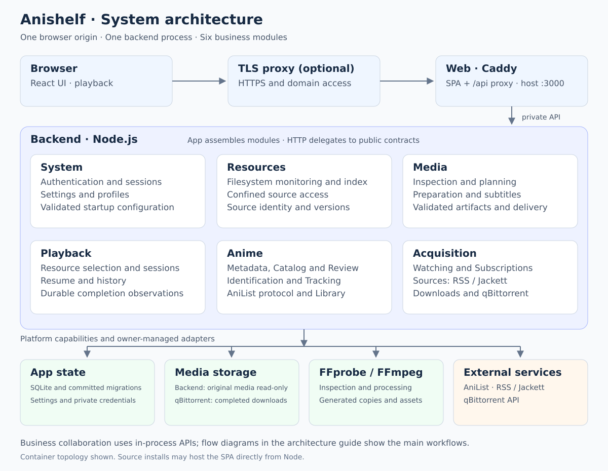
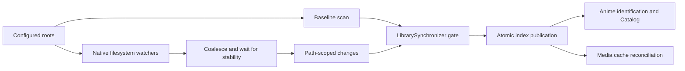
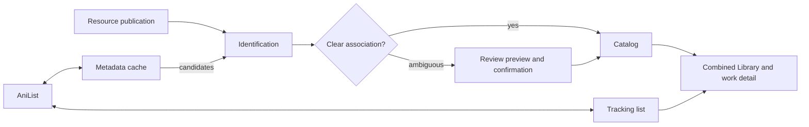
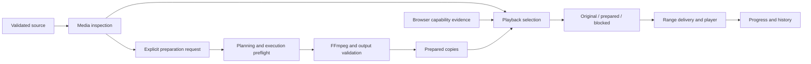
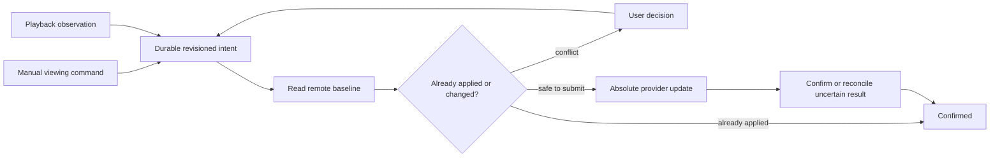
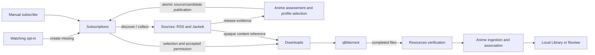

# Anishelf Architecture

Anishelf runs one Node.js backend with six business modules. React uses its HTTP
API; business modules collaborate through in-process public contracts. SQLite
stores durable state, and Resources confines access to original media.

[Development](README.md) · [Database](database-design.md) · [UI design](design-system.md) · [Deployment](../guide/deployment.md)

## System structure

Container deployments use Caddy Web to serve the SPA and proxy `/api` to the private
Backend on one browser origin. A host proxy provides HTTPS. Source installations
can enable Node frontend hosting with `ANISHELF_FRONTEND_DIR`.

## Internal ownership

| Module | Owns | Main collaborators |
| --- | --- | --- |
| System | Authentication, sessions, settings, profiles | Platform configuration and persistence |
| Resources | Roots, filesystem monitoring, atomic index, confined source access | System |
| Media | Inspection, compatibility planning, processing, preparation, subtitles | Resources, System, FFprobe/FFmpeg |
| Playback | Resource selection, sessions, resume/history, completion observations | Resources, Media, System; injected Anime observation port |
| Anime | Metadata, identification, Catalog/Review, Tracking, combined Library, AniList protocol | Resources, System, AniList |
| Acquisition | Watching creation, Sources, Subscriptions, Downloads, qBittorrent adapter | Anime, Resources, Jackett/RSS, qBittorrent |

Module creation and lifecycle stay with each owner. App injects complete modules
and coordinates shutdown; HTTP handlers validate/project requests and delegate to
applications. Original media is read-only to Backend; qBittorrent writes downloads.

## Source organization and dependency boundaries

| Backend root | Responsibility |
| --- | --- |
| `app/` | Composition, global policy, HTTP setup, staged shutdown |
| `modules/` | Six business modules and their private implementations |
| `contracts/` | Browser-safe protocol types, schemas and shared limits |
| `platform/` | SQLite, filesystem/process mechanisms, media tools, logging |
| `transport/` | HTTP security, streaming, errors, shared projections |
| `shared/` | Small internal concepts without business dependencies |

| Module root entry | Allowed consumers |
| --- | --- |
| `public.ts` | Sibling modules and app: selected business capabilities/types |
| `create.ts`, `http.ts` | App: construction and HTTP registration |
| `persistence.ts` | App/database adapters: schemas and storage ports |

Only root entries cross a module boundary, including from app. Public contracts
hide application/repository constructors and protocol adapters. Modules cannot
import app; platform/shared cannot import modules. Runtime cycles are rejected by
`npm run architecture:check` and its dependency fixtures.

### Frontend ownership

| Layer | Responsibility |
| --- | --- |
| `app/` | Router, Providers, page composition, global feedback, cross-module invalidation and UI slots |
| `features/` | Resources, Media, Playback, Settings, Anime and Acquisition |
| `shared/` | HTTP/query mechanisms, UI primitives, navigation, translations |

Encapsulated features expose data through root `public.ts` and app-only UI through
`ui.ts`; Acquisition also groups its API clients and subscription/settings UI.
Sibling consumers cannot import private children or UI entries. App supplies player
and file-action slots. Preserve query scope, cancellation and invalidation across
changes; do not put server paths or configuration into browser contracts.

## Resource directory isolation

| Concern | Rule |
| --- | --- |
| Identity | Opaque scope/file/version identifies a source; filesystem paths stay in Resources |
| Access | Membership, confinement, source version and process-local access revision are revalidated |
| Synchronization | One mutation gate serializes scans, patches and root changes; events arriving during scans are queued |
| Root changes | Invalidate active references, retain unchanged identities, remount and scan |
| Failure | Unavailable roots retain previous records; healthy roots can update; monitoring recovery reconciles drift |
| Removal | Hides resources without deleting accepted Catalog decisions or playback history |

Consumers use bounded directory reads and source capabilities rather than rebuilding
absolute paths. Durable identities omit process-local access revisions so restart
recovery can revalidate them. Network-mount watcher behavior needs deployment checks.

## Delivered anime-library workflow

| Owner | Boundary |
| --- | --- |
| Identification | Stateless parsing/ranking/proposals; no database, HTTP or Catalog dependency |
| Metadata | Shared current work descriptions, provider cache, immutable evidence, artwork and refresh |
| Catalog | Local work/episode identity, confirmed associations, manual decisions and Review |
| Tracking | Account credentials, confirmed list cache, viewing intent, submission/conflicts |
| Anime Library | Read-only join of Catalog and Tracking with filtering/pagination |
| AniList protocol | Typed provider clients, response validation, shared pacing/retry/cancellation |

Provider-qualified IDs remain opaque outside adapters. Metadata and Tracking use
consumer-owned ports; provider protocol code does not import their business types.
Manual decisions survive recognition refreshes. AniList outages leave local playback,
subtitles, preparation, resume and history available.

### Local work detail query naming

App's [detail adapter](../../backend/src/app/anime-detail.ts) composes work information,
local resources, Tracking and subscription summaries. Local IDs become authoritative
when a tracked work acquires a local Catalog entry; replace navigation preserves
query context and mounted playback state. Heavy candidate diagnostics load on demand.

## Core collaboration

| Concern | Rule |
| --- | --- |
| Selection | Read-only; opening playback does not start processing |
| Preparation | Persistent tasks produce validated reusable copies; cache budget and free space bound output |
| Modes | Compatibility encodes video/audio; Fast can retain supported streams allowed by the profile |
| Time | Original source time anchors progress, chapters and subtitles |
| Subtitles | Independent discovery, preparation, fonts and delivery lifecycle |
| Reuse | Validate source version before inspection-cache reuse, artifact delivery and restart recovery |
| Browser cache | Definitive compatibility results persist in bounded IndexedDB; source/browser/rule changes invalidate them |

## Playback Completion Observation

Playback records eligible normal-play completion observations durably alongside
progress. A handoff worker sends them to Tracking; seeking alone does not establish
completion. Playback sessions and monotonically ordered saves fence stale writes.

## Tracking Persistence and Submission

| Stored state | Purpose |
| --- | --- |
| Account generation | Fences credentials, reads and in-flight delivery after account changes |
| Manual intent version and command receipts | Preserve user ordering and deduplication across restart/pruning |
| Baseline, desired fields, immutable attempt | Retry or reconcile without replacing unrelated remote fields |
| Confirmed list and pending intent | Keep remote truth separate from requested changes in the UI |

Targets must resolve to confirmed, unambiguous Catalog mappings. Automatic observations
also capture account/manual versions. A remote write already accepted cannot be
recalled; AniList has no atomic conditional mutation, so concurrent remote edits
between read and write remain possible.

## Acquisition

### Acquisition business ownership

| Owner | Responsibility |
| --- | --- |
| Watching | Opt-in creation of missing ordinary subscriptions from a fresh confirmed list; recreation exclusions |
| Subscriptions | Saved intent, pending discovery, pinned site/feed, starting episode, profile, accepted scope and candidate selection |
| Sources | RSS/Jackett configuration, transport, cached evidence, backoff, opaque download references |
| Downloads | Destination, stable directories, reservations, submission, observation, recovery and verified import |
| qBittorrent adapter | Private account settings, connection generations, SDK/client lifecycle |

### Unified Subscriptions and Watching Creation

| Stage | Behavior |
| --- | --- |
| Save | Persist intent before searching; automatic discovery can remain pending without a fabricated feed |
| Resolve | Use ordered sites and eligible releases; pin the first successful site; explicit RSS is also supported |
| Select | Apply episode bounds, recognition, profile priority/wait windows, local availability and reservations |
| Fence | Recheck subscription revision and account/source/profile/destination scope before binding permission |
| Pause/remove | Fence late discovery; submitted tasks/imports continue independently |
| Watching | Default off; creates missing subscriptions only; existing subscriptions retain their settings |
| Unsubscribe | Records recreation exclusions so Watching cannot immediately recreate the subscription |

Changing account/status/progress or disabling Watching does not stop existing
subscriptions. Starting episode is fixed at creation. Check updates can retry pending
discovery immediately, subject to source limits. [Operator behavior](../guide/watching-automation.md)
and [selection profiles](../guide/acquisition-profiles.md) cover configuration.

### Sources API and lifecycle

| Public operation | Purpose |
| --- | --- |
| `snapshot` | Read saved evidence or describe a pending definition without network writes |
| `fetch` | Prepare evidence and return a snapshot plus synchronous commit capability |
| `readContent` / `isContentCurrent` | Resolve accepted magnet/torrent content and validate its reference |
| `test` | Diagnose a source without publishing candidates or permission |
| `connector` | Configure connection, selected providers and capability probes |

Subscriptions evaluates prepared evidence, then commits source evidence, accepted
download references and candidates in one SQLite transaction. Stale revisions or
candidate-write failures roll back publication. Sources owns collection errors and
backoff; Subscriptions owns assessment errors. Only enabled subscriptions drive
recurring collection. Pausing/removing them retains existing evidence/references.

RSS and Jackett adapters, credentials, raw locators and runtime scheduling remain
private to Sources. Downloads and Subscriptions share one `SourcesApi`. Connector
changes fence old search bindings and unsent references. Existing submitted tasks
can reconcile without a live source service.

### Task execution and recovery

| Stage | Required guarantee |
| --- | --- |
| Reserve | Durable episode/hash identities prevent duplicate work across restart |
| Submit | Persist submitting state before remote add; recheck permission, source, destination and local availability |
| Own | Category `anishelf` plus tag `anishelf-<intent-id>` identify owned tasks; a matching hash alone is insufficient |
| Reconcile | Unknown submissions are queried before action; absence does not cause automatic resend |
| Observe | Outages mean stale status; external pauses/removals require respecting user actions |
| Import | Require safe completed files, targeted Resources refresh, matching size/version and Anime verification |
| Retry | Import retry never resubmits or transcodes; revision/command checks fence late results |

Task submission, transfer and import states remain separate. A global destination
maps a downloader POSIX prefix to a Resources root; incomplete files stay outside
watched roots. Work directories retain stable identities when titles change.
Activity exposes status/recovery; qBittorrent owns transfer controls and deletion.

## Authentication boundary

| Surface | Protection |
| --- | --- |
| Business APIs | Single-user login, persistent sessions; mutations require CSRF and allowed Origin |
| HTTPS proxy | Matching public origin in Web/Backend; forwarded scheme/address trusted only from configured proxies |
| Original-media external links | Expiring, source-bound scoped tokens |
| Credentials | Private files; responses/logs omit passwords, tokens and raw private download locators |

## Background scheduling and browser refresh

| Owner | Trigger / cadence |
| --- | --- |
| Resources | Native events, stability wait, manual scan and recovery reconciliation |
| Sources | 30-second scheduler; default successful refresh every 30 minutes; bounded failure backoff |
| Pending subscriptions / Watching | Separate 30-second workers, at most five resolutions/creations per pass; unresolved discovery retries after five minutes |
| Tracking / playback handoff | Durable admission/startup wakeups and bounded failure retries |
| Catalog metadata | Initial delayed check, then 15-minute passes; refresh only stale unfinished work |
| Browser | Focus revalidation; faster polling while detail/tasks are active; slower idle fallback |

Exact limits live in owner policy and query code. Empty Tracking/handoff queues do
not keep a polling timer. Hidden browser tabs suspend session fallback checks.

## Lifecycle

App closes Acquisition and Playback, quiesces Anime/Media/Resources producers, then
closes Anime, Media, Resources and the database. Logging closes after server cleanup.
All cleanup is attempted even when an owner fails.

Within Acquisition: stop Watching creation, drain Downloads, cancel Subscriptions,
abort/drain Sources, drain Watching, then close the downloader connection. Shared
source access, provider scheduling and persistence outlive their consumers.

## Persistence and implementation references

| Topic | Source |
| --- | --- |
| Tables, constraints, migrations | [Database design](database-design.md), `backend/migrations/`, module persistence entries |
| App assembly and shutdown | `backend/src/app/bootstrap/server.ts`, `backend/src/app/lifecycle.ts` |
| Acquisition assembly | `backend/src/modules/acquisition/create.ts` |
| Installer | `package/install.sh`, canonical `package/deploy/` templates |
| Historical design and acceptance | [History](../history.md) |

The installer generates a fresh deployment bundle and delegates to the container
runtime/systemd. Application bootstrap owns settings and credentials. Exact fields,
routes and defaults remain defined by source contracts and policy.

Bundled Jackett starts after a one-shot initializer. Only an empty config volume
receives `/config/.anishelf-bootstrap.json` authorizing first-run Nyaa.si setup.
Backend reads this marker beside the native `Jackett/ServerConfig.json`; observing
a missing native file does not grant initialization permission. Backend can start
before or after Jackett without changing the decision. Existing volumes without
the marker remain manual, and saved external connections/disconnects are preserved.
The application-data journal fences completed setup, so deleting a site does not
cause it to be recreated on restart. Back up the journal and config volume together.

Before each authorized attempt, Backend lists configured sites. An uncertain write
is reconciled by listing again before any retry, including after restart; setup
completes only after the configured site is observed. Connection revisions and
shutdown signals fence management requests. The authenticated, CSRF-protected
bundled connector command accepts `initializeSite: true` as explicit permission to
retry manual setup; selecting the bundled connection alone does not grant it.
An administrator password still requires site setup in Jackett management.
