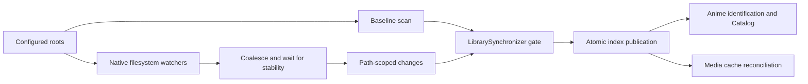
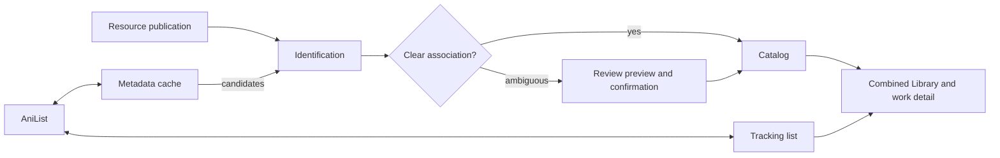
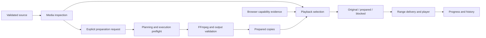
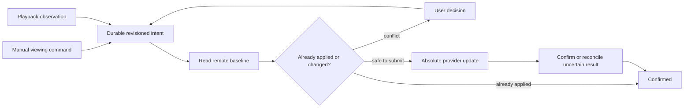
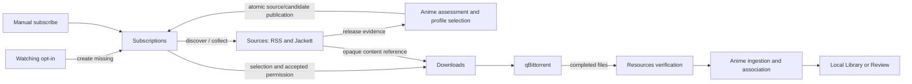

# Anishelf Architecture

Anishelf runs one Node.js backend with six business modules. React uses its HTTP
API; business modules collaborate through in-process public contracts. SQLite
stores durable state, and Resources confines access to original media.

[Development](README.md) · [Database](database-design.md) · [UI design](design-system.md) · [Deployment](../guide/deployment.md)

## System structure


Container deployments use Caddy Web to serve the SPA and proxy `/api` to the private
Backend on one browser origin. A host proxy provides HTTPS. Source installations
can enable Node frontend hosting with `ANISHELF_FRONTEND_DIR`.

## Internal ownership

| Module | Owns | Main collaborators |
| --- | --- | --- |
| System | Authentication, sessions, settings, profiles, build identity and update checks | Platform configuration and persistence |
| Resources | Roots, filesystem monitoring, atomic index, confined source access | System |
| Media | Inspection, compatibility planning, processing, preparation, subtitles | Resources, System, FFprobe/FFmpeg |
| Playback | Resource selection, sessions, resume/history, completion observations | Resources, Media, System; injected Anime observation port |
| Anime | Metadata, identification, Catalog/Review, Tracking, combined Library, AniList protocol | Resources, System, AniList |
| Acquisition | Watching creation, Sources, Subscriptions, Downloads, qBittorrent adapter | Anime, Resources, Jackett/RSS, qBittorrent |

Module creation and lifecycle stay with each owner. App injects complete modules
and coordinates shutdown; HTTP handlers validate/project requests and delegate to
applications. Original media is read-only to Backend; qBittorrent writes downloads.

## Source organization and dependency boundaries

| Backend root | Responsibility |
| --- | --- |
| `app/` | Composition, HTTP setup, staged shutdown |
| `modules/` | Six business modules and their private implementations |
| `contracts/` | Browser-safe protocol types, schemas and shared limits |
| `platform/` | SQLite, filesystem/process mechanisms, media tools, logging |
| `transport/` | HTTP security, streaming, errors, shared projections |
| `shared/` | Small internal concepts without business dependencies |

| Module root entry | Allowed consumers |
| --- | --- |
| `public.ts` | Sibling modules and app: selected business capabilities/types |
| `create.ts`, `http.ts` | App: construction and HTTP registration |
| `persistence.ts` | App/database adapters: schemas and storage ports |

Only root entries cross a module boundary, including from app. Public contracts
hide application/repository constructors and protocol adapters. Modules cannot
import app; platform/shared cannot import modules. Runtime cycles are rejected by
`npm run architecture:check` and its dependency fixtures.

Submodules with multiple internal collaborators assemble them in their own
`create.ts` (Metadata, Tracking, Identification, Preparation, Subtitles and Library).
These factories receive storage ports, configuration values and collaborator APIs;
they do not receive an entire parent database or configuration service just to
extract a field. A single application that already constructs its collaborators
can be instantiated directly; no forwarding factory is needed.

Parent `create.ts` files select implementations, connect submodules and coordinate
startup, degradation and shutdown. Cross-submodule translations live in
`integration/`; automatic identification publication is an Anime workflow.
Business code cannot import construction entries or integration adapters, including
through type-only dependencies. Public contracts remain separate from factories.
Public capability objects select existing bound methods or bind a method once;
they retain wrappers only for data/error conversion, orchestration or live getters.
Internal lifecycle and mutation capabilities remain private.

### Defaults and behavior policies

Keep fixed implementation choices next to their consumer (for example SQLite
pragmas, HTTP body limits, log redaction and shutdown timing). A value used by one
implementation does not need a separate policy file.

Use a feature-local `defaults.ts` for parameters shared by several files in that
feature, such as download scheduling or metadata cache freshness. These defaults
are imported directly; they are not part of a global configuration object.

Keep `policy.ts` for injectable behavior with related limits or semantic
constraints, such as playback completion, resource monitoring and media workflows.
Module constructors select their own defaults and validate their policies before
starting work. Tests can override the relevant module or section without building
an application-wide policy object. Debug logs record which sections were overridden.
Persistence accepts only the playback policy it uses; media tools own their process
limits. App composes capabilities rather than aggregating all policy values.

Browser/server limits belong in `contracts/` and consumers import them directly.
Avoid aliases or forwarding files that only rename a contract constant. Frontend
presentation timings shared within a feature live in its `defaults.ts`.

### Frontend ownership

| Layer | Responsibility |
| --- | --- |
| `app/` | Router, Providers, page composition, global feedback, cross-module invalidation and UI slots |
| `features/` | Resources, Media, Playback, Settings, Anime and Acquisition |
| `shared/` | HTTP/query mechanisms, UI primitives, navigation, translations |

Encapsulated features expose data through root `public.ts` and app-only UI through
`ui.ts`; Acquisition also groups its API clients and subscription/settings UI.
Sibling consumers cannot import private children or UI entries. App supplies player
and file-action slots. Preserve query scope, cancellation and invalidation across
changes; do not put server paths or configuration into browser contracts.

## Resource directory isolation



| Concern | Rule |
| --- | --- |
| Identity | Opaque scope/file/version identifies a source; filesystem paths stay in Resources |
| Access | Membership, confinement, source version and process-local access revision are revalidated |
| Synchronization | One mutation gate serializes scans, patches and root changes; events arriving during scans are queued |
| Root changes | Invalidate active references, retain unchanged identities, remount and scan |
| Failure | Unavailable roots retain previous records; healthy roots can update; monitoring recovery reconciles drift |
| Removal | Hides resources without deleting accepted Catalog decisions or playback history |

Consumers use bounded directory reads and source capabilities rather than rebuilding
absolute paths. Durable identities omit process-local access revisions so restart
recovery can revalidate them. Network-mount watcher behavior needs deployment checks.

## Delivered anime-library workflow



| Owner | Boundary |
| --- | --- |
| Identification | Stateless parsing/ranking/proposals; no database, HTTP or Catalog dependency |
| Metadata | Shared current work descriptions, provider cache, immutable evidence, artwork and refresh |
| Catalog | Local work/episode identity, confirmed associations, manual decisions and Review |
| Tracking | Account credentials, confirmed list cache, viewing intent, submission/conflicts |
| Anime Library | Read-only join of Catalog and Tracking with filtering/pagination |
| Provider protocols | AniList and Bangumi typed clients, response validation, shared pacing and cancellation |

Metadata's ordinary content API uses permanent project work IDs (`reference: { id }`).
Search, detail, relations, schedules, retained snapshots and artwork use this identity.
Search accepts a query and pagination, never a provider selector. Metadata searches
its configured sources, interleaves results in stable source order and deduplicates
only verified associations. Equal titles alone never establish identity. Source
prefix pages are cached independently; the public search window is bounded to 500
results, with at most 50 items per page. One source failing leaves available results
with a generic partial-failure status; all sources failing returns a Metadata error.

A project identity may have several source associations. Explicit association keeps
the target ID canonical and every previously issued ID as a permanent alias. It
requires confirmation that the entries describe the same work with equivalent
regular-episode numbering, and rejects conflicting entries from the same source.
No automatic title matching or episode-offset inference is performed. Detail reads
combine only associated sources in stable order: the first available source owns
conflicting scalar values and ratings, later sources fill missing fields, and titles
are deduplicated. Cache state, freshness and safe failures remain visible without
exposing source identities. Unsupported schedules/relations return an empty page
with `unavailable: true`, rather than requiring consumers to inspect a provider.

Project documents retain their exact projected content and artwork evidence inside
immutable snapshots, independently of source cache eviction or later associations.
Snapshot pins and pruning use the existing Metadata lifecycle. Descriptive results
omit source page/update fields and studio/schedule IDs; artwork uses project URLs.

Identification and Catalog use project references, including persisted proposals
and confirmed metadata links. They read the ordinary Metadata port. External
Tracking and Acquisition identities are translated through the separate
`MetadataAssociations` integration capability, not the content API. Combined
Library/detail views may expose explicit Tracking associations for viewing commands;
this does not make source selection part of metadata retrieval. Provider protocols
do not import Metadata or Tracking business contracts.

### Metadata implementation responsibilities

`metadata/create.ts` assembles Metadata's collaborators and binds their methods once into
`MetadataApi`. Anime and HTTP consumers use these bound functions directly; there
is no forwarding facade or repeated content-method wrapper. The external identity
bridge is injected into Tracking and other integrations separately from ordinary
content reads. The public content contract, project UUIDs and persisted snapshot
format do not depend on this internal split.

| Implementation | Responsibility |
| --- | --- |
| `application/identities.ts` | Register project IDs, resolve aliases/external inputs, translate external identities and validate explicit associations |
| `application/search.ts` | Federate source searches, preserve pagination/order, deduplicate verified identities and report partial results |
| `application/work-reader.ts` | Read current/detail content and select supported relation/schedule capabilities |
| `domain/projection.ts`, `domain/composition.ts` | Pure content projection and field merge policy; no database, requests or UUID generation |
| `application/snapshots.ts` | Persist/read immutable project documents, adapt retained legacy evidence and expose artwork evidence |
| `application/artwork.ts` | Select current or historical artwork and delegate binary caching/downloads to the existing artwork adapter |
| `application/results.ts`, `application/operations.ts` | Project safe result envelopes and normalize storage/read/partial-failure outcomes |

Application collaborators receive only the source/store methods they need. The
source-facing application, cache reader, provider adapters and binary artwork cache
retain their existing responsibilities. Snapshot serialization and database-index
maintenance continue to use the same persistent format; no migration is needed.
Snapshot retain/release and binary artwork reads bind directly to the existing source
cache lifecycle instead of passing through content services.

Manual decisions survive recognition refreshes. AniList outages leave local playback,
subtitles, preparation, resume and history available.

### Local work detail query naming

App's [detail adapter](../../backend/src/app/anime-detail.ts) exposes descriptive work
details separately from `/api/anime/status/:key`, which combines cached Tracking,
subscription summaries and download counts. Status reads do not load metadata or
download task pages. Activity and candidate diagnostics load when opened. Local IDs become authoritative
when a tracked work acquires a local Catalog entry; replace navigation preserves
query context and mounted playback state. Heavy candidate diagnostics load on demand. Local-ID and provider-key detail reads
seed each other's cache using the original request timestamp; loaders and components
share freshness policies. Download activity only drives lightweight status polling.
Subscription commands invalidate the affected work rather than every detail.
Account changes cancel and remove both detail and status queries; ordinary page
refresh preserves playback sessions and versioned compatibility caches.

## Core collaboration



| Concern | Rule |
| --- | --- |
| Selection | Read-only; opening playback does not start processing |
| Preparation | Persistent tasks produce validated reusable copies; cache budget and free space bound output |
| Modes | Compatibility encodes video/audio; Fast can retain supported streams allowed by the profile |
| Time | Original source time anchors progress, chapters and subtitles |
| Subtitles | Independent discovery, preparation, fonts and delivery lifecycle |
| Reuse | Validate source version before inspection-cache reuse, artifact delivery and restart recovery |
| Browser cache | Definitive compatibility results persist in bounded IndexedDB; source/browser/rule changes invalidate them |

## Playback Completion Observation

Playback records eligible normal-play completion observations durably alongside
progress. A handoff worker sends them to Tracking; seeking alone does not establish
completion. Playback sessions and monotonically ordered saves fence stale writes.

## Tracking Persistence and Submission



| Stored state | Purpose |
| --- | --- |
| Account generation | Fences credentials, reads and in-flight delivery after account changes |
| Manual intent version and command receipts | Preserve user ordering and deduplication across restart/pruning |
| Baseline, desired fields, immutable attempt | Retry or reconcile without replacing unrelated remote fields |
| Confirmed list and pending intent | Keep remote truth separate from requested changes in the UI |

Targets must resolve to confirmed, unambiguous Catalog mappings. Automatic observations
also capture account/manual versions. A remote write already accepted cannot be
recalled; AniList has no atomic conditional mutation, so concurrent remote edits
between read and write remain possible.

## Acquisition

### Acquisition business ownership

| Owner | Responsibility |
| --- | --- |
| Watching | Opt-in automatic subscription group, current Watching membership, account-bound permissions and exclusions |
| Subscriptions | Saved intent, pending discovery, pinned site/feed, starting episode, profile, accepted scope and candidate selection |
| Sources | RSS/Jackett configuration, transport, cached evidence, backoff, opaque download references |
| Downloads | Destination, stable directories, reservations, submission, observation, recovery and verified import |
| qBittorrent adapter | Private account settings, connection generations, SDK/client lifecycle |



### Subscription Ownership and Completion

| Stage | Behavior |
| --- | --- |
| Save | Persist intent before searching; automatic discovery can remain pending without a fabricated feed |
| Resolve | Use ordered sites and eligible releases; pin the first successful site; explicit RSS is also supported |
| Select | Apply episode bounds, recognition, profile priority/wait windows, local availability and reservations |
| Fence | Recheck subscription revision and account/source/profile/destination scope before binding permission |
| Pause/remove | Fence late discovery; submitted tasks/imports continue independently |
| Watching | Default off; manages automatic subscriptions together, skips manual subscriptions and pauses works outside the current Watching list |
| Unsubscribe | Records recreation exclusions so Watching cannot immediately recreate the subscription |

Disabling Watching or leaving its current list stops automatic acquisition while
manual subscriptions remain independent. Account/scope changes require renewed confirmation. Starting episode is fixed at creation. Check updates can retry pending
discovery immediately, subject to source limits. Watching activation uses the saved
subscription-default release profile. A default change fences pending activation
and automatic acquisition until a new preview is confirmed. Saved profiles and starting
episodes remain stable; the work editor explicitly converts automatic ownership to manual.
Both ownership types become completed after full verified local coverage of their known
episode range. Completed records retain history and stop source polling; metadata checks
can reopen expanded ranges, while explicit resume overrides completion of the same range. [Operator behavior](../guide/watching-automation.md)
and [selection profiles](../guide/acquisition-profiles.md) cover configuration.

### Sources API and lifecycle

| Public operation | Purpose |
| --- | --- |
| `snapshot` | Read saved evidence or describe a pending definition without network writes |
| `fetch` | Reuse fresh evidence or collect it, then return a snapshot plus synchronous commit capability |
| `readContent` / `isContentCurrent` | Resolve accepted magnet/torrent content and validate its reference |
| `test` | Diagnose a source without publishing candidates or permission |
| `connector` | Configure connection, selected providers and capability probes |

Subscriptions evaluates prepared evidence, then commits source evidence, accepted
download references and candidates in one SQLite transaction. Stale revisions or
candidate-write failures roll back publication. Sources owns collection errors and
backoff; Subscriptions owns assessment errors. Only enabled subscriptions drive
recurring collection. Pausing/removing them retains existing evidence/references.

RSS and Jackett adapters, credentials, raw locators and runtime scheduling remain
private to Sources. Downloads and Subscriptions share one `SourcesApi`. Connector
changes fence old search bindings and unsent references. Existing submitted tasks
can reconcile without a live source service.

### Outbound collection budgets and reuse

Sources uses the platform outbound scheduler (`p-queue`) with two global network
slots, bounded waiting and keyed serialization. RSS uses a five-second minimum
dispatch interval per origin. Jackett uses a ten-second connection and site budget
across search, capability probes, torrent retrieval and bundled management. Redirects
are admitted independently; public torrent redirects retain their Jackett budgets.
A permit covers the response body, not merely its headers. Queued requests recheck
cancellation and remote cooldown before dispatch. AniList retains its separate SDK
limiter and service-specific response-header policy.

HTTP 429, retryable 503 and Torznab XML throttle responses apply `Retry-After`
cooldown to the applicable buckets. `acquisition/source-cooldowns.json` persists
only opaque bucket hashes and deadlines, so reconnecting or restarting does not
reset a known upstream cooldown. Expired records are removed; unreadable state
briefly defers collection. Local queue pressure and consumer assessment failures
do not increase a source's upstream failure counter. Normal source refresh and
explicit checks share freshness/cooldown admission; checks can reevaluate cached
evidence without sending a new upstream request.

Prepared and published evidence is reused for the configured refresh interval
(default 30 minutes); empty results are reusable for at most five minutes. Prepared
reuse is bounded to 64 sources / 10,000 entries and preserves source revision and
connection fences. Diagnostic/discovery results remain uncommitted until an
ordinary candidate transaction publishes them. Every cache hit still runs the
consumer's current local/profile assessment and permission checks.

Jackett raw pages have bounded, connection-scoped caches (10 minutes for matches,
five for empty pages, at most 128 pages / 10 MiB); capability results last 15 minutes.
Identical in-flight requests coalesce, and canceling one reader leaves other
readers running. Discovery evaluates pages progressively and stops only after
business acceptance; partial coverage is explicit. Full recurring collection does
not treat those partial snapshots as complete, but reuses their raw pages. RSS
continues conditional ETag/Last-Modified requests and retains evidence on 304.
Torrent contents share a separate bounded 10-minute cache (64 entries / 32 MiB),
with connection/authorization validation before reuse and independent cancellation.

Structured `network.request_*`, `acquisition.source_cache_hit` and
`acquisition.jackett_query_cache` events distinguish queueing, dispatch, cooldown
and reuse without logging credentials or private locators.

### Task execution and recovery

| Stage | Required guarantee |
| --- | --- |
| Reserve | Durable episode/hash identities prevent duplicate work across restart |
| Submit | Persist submitting state before remote add; recheck permission, source, destination and local availability |
| Own | Category `anishelf` plus tag `anishelf-<intent-id>` identify owned tasks; a matching hash alone is insufficient |
| Reconcile | Unknown submissions are queried before action; absence does not cause automatic resend |
| Observe | Outages mean stale status; external pauses/removals require respecting user actions |
| Import | Require safe completed files, targeted Resources refresh, matching size/version and Anime verification |
| Retry | Import retry never resubmits or transcodes; revision/command checks fence late results |

Task submission, transfer and import states remain separate. A global destination
maps a downloader POSIX prefix to a Resources root; incomplete files stay outside
watched roots. Work directories retain stable identities when titles change.
Activity exposes status/recovery; qBittorrent owns transfer controls and deletion.

## Authentication boundary

| Surface | Protection |
| --- | --- |
| Business APIs | Single-user login, persistent sessions; mutations require CSRF and allowed Origin |
| HTTPS proxy | Matching public origin in Web/Backend; forwarded scheme/address trusted only from configured proxies |
| Original-media external links | Expiring, source-bound scoped tokens |
| Credentials | Private files; responses/logs omit passwords, tokens and raw private download locators |

## Background scheduling and browser refresh

| Owner | Trigger / cadence |
| --- | --- |
| Resources | Native events, stability wait, manual scan and recovery reconciliation |
| Sources | 30-second scheduler; default successful refresh every 30 minutes; bounded failure backoff |
| Pending subscriptions / Watching | Separate 30-second workers, at most five resolutions/creations per pass; unresolved discovery retries after five minutes |
| Tracking / playback handoff | Durable admission/startup wakeups and bounded failure retries |
| Catalog metadata | Initial delayed check, then 15-minute passes; refresh only stale unfinished work |
| Browser | Focus revalidation; faster polling while detail/tasks are active; slower idle fallback |

Exact limits live in owner policy and query code. Empty Tracking/handoff queues do
not keep a polling timer. Hidden browser tabs suspend session fallback checks.

## Lifecycle

App closes Acquisition and Playback, quiesces Anime/Media/Resources producers, then
closes Anime, Media, Resources and the database. Logging closes after server cleanup.
All cleanup is attempted even when an owner fails.

Within Acquisition: stop Watching creation, drain Downloads, cancel Subscriptions,
abort/drain Sources, drain Watching, then close the downloader connection. Shared
source access, provider scheduling and persistence outlive their consumers.

## Persistence and implementation references

| Topic | Source |
| --- | --- |
| Tables, constraints, migrations | [Database design](database-design.md), `backend/migrations/`, module persistence entries |
| App assembly and shutdown | `backend/src/app/bootstrap/server.ts`, `backend/src/app/lifecycle.ts` |
| Acquisition assembly | `backend/src/modules/acquisition/create.ts` |
| Installer | `package/install.sh`, canonical `package/deploy/` templates |
| Historical design and acceptance | [History](../history.md) |

The installer generates a fresh deployment bundle and delegates to the container
runtime/systemd. Application bootstrap owns settings and credentials. Exact fields,
routes and defaults remain defined by source contracts and policy.

Bundled Jackett starts after a one-shot initializer. Only an empty config volume
receives `/config/.anishelf-bootstrap.json` authorizing first-run Nyaa.si setup.
Backend reads this marker beside the native `Jackett/ServerConfig.json`; observing
a missing native file does not grant initialization permission. Backend can start
before or after Jackett without changing the decision. Existing volumes without
the marker remain manual, and saved external connections/disconnects are preserved.
The application-data journal fences completed setup, so deleting a site does not
cause it to be recreated on restart. Back up the journal and config volume together.

Before each authorized attempt, Backend lists configured sites. An uncertain write
is reconciled by listing again before any retry, including after restart; setup
completes only after the configured site is observed. Connection revisions and
shutdown signals fence management requests. The authenticated, CSRF-protected
bundled connector command accepts `initializeSite: true` as explicit permission to
retry manual setup; selecting the bundled connection alone does not grant it.
An administrator password still requires site setup in Jackett management.

### Bangumi protocol and project metadata

Bangumi implements the internal Metadata provider port through a separate protocol
client. `GET /api/metadata/search?query=...` includes configured sources automatically.
`GET /api/metadata/reference?value=https://bgm.tv/subject/400602` (also `bangumi.tv`,
`chii.in`, or `bangumi:anime:400602`) resolves a permanent project ID; details and
artwork use project-ID routes. Unqualified numeric inputs resolve against the
default source at this external-input boundary. AniList remains the only Tracking
provider. Independent source entries remain distinct until explicitly associated.

`POST /api/metadata/associations` is an authenticated management command, subject to
the normal mutation protections. Its body contains `target: { id }`, `other: { id }`
and `sameEpisodeNumbering: true`. The operator must verify both work identity and
numbering first. The response is the canonical target reference; old IDs continue
to resolve. This operation does not merge local Catalog works, episodes or files. App composition
rejects association when both groups already own different local Catalog works; those
local decisions must be reconciled first.
There is no source-management UI or automatic cross-source matching in this change.

The consumed OpenAPI subset is checked in at
`backend/src/modules/anime/bangumi/openapi.yaml`, copied from the
[official v0 schema](https://github.com/bangumi/api/blob/master/open-api/v0.yaml).
Regenerate types with:

```sh
npm run generate:bangumi --workspace @anishelf/backend
```

OpenAPI types describe the wire API; runtime TypeBox schemas validate consumed
fields before they enter Metadata. Responses must contain anime subjects, valid
IDs and matching pagination. Unknown air dates may be omitted or null, including
in search results; the local OpenAPI subset records this observed wire behavior.
The client assembles Metadata pages of up to 50 items from wire pages of at most
20 items, matching the live endpoint cap. Each wire request uses the shared limiter
and cancellation signal. Validation failures log requested/returned pagination,
the operation, reason and up to ten field paths without
search strings or response bodies. The search endpoint is experimental upstream.

One Bangumi client shares a strict PQueue limiter between search and detail:
concurrency one, at most one request start per second, and at most 50 queued
requests. This conservative local policy is not a statement of upstream quota.
Each active request has an eight-second timeout; queued and active work supports
cancellation and shutdown. There is no automatic inline retry. HTTP 429 and 5xx
responses establish a shared cooldown of at least 60 seconds, extended by a valid
`Retry-After` seconds value or HTTP date. Other queued/new requests fail locally
until that time. Client configuration, request outcomes and cooldowns are logged
without search strings or response bodies. A project/version/homepage User-Agent
follows the [upstream policy](https://github.com/bangumi/api/blob/master/docs-raw/user%20agent.md).

The existing source-keyed persistent cache coalesces identical requests and retains
usable stale snapshots after failures. Successful searches stay fresh for 24 hours,
empty searches for 15 minutes, and Bangumi details for 24 hours. Refresh failure
cooldowns are retained on existing snapshots. Artwork uses the existing bounded
cache and only allows `lain.bgm.tv` in addition to AniList's image host.

Bangumi's `eps` supplies the declared episode count; `total_episodes` counts database
chapters and is not used as a regular-episode count. Premiere dates never imply
finished/releasing status. Unsupported schedules, relations and canonical episode
catalogs remain unavailable. Scores are projected to the existing 0–100 scale.
Bangumi Tracking and a canonical cross-source episode catalog remain unavailable.
Source-specific capabilities are handled inside the project Metadata boundary.
