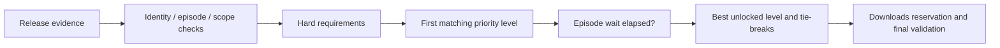

# Acquisition Selection Profiles

Profiles select supported regular-episode releases from RSS or Jackett evidence.
They control release preferences and waiting; identity, episode, destination and
download-authorization checks still apply. Packs and automatic upgrades of reserved
downloads are not supported.

## Built-in profiles

| ID | Preference and wait from first eligible observation |
| --- | --- |
| `builtin:general` (default) | 1080p/2160p after 60 minutes; 720p after 120 |
| `builtin:efficient` | HEVC/AV1 at 1080p/2160p after 120 minutes; any codec at those resolutions after 180; 720p after 240 |
| `builtin:chinese` | Explicit Simplified/Traditional Chinese subtitles required; 1080p/2160p after 60 minutes; 720p after 120 |

Waits run from the same episode clock, not consecutively. Values within a level are
equal preferences: 2160p does not outrank 1080p. Unknown resolution fails these
built-ins; General/Efficient accept unknown subtitle language. Codec labels do not
certify quality, size or device compatibility.

## External configuration and selection

1. Create `<dataDir>/acquisition-profiles.yaml` using the
   [commented example](../examples/acquisition-profiles-example.yaml).
2. Restart Backend to load it.
3. Choose a global default in Settings or override it in a subscription's More options.

| Situation | Behavior |
| --- | --- |
| No custom file | Built-in profiles remain available |
| Invalid/unreadable custom file | Report the configuration issue and use built-ins |
| Saved profile no longer available | Preserve the ID and block new selections until an available profile is chosen |
| Profile/default changed | Re-evaluate unreserved choices; accepted scope/fingerprint checks still apply |
| Download already reserved | Retain its selection |

The app reads an immutable startup snapshot and never rewrites the YAML. Hot reload
is [future work](../requirements.md#acquisition-profile-hot-reload-o20).
YAML aliases, custom tags, duplicate keys, unknown fields and multiple documents
are rejected. Built-ins cannot be overwritten.

## File fields

| Field | Type | Meaning |
| --- | --- | --- |
| `version` | Integer, required | Must be `1` |
| `profiles` | Array, required | At most 100 custom profiles |
| `profiles[].id` | String, required | `custom:` plus a lowercase letter followed by up to 63 lowercase letters, digits or hyphens; unique and cannot replace built-ins |
| `name` | String, required | Nonblank display name, at most 240 characters |
| `description` | String, optional | Nonblank explanation, at most 240 characters |
| `requirements` | Conditions, optional | Hard conditions shared by every level |
| `preferMoreSeeders` | Boolean, optional | Default true; compares counts only within the best unlocked level |
| `levels` | Array, required | 1–32 levels, highest priority first |
| `levels[].name` | String, required | Nonblank display name, at most 240 characters |
| `levels[].match` | Conditions or `anyOf`, required | `{}` accepts any release passing hard requirements |
| `levels[].acceptAfterMinutes` | Integer, required | 0–10080 minutes from the episode's first eligible observation; must not decrease down the levels |

All lists in conditions contain 1–64 unique values. Omit a field to impose no
constraint. Different fields are ANDed. Positive attribute lists match any listed
value; their order does not express preference. `includeKeywords` requires all
listed words; exclusion lists reject any matching word/group.

| Condition field | Values / matching |
| --- | --- |
| `subtitleLanguages` | `zh-Hans`, `zh-Hant`, `en`, `ja`, `ko`; multilingual releases match any included language |
| `subtitleFormats` | `hard`, `soft`, `external` |
| `resolutions` | Integer height labels, 1–8640; e.g. `[1080, 2160]` |
| `videoCodecs` | `avc`, `hevc`, `av1`, `vp9`, `mpeg2`, `mpeg4` |
| `sources` | `web`, `bluray`, `hdtv`, `dvd` |
| `releaseGroups` | Allowed complete normalized names; joint names also expose their `&`/`+` components |
| `excludeReleaseGroups` | Blocked normalized group names |
| `includeKeywords` | All must occur in the release title |
| `excludeKeywords` | Any occurrence excludes the release |
| `minSeeders` | Minimum source-reported count, 0–2147483647 |
| `unknownSeeders` | `allow` or `reject`; requires `minSeeders`, defaults to `reject` |

Group names and keywords use Unicode NFKC normalization and case-insensitive
comparison. Group matching is exact; keywords use literal substring matching,
without regex. Unknown attributes cannot satisfy explicit positive conditions;
unknown groups do not match a blocked group. A later level can omit an attribute to
accept unknown values, but cannot relax a hard requirement.

`match` may instead contain only `anyOf`, an array of 1–32 ordinary condition
objects. Any branch may match; all fields within a branch must match. Do not mix
`anyOf` with ordinary fields or nest expressions. `requirements` accepts ordinary
conditions only. There are no scores, scripts, `earlySelect` conditions or separate
wait overrides.

## Evidence and seed counts

| Evidence | Interpretation |
| --- | --- |
| Group, resolution, codec, source, revision | Parsed from release titles |
| Subtitle language/format | Explicit labels only; no inference from group or site |
| Seed count | Source-reported; malformed/missing counts are unknown |
| Freshness | Counts expire one hour after the last XML item observation; HTTP 304 does not renew them |

Labels describe releases, not verified media tracks. No tracker scrape is issued;
avoid seed thresholds for sites whose adapters report artificial counts.

## Decision and recovery rules

| Rule | Effect |
| --- | --- |
| Clock | Starts at first eligible observation; persists through pause, edits and restart for the same source/episode |
| Wait | Highest-priority unlocked level wins; zero permits immediate selection |
| Re-evaluation | Occurs on source refresh; thresholds are not exact submission deadlines |
| Seed tie-break, when enabled | Larger positive known counts, then unknown, then zero |
| Remaining ties | Newer revision within the same group set, then earlier publication and stable identity |
| Reservation | Locks the choice; later evidence cannot replace an accepted download |

Activity shows profile level, wait threshold or rejection reason. Use Diagnostics
for evidence and [subscription recovery](watching-automation.md#recovery-and-upgrade)
for stalled work.
